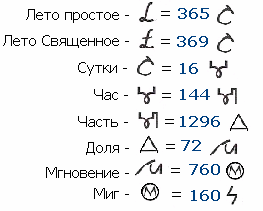

# Славянские меры времени

**Лето простое** = 365 суток  
**Лето Священное** = 369 суток  
**Сутки** = 16 часов  
**Час** = 144 части  
**Часть** = 1296 долей  
**Доля** = 72 мгновения  
**Мгновение** = 760 мигов  
**Миг** = 160 сигов - отсюда и слово «сигануть», т.е. быстро переместиться (1 сек = 229960581120 сигов).

Это основные славянские меры времени, наши Предки знали их с детских лет. Есть и другие меры времени, но в обиходе они нам не нужны.

## Современные единицы измерения времени

**Час** – одинаковое название и в славянской и в современной системе.  
1 славянский час = 1,5 современных часа.

**Минута** – латинского происхождения, означает минимум, т.е. минимальная часть часа. По-славянски так и называется «часть».  
5 современных минут = 8 славянских частей.

**Секунда** – это второе минимальное деление часа, а «второй» по латыни «secundus», отсюда и название «секунда». По-славянски – «доля».

Славянское время  
Названия славянских часов
