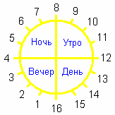

# Славянское время

Славянское время отличается от современного - христианского (ввёл римский папа), где за основу принято время так скажем, жёлтых народов: ислам, Китай, к нам притащили библейцы – у них всех было структурировано деление на 12 (12 часов день, 12 часов ночь), или как во многих западных странах: 12 до и 12 после полудня – т.е. это заданный определённый ритм. И заметьте, сутки начинаются в полночь, потому что у христиан многие службы начинались в полночь, т.е. так им было удобнее отмерять начало нового служения. Наши Предки таким безобразием не занимались, ночью надо спать.

## Сутки = 16 часов

**В сутках 16 часов** - это один Круг, т.е. 16-тиричная система. У нас всё построено на 16: в пуде 16 кг, в Сварожьем Круге 16 Чертогов, 16 Лет составляют Единый Круг, девушка может выйти замуж после 16 лет и т.д.  
**1 час = 144 части**, т.е. идёт отображение Небесной структуры на жизнь земную. В Сварожьем Круге 16 Чертогов, в каждом Чертоге 9 Залов (9\*16 = 144), отсюда и наши 144 части в одном часе, т.е. это прообраз.  
**1 часть = 1296 долей**, это также связано с Небесной структурой, т.е. в каждом Небесном Зале 9 Столов (9\*144 = 1296).

**Славянское время более гармонично с природой**. Мидгард-Земля – это часть системы Ярилы-Солнца. Солнце является частью созвездия Зимун, которое входит в большое созвездие Свати, т.е. в галактику. И они все подчинены одним вселенским законам. Человек – часть этой системы, но почему-то многие считают, что время природы, как бы не совместимо с временем человека. Нас вырывают из общей системы, создают иные условия, иной ритм, время жизни, т.е. быстренько использовать «раба божьего» и всё.

**Деление суток на 16 часов создавало совершенно другую форму построения жизни**, более размеренно. Можно сравнить с газовой плитой, на которую поставили два одинаковых сосуда с водой, но одну конфорку плиты включили на полную (на 24), а вторую на 16. Естественно, вода закипит быстрее, где включено на 24. Если человек перейдёт с 24 часовой формы на 16-тиричную, он будет более гармоничен с природой, организм перестраивается на иную форму упорядочения, жизнь становится более размеренная.

У каждого есть биологические часы, и жизнь во многом зависит от того, какая система прививается человеку, как он настроит внутренние часы – либо христианская система времени, либо наша природная славянская.

## Славянский Круг Времени

Наши Предки делили сутки на 4 равных части, как и положено, а не на 2 как христиане (день и ночь). И построение Круга немного другое. Смена суток происходит вечером – в это время наши Предки прилетели на Мидгард-Землю. И нет такого понятия как «**нулевое время**» (0 часов), т.е. говорили 16 часов 143 части, а уже 144 части – это 1-й час. И кроме того, каждый час имел своё название (см. Названия славянских часов).

Заметьте, когда проходит четвёртая часть на Круге Времени (с 12 до 16) мы говорим: «*вот и день прошёл*». Или другая поговорка: «*Утро вечера мудренее*» - потому что 3/4 суток гораздо больше чем одна четверть.

## Соотношение славянского и современного времени

1,5 современных часа = 1 славянский час  
5 современных минут = 8 славянских частей  
25 секунд = 864 доли  
5 секунд = 9455616 мгновений  
1 секунда = 1437253632 мигов  
1 секунда = 229960581120 сигов

\* Славянские меры времени
