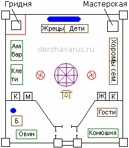

# Скит (схема)

Скиты имели две основные формы постройки: 1) квадратные, прямоугольные, и 2) округлые в виде круга или яйца. Скиты окружали крепостной стеной, изгородью или валом, а также существовали скиты без ограды, их защищали естественные условия, допустим: Скит в горах, Скит средь болот, таёжный Скит. Если скит строили возле реки, то старались на слиянии, чтобы он с двух сторон был защищён естественной преградой. Т.е. скиты были разные, но структура примерно одинаковая.

## Структурная схема Скита

\* На северной стороне скита создавали **водоём**, где хранилась вода на случай осады, иногда водоём даже упрятывали под землю.  
\* Также на северной стороне строили **хоромы** (т.е. если нарисовать круговую систему, то Капище в центре, а от него квадрат и там строили хоромы). В этих хоромах жили жрецы и дети, из которых воспитывались жрецы. Семейные пары жили отдельно и сами воспитывали детей. Холостая молодёжь жила отдельно. И заметьте, в хоромах детей размещали на востоке, т.е. по движению Солнца – всходит на востоке, как бы молодое, новое, а уходя на запад оно стареет, поэтому жрецы жили в западной части хором. Т.е. определённые образы были во всём у славян.  
\* На северо-западной стороне строилась **гридня для охраны**. Из гридни по периметру стены ходили охранники.  
\* На северо-востоке – мастеровые постройки (совр. **мастерские**).  
\* На восточной стороне строились **хоромы для семейных людей** (т.е. тоже образ связан с востоком, в семьях рождаются дети, т.е. новая жизнь).  
\* На западной стороне строились **амбары и клети**. Здесь образ - что Солнце идёт на заход, и за светлое время уже собранный урожай, соленья, варенья и пр.  
\* **Капище** строилось всегда посредине. На запад от капища строили алтарь Рода, на востоке от капища – алтарь Богов и Предков. С южной стороны была большая площадь, там, как правило, на двух столбах под крышей ставили вечевой колокол, и собирали вече.  
\* Отдельно строили **хоромы для холостых мужчин и женщин** (на схеме «М» и «Ж»). А рядом летние кухни (К), т.е. кухня под открытым небом - печки, навесы, столы с лавками для братчины. Рядом с кухнями были водоёмы или колодцы.  
\* На юго-западе был **овин**, и чтобы не просто зерно сушить, тепло растрачивать, здесь же делали баню (Б), и водоём был рядом. Также рядом с баней была кузня, обычно от неё под овин подводили тёплый воздух.  
\* На юго-востоке - **заезжий двор**, там были конюшни, скот. Там же ставили гостевые хоромы с отдельным колодцем. Гостевые дома отгорожены забором от основной части, поскольку гостям нечего там делать, и тем более заходить в дома. Даже в обычном доме у славян гость может быть только там, куда его пригласит хозяин, а не куда он сам хочет. А в скиту свои правила, там гостевой дом - вот территория гостей. Кому надо, они сами придут к гостю, пообщаются. И вообще, в скиту случайных гостей не было, даже на порог не пустят, приезжали только по приглашению, допустим жрец из другого скита.  
\* На задних дворах устраивали выгребные ямы. Ибо хоромы, где жили люди, всегда считались священными, поэтому негоже было гадить в священном месте.  
\* Огороды, поля, загоны были за пределами скита.

## Терема и подземные ходы

Все постройки в скитах были преимущественно теремного типа, т.е. были и горницы и светлицы. Строили из брёвен, без гвоздей. Вокруг скита также строили хоромы (дома), селились люди, которые также могли построить стену, т.е. ещё один ряд, затем следующий ряд населился – ещё одну стену, и получалось, что город как форпостами, слоёный пирог. Когда скит увеличивался, на месте гридни в пограничной зоне ставился **детинец** – это княжьи хоромы, где всё войско находилось. Детинец внутри скита обносился ещё одной стеной, т.е. это был последний рубеж, и в случае нападения все люди переходили в детинец, а если отбить атаку не получалось, там была система подземных ходов, через которую люди уходили из скита.

**Подземные ходы** делались не только из скита, но и абсолютно все строения внутри связывались подземными ходами. Т.е. даже если кто-то с гор наблюдал, он мог видеть, что по территории никто не ходит. А под землёй люди спокойно передвигались. При этом было много ходов-ловушек. Т.е. и сам скит строился по системе кругов, и подземные ходы строились также, помните: круг, квадрат, круг, квадрат…, но была система наложения кругов, т.е. чтобы пройти и не попасть в ловушку надо знать какой круг в основе. Жрецы, зная эту систему, при осаде спокойно выводили детей и взрослых, минуя ловушки. Под взрослыми здесь понимаются старики. Т.е. всегда спасали стариков и детей: дети – это продолжение Рода, старики – мудрость Рода.

**Продолжение:** Рядом со скитами и скуфами располагался погост.
