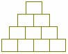

# Тайна египетской пирамиды (календарь)

В египетских пирамидах археологи часто находили маленькие четырёхуровневые пирамидки (4 куба в основании). Они считали, что это модели, прообразы больших пирамид. А на самом деле такая пирамида – это тайна египетского жречества, тайна жреческого календаря.

**Жрецы Египта использовали четырёхрядную пирамиду для символьного обозначения года:**

**1**. Общее количество камней составляющих пирамиду указывало на количество дней месяца (30 дней).  
**2**. Нижний ряд камней визуально наблюдаемых указывал на количество времён года (4).  
**3**. Второй ряд снизу визуально наблюдаемый указывал на количество месяцев в одном времени года (3).  
**4**. Общее количество камней двух верхних рядов указывало на дополнительные священные дни Богов, которые дополнялись к общему году (5).  
**5**. Камни двух нижних рядов визуально наблюдаемые указывали на количество дней в неделе (7).  
**6**. Камни двух верхних рядов визуально наблюдаемые указывали на количество молитв, которое произносит каждый египтянин в день (т.е. 3 раза обращается к Богу: утром, днём и вечером).  
**7**. Третий ряд снизу визуально наблюдаемый указывает, что Египет состоит из двух частей: верхнего и нижнего Египта, которые подчиняются фараону (верхний камень), т.е. наместнику, проекции воплощения верховного Бога Солнца (фаРАон - воплощение Солнца на Земле).  
**8**. Три верхних ряда визуально наблюдаемые указывают на количество рабочих дней в неделе (6).  
**9**. Количество всех камней визуально наблюдаемых указывает, какую часть от дохода каждый египтянин должен отдать в храм.  
\* Фараону тоже отдавали какую-то часть, но в первую очередь в храм. Фараон – это символ, а зачем Богу деньги? Деньги нужны храмам на ремонт, строительство, просвещение.

**Количество дней в году:**  
4\*3 = 12 (т.е. 4 времени года умножить на 3 месяца – два нижних ряда).  
12\*30 = 360 (12 умножаем на количество всех камней в пирамиде - дни).  
360+5 = 365 (прибавили 5 дополнительных дней, которые в конце года вводили жрецы).

Вся система жизни обозначена в маленькой четырёхрядной пирамидке.
