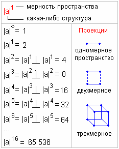

# Системы умножения и их структурные проекции

Структура у нас единая, изначальная, т.е. АЗовая, поэтому будем обозначать её **|а| - «азъ»**, она будет передавать любую структуру и отображать любую проекцию.

Теперь, представьте: есть Миры-пространства, Миры с дробными пространствами, есть что-то внепространственное, но это внепространственное всё равно имеет какую-то характеристику. Как мы единое передадим вне всякого пространства? А это и будет та самая **изначальная точка**, которую учёные называют точка сингулярности.

## Нулевое пространство

«Некогда, вернее тогда, когда ещё не было времён, не было Миров и Реальностей, нами людьми воспринимаемых, был, не воплощаясь, один только Великий Ра-М-Ха. Он проявился в Новую Действительность и от восприятия Новой Безкрайней Безконечности озарился Великим Светом Радости» - *Книга Света, харатья 1, Начало.*

Веды говорят о том, что было такое состояние, когда не было времён и пространств, т.е. было что-то безвременное и безпространственное. Но заметьте, Ра-М-Ха проявился в Новую Действительность, значит где-то была Старая Действительность. Он наткнулся на Новую Действительность и от него пошёл Свет, в котором появились Вселенные. Здесь говорится о той самой точке, которую учёные называют **точка сингулярности**, когда Вселенная (или чтобы это ни было) была в единой внепространственной структуре. Только учёные так и не знают, кто поднёс «спичку», чтобы это всё рвануло, ведь у них в основе - *теория большого взрыва*. А по Ведам, это просто не воплощаясь Ра-М-Ха проявился, и от него Свет Радости (поток Инглии) наполнил жизнью, и жизнь появилась.

**|а|° – это нулевое пространство**, т.е. как бы его отсутствие. И в этом нулевом пространстве Великий Ра-М-Ха был един, не воплощаясь. Поэтому: **|а|° = 1**.

## Одномерное пространство

**|а|1 – одномерное пространство**. Когда пошёл Свет (который мы называем Инглия), появилась первая пространственная характеристика, которую начал заполнять Свет. И как только Свет начал наполнять, в этот момент: «В Новой Действительности появилось сверхвеликое абсолютное Нечто». А так как Нечто не было тем, чем являлся Ра-М-Ха, значит оно стало **точкой противоположности**. А если есть что-то одно и ему противоположное, это равно двум, как бы светлое и тёмное. Поэтому: **|а|1 = 2**.

ПОДПРАВИЛО: любая фигура, объект или структура одномерного пространства будет иметь **2 опорные точки** (если образно, то эти точки: Инглия и Нечто).

ПРИМЕР одномерного пространства. Если на листе бумаги нарисовать любой рисунок, многоугольник или даже точку, и посмотреть на лист сбоку, получится одна линия, а по бокам две опорные точки, т.е. два начала между которыми они упираются. Поэтому проекция изначальной точки в одномерном пространстве - **линия** (отрезок).  
Вспомните, когда в школе рисовали оси координат, всегда изображали где-то минус безконечность, где-то плюс безконечность. Вот этот плюс безконечность – это положительное, светлое, а минус безконечность – как бы мрачное, уходящее во мрак.

## Двухмерное пространство

Чтобы получить структурную характеристику какого-то отрезка в двухмерном пространстве, мы должны провести проекцию к длине отрезка на длину данного отрезка. Т.е. спроецировать отрезок на его длину. Получим **квадрат**, у которого **4 опорные точки**.

## Трёхмерное пространство

Чтобы получить фигуру трёхмерного пространства, надо спроецировать |а|2 на |а|2, то есть провести проекцию уже не к отрезку, а к квадрату на длину квадрата. Получим **куб** и **8 опорных точек**.

## Четырёхмерное пространство

Чтобы получить четырёхмерную фигуру, надо провести проекцию |а|3 на длину |а|3, т.е. спроецировать куб на длину куба. Таким образом, характеристику выводим в сторону и получается **куб в кубе** и **16 опорных точек**. Т.е. увеличилась плотность, но и увеличилась в пространстве.

И так далее, в пятимерном пространстве будет 32 опорные точки, в шестимерном 64, в семимерном 128… в шестнадцатимерном пространстве 65 536 опорных точек. Шестнадцатимерное пространство – это следующее за нашим 4-хмерным гармоничное пространство. Если у нас здесь раскрыто 16 каналов (см. энергоновая система крови), то там будет раскрыто 256 каналов.

## Дважды два = 4?

И заметьте, мы говорим о трёхмерности. Куб имеет 8 опорных точек, поэтому, когда умножаем ЖДЫ (**два куба в пространстве**), получаем 16. Поэтому когда вам в школе сказали, что 2+2 = 4, дважды два = 4, 2 во второй степени = 4 - вас два раза из трёх обманули.  
2+2 = 4;  
2х2 = 16 (дважды два = 16);  
2 во второй степени = 3,9999… и никогда не будет равно 4, потому что мерность нашего пространства не равна четырём, и не равна трём.
