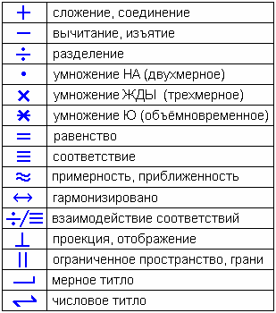

# Знаки х’Арийского определения (знаки вычисления)

«**+**» **сложение, соединение**.

«**-**» **вычитание, изъятие**. Вычитать – значит что-то убрать, поэтому иногда говорят «вычисление», т.е. вычислить, что убрать.

«**÷**» **разделение**. Это не деление, а разделение. Черта «вычитания» разделила две точки, мы как бы вычли одно наверх, другое вниз, т.е. разделили их на соответствующий порядок.

«**•**» **умножение НА (двухмерное)**. Точка – это какая-то определённая структура. Поэтому когда мы делаем структурированное вычисление, мы ставим именно точку.  
**Н** – «наша»  
**А** – «Аз» (Бог, живущий на Земле)  
То есть, умножение НА – это умножение наших Богов, которые жили на Земле, т.е. они проводили свои вычисления на какой-то плоскостной форме. А раз на плоскости, значит это двухмерное умножение.

«**х**» **умножение ЖДЫ (трёхмерное)**. Через одну точку провели четыре линии, четыре пространственные координаты. Помните в Юджизме разбирали: Три Слона и Черепаха – у нас мир как бы трёхструктурированный, но эта троичная структура покоится на четвёртой (на черепахе). Поэтому в «крестике-умножении» четыре линии, это глубина, длина, высота и одновременно во времени. Поэтому наш Мир называют четырёхмерным (трёхмерный в четвёртом).  
**Ж** – «жизнь»  
**Д** – «добро»  
**Ы** – «подчинённая определённым законам»  
То есть, что-то доброе созданное в жизни, подчинённое определенным законам. Это всё определённое законами Яви, поэтому всё трёхмерное, но во времени, потому что всё происходит, всё течёт.

Чтобы детей не путать «временем», им объясняют просто: четыре луча - это глубина, длина, ширина и высота. Но у славян понятия длина и ширина взаимосвязаны. Если смотрим в одну сторону, перед нами длина, сбоку ширина, а стоит повернуться на 90 градусов, длина и ширина поменяются местами.

«**х-**» **умножение Ю (объёмновременное)**. В начертании остаётся «крестик-умножение ЖДЫ», т.е. те же характеристики, но горизонтальной чертой мы разделяем их к самим себе. То есть, если знак «разделение» разделяет порядки разных структур, то здесь разделяем на равные структуры, получается объём разделённый во времени. Объёмное и пространственное.  
Посмотрите начертание **Ю**: есть круг (объём) и что-то находится вне его, поэтому объёмновременное, оно же пространственное. Т.е. находясь на сфере, мы воспринимаем плоскость, а находясь на плоскости воспринимаем сферу. Допустим, наша Земля круглая, но её поверхность мы воспринимаем как плоскость. Или Луна в небе объёмная, но мы её воспринимаем плоской.

«**=**» **равенство**. Одна черта «вычитание», а две - уже вычли и высчитали то, что получилось. Поэтому структурно знак равенства, это две черты. Но равные объёмы могут быть и не равны, поэтому есть знак соответствия.

«**≡**» **соответствие** (равенство и соответствие, это разные знаки). Пример: две литровые бутылки, в одной вишнёвый сок, в другой молоко. По объёму бутылки равны, но они не равны по значению. Т.е. у них вводится ещё одна вычислительная характеристика. И раз они не равны, а тождественны, значит определённой структуре они соответствуют. Поэтому к равенству добавляется ещё одна черта - соответствие. Пример: +5 неравно -5, но оно ему соответствует, они равноудалены на пространственной оси координат от какой-то определённой точки.

«**≈**» **примерность, приближённость**. Структурное отличие. Пример: две бутылки 0,5 л и 0,6 л издалека схожи, но их равенство только визуально, а на самом деле оно искажено, структурно они не похожи. Поэтому и в знаке приближённости линии искажены.

«**↔**» **гармонизировано**. Допустим, две бутылки молока – один объём, вес, молоко от одной коровы, но время дойки разное, утреннее и вечернее, значит молекулярный состав разный, т.е. по внутреннему составу бутылки не равны. Эти бутылки между собой гармонизированы, но не равны, хотя объём один, питательность одна. Другой пример: +5 и -5 гармонизированы относительно центра координат, т.е. они не равны, но относительно какой-то структуры они гармонизированы.

«**÷/≡**» **взаимодействие соответствий**. Знак «разделения» соприкасается со знаком «соответствия», т.е. то, что соответствует друг другу между собой может и взаимодействовать.

«**┴**» **проекция, отображение**.

«**| |**» **ограниченное пространство, грани**. Две широко расставленные вертикальные черты, между которыми что-то вписывали.

«**┘**» **мерное титло**. Это определённые меры пядевой системы.

«**ā**» **числовое титло**. Используется для записи чисел буквицами. Если над буквицей числовое титло, значит это число. Причём у славян были именно числа, а не цифры (цифры у евреев, у них есть дерево цифирот, сейчас говорят «сефирот», и одна из книг каббалы - «Цифирь Йецира»). Т.е. у славян числа, цифры ввёл Петр 1.
