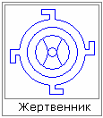

# День Бога Купала (обряды и ритуалы)

Многие путают День Бога Купала с христианским праздником Ивана Купала. Сразу стоит пояснить, в чём различие. Когда христиане всё переводили, у них получилось, что день рождения Иоанна Крестителя пришёлся на день Летнего Солнцестояния (совр. дата: 22–24 июня). Но у славян **в день летнего солнцестояния был День Числобога**, т.е. Бог Времени, он как раз и управляет, разграничивает, когда самая длинная или короткая ночь, когда день и ночь равны, т.е. время входит в его компетенцию. А через две недели – День Бога Купала, т.е. **7 Хейлетъ**. Но христиане решили подменить День Бога Купала своим праздником, что было по созвучию, т.е. на Западе его называют: День Джона Баптиста (Иоанна Крестителя), а эти на наш манер назвали – Иваном Купалой.

1. Время праздника  
2. Как проходит сам День  
3. Хороводы вокруг Меча Перуна

## Время праздника

Почему День Бога Купала после летнего солнцестояния? Купала даёт силу и очищение, возможность людям избавиться от внутренних неудобств, болезней, каких-то терзаний и переживаний, поэтому и празднуют День Бога Купала не в само Солнцестояние, а **когда Солнце идёт на убыль, чтобы все болезни, невзгоды убывали**, именно с этим и был изначально связан День Бога Купала.

И заметьте, когда венки с зажжёнными свечами отправляют по реке, в День Бога Купала наговаривается что должно уйти. А потом на День Бога Перуна повторяют обряд, и наговаривается уже, что мы хотим взамен ушедшего. Т.е. данная система праздников - чтобы вместо ушедшего отрицательного пришло положительное.

## Как проходит сам День

**1. Утренняя служба в честь Бога Купала**, т.е. в честь очищения. Мы прославляем своих Богов и Предков, потому что они дали нам жизнь, передали свою силу, свою славу, свою мощь.

**2. После службы мы приносим требы им**, чтобы они были вместе с нами во время очищения в День нашего очищения. Т.е. провели службу, требы принесли, Богов накормили, и сами потрапезничали.

**3**. Едем на берег Ирия, где готовим место для проведения праздника. Т.е. там делаем Жертвенник, Огневище, устанавливаем Меч Перуна, девчата плетут себе венки.

**4**. После того, как всё подготовлено, **начинаются игрища**, т.н. «Игры Богов», различные испытания, хороводы, ручейки, змейки (\* становятся друг за другом змейкой, и голова должна поймать хвост, т.е. тот, кто спереди, должен поймать заднего). Но это просто как разминка перед началом праздника.

Или было такое, когда прибегали к Воле Богов, т.е. выкапывали в земле или в песке на берегу две Огневицы (свастики навстречу друг другу), и вокруг них два хоровода: в одну сторону ходит девичий хоровод (против часовой стрелки), в другую сторону движется юношеский хоровод (по часовой стрелке). Т.е. взявшись за руки, в хороводе движутся, и когда произносится фраза: «Воля Богов!», хороводы сталкиваются, и вот кто спиной столкнулся, тех потом проверяют – Боги свели или бесы столкнули. Бывает и так, что столкнулись одна девушка и два парня, и они потом начинают оспаривать, кто из них будет проходить данный обряд. В таком случае им предлагалось сыграть в «Игры Богов», и кто из двоих наберёт больше очков, кто ловчее, тот и будет проходить с ней обряд.

**5. Жертвенник** делается из песка (см. рис. - Вид сверху). Солнце у нас движется по часовой стрелке, с востока на запад, поэтому лучи свастики влево. Если смотреть сбоку, то Жертвенник как пирамида со срезанным верхом. В принципе, на основе структуры данного жертвенника и градостроительство шло, с оборонительными стенами, с выступами, достаточно посмотреть на структурную схему Аркаима.

**6. Меч Перуна** устанавливаем южнее Жертвенника, и так, чтобы гарда показывала ориентир: Север – Юг. Вокруг меча делают косрище – огневище, ибо сказано: «И победиша злые силы вонзил в землю сияющий меч Бог Перун». Вокруг меча ходят хороводы.  
\* Солярники для «Воли Богов» ещё южнее меча, и площадка для «Игр Богов» находится южнее меча, а направлена она на восток, т.е. мы бросаем как бы с запада на восток.

**7. Огневицы-венцы, плотики со свечами** у каждого уже заготовлены заранее, их зажигаем от Жертвенника (Священного Огня) после хороводов, наговариваем на свечу, чтобы беды, лихолетия, утраты от нас ушли, и эти Огневицы пускаем по Ирию. И когда их пускали, то пели Гимн Святой Земли: «Ой, течёт река Ирий Светлый…».

**8**. Далее, каждый должен **омыться в водах Ирия**. Т.е. омываясь в водах Ирия, мы очищаем своё тело. И только те, кто омыл своё тело, идут далее прыгать через костёр.

**9. Прыжки через большой центральный костёр**. Прыгаем с востока на запад, т.е. по движению Солнца. А через Северный костёр, называемый Огнём Даарии, не прыгают, потому что считалось, что тот, кто прыгает через этот костёр, тот мимо Мудрости проскочит. Но некоторые, чтобы не стоять по полчаса в очереди, чтобы через большой костёр прыгнуть, они себе маленькие костерки делают и через них прыгают. Считается, что в полночь, прыгая через большой костёр (а мы уже знаем, что человек имеет энергетическую структуру матрёшки (9 тел) одна в одной), т.е. надо прыгнуть девять раз, с каждым прыжком мы как бы очищаем одно из девяти своих тел.

**10**. Затем молодёжь водит хороводы вокруг двух солярников - левосторонний и правосторонний. Пока водятся хороводы, заполняется углём Огненная дорожка.

**11. Хождение по углям**.

**12**. После того, как прошли по углям, берётся братина, наполняется обычным хлебным квасом, и все кто прошёл полное очищение, т.е. Телес, Души и Духа, они становятся вкруг и братина передаётся по кругу от одного к другому – глотнул и передал братину дальше.  
\* **Братчина или братина** – это большой ковш, наполненный квасом, на который начитывается благословение Перуна.  
А совпавшим молодым - паре даётся отдельно, не с этой братины, а отдельно, один кубок на двоих. И они вместе как бы испили одну чашу, и юноша до рассвета обязан смотреть за девушкой, чтобы она была сытой, была весела, нравственна и непорочна.

**13**. После братчины, возле любого огневища, туда подкидывают дрова, пологи раскладывают и делают общий трапезный стол, начинается **общая трапеза**. После трапезы начинаются игры, загадки, песни поют.

**14**. В 4-й час по славянскому времени (совр. час ночи), т.е. после часа ночи уже можно идти искать Цвет Папоротника, его можно увидеть только Духовным зрением. И это только в христианских сказках лишь бы сорвать, потом клады искать, т.е. сразу видно, что намерения материалистические. Нельзя губить Природу – красота растёт и хай растёт. Узрел - значит, в тебе чистота раскрылась.

**15**. Празднество продолжается до первой зари, после чего **встречают Ярило-Солнце**. Мы уже заметили, что птички, кузнечики, лягушки и пр., как начнёт всходить Ярило-Солнце, у них будто кто-то выключил звук, сразу же резкая тишина. И в этот момент надо встать ликом своим на восток, и встретить Ярило-Солнце, т.е. всплеск и поток солнечного ветра он наполняет человека такой могучей силой, которой ему хватит на целое Лето. Встречаем мы его поутру и глаголим: «Здравствуй, Трисветлый. Ура! Мы чада твои». После этого опять трапеза братская.

**16**. После праздника мы всё убираем, Жертвенник делали из песка – всё выравниваем, и берег чистый, как будто нас там и не было, Природа остаётся после нас в чистоте и неприкосновенности. Мусор сжигается на кострах, костры потом покрываются песком, и остаётся после нас чистота и порядок.

## Хороводы вокруг Меча Перуна

Вокруг Меча Перуна делались всегда несколько кругов хоровода:  
**Первый круг** – детский (до 12 лет), т.е. как правило, большой был хоровод, т.к. детей раньше было много.  
**Второй круг** – от 12 лет (девушки до 16-ти и юноши до 21-го), но иногда делали, чтобы все до 16 лет, т.е. здесь те, кто ещё не был в Семейном Союзе. Иногда делались отдельно девичий круг и отдельно юношеский, но в таком случае девичий шёл сразу за детским, т.к. юноши были взрослее (21 год) и они тоже девушкам создавали обережный круг.  
**Третий круг** – старше 21, т.е. здесь были те, кто уже достиг возраста, когда можно заключать Семейные Союзы, но они ещё его не заключили.  
**Четвёртый круг** - молодые семейные пары.  
**Пятый и т.д. круги хоровода** – взрослые и старики. У них тоже могло быть несколько кругов.

Т.е. получались как бы обережные круги - от стариков к молодёжи, и в то же время старики и молодые создавали для детей дополнительные обережные круги. И заметьте, сначала все поют Гимн Богу Купале, а после него Гимн Огню, и движение всех хороводов идёт по Солнцу. После появляется Бог Семаргл, и все нечётные круги хороводов (1, 3, 5, 7, 9) продолжают ходить по Солнцу, а чётные (2, 4, 6, 8) меняют движение и идут навстречу Солнцу. Т.е. получается двунаправленная свастика (Перунов Цвет), это общее благословление.

После общих хороводов, т.е. после того как получили, спев гимны, благословение, раньше делали ещё один **Огневик севернее от Жертвенника**, и молодёжь, незамужние, водили хороводы по Солнцу вокруг этого костра. Т.е. заметьте, семейные пары остаются вокруг Меча, они создали вместе с Семарглом–Огнебогом для молодёжи обережные круги, и молодёжь потом идёт в хороводе (используя тот же возрастной принцип) вокруг костра. Чтобы этот Огневик (севернее Жертвенника), это символизировало, что Огонь на Севере освещает их разум, чтоб **познавать Северную Мудрость своего народа**, ведь наши Предки с Севера пришли, и вот этот огонь Огневика, заметьте без меча, а просто костёр, он символизировал Гору Мира в Даарии, а на его вершине, т.е. Асгард Даарийский, где вся Мудрость была собрана, т.е. старики-то уже Мудрость всю познали, и семейные, а молодёжи надо учиться. Поэтому вся молодёжь вокруг данного Огневища хороводы водит.

\* **Что брать на праздник?**  
Требы: блины, оладьи, булочки, печенье, зёрна, цветы.  
И свою чашку, кружку, ложку, нож. Нож должен быть у каждого мужчины. Нож – это не холодное оружие, а элемент Славянской национальной одежды.
