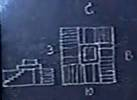

# Дуния - Огненный жертвенник

**Священный Огненный жертвенник называли Дуния** (или Дунья). Дуния в виде двойной свастики (см. Солярные символы). Огненный жертвенник всегда располагается рядом с Капищем или Святилищем **с западной стороны**, т.е. Предки же уходят за Солнцем, поэтому, когда приносят Требы, выходя из Капища или Святилища, идут к жертвеннику на запад, по ходу Солнца. Вокруг жертвенника создавалась Куммирня, т.е. ставились как бы сейчас сказали: Столбы Куммиров, чётное количество: 4, либо 8, либо 16. Т.е. от центра Жертвенника (Дуньи) очертили круг и по нему расставили Куммиры. Либо круг Куммиров располагали с северной стороны жертвенника.

1. Принесение Треб  
2. Заполнение пустоты  
3. Что можно и нельзя бросать в огонь?

Либо Куммирня делалась западнее Дуньи, но тогда она должна быть под навесом. Т.е. в Куммирне посредине стоял центральный столб, вокруг него 16 Куммиров (Богов), перед каждым Алатырь-камень – жертвенник, и над всей Куммирней навес, чтобы Куммиры ни дождь, ни снег не заливал. Т.е. **если Куммиры с западной стороны от Дунии, то над ними делают навес**, а если Куммиры севернее жертвенника – они стояли без навеса.

Стен у западной Куммирни не было, просто между столбами подвешивали плотно сотканную узорчатую ткань, собранную на валики. И в период снегопада или дождя эту ткань сверху с валиков отпусками, получались как бы стены из плотной материи, металлический валик давал своеобразное натяжение, и Куммирня получалась закрытой, непродуваемой. Когда надо – подняли ткань и всё открыто, т.е. просторно, удобно, никто никому не мешает, требы на Алатырь-камень положили, а каждый обращается к своему Богу – Куммиру.

От центрального Огненного жертвенника (Дуньи) брался огонь, который использовали для того, чтобы зажечь огонь перед другими Куммирами, и в западной Куммирне. Но жрецы старались в такой Куммирне поддерживать огонь постоянно, либо были дни, когда огонь специально гасился, допустим: в Новолетие, на Купалу, и ещё ряд праздников, т.е. когда обновление - чтобы погас Старый Огонь и был привнесён Новый Огонь.

## Принесение Треб

**1**. Во время праздников в честь Вышних Богов, Богов–Управителей, Богов–Охранителей, движение идёт **с Юга на Север**, т.е. человек поднимается по ступеням с южной стороны, проходит по площадке и становится перед огнём, лицом к северу, произносит определённые гимны, приносит в огонь Требы, и уходит на север – это у нас движение в честь Вышних Богов.

**2**. Когда идёт служение в честь Предков и Родовых Богов, мы идём **с Востока на Запад**. Поднимаемся по ступеням с востока, приносим требы Предкам, и выходим на запад, т.е. как бы за Предками, так как они пришли в этот Явный Мир с востока, как бы с восходом Солнца, а ушли за Солнцем на запад. Такое движение в честь Предков, Пращуров, Родовых Богов.

Т.е. в Родительские дни движение (Требы приносим) с Востока на Запад, а допустим, службы в День Перуна, в День Велеса, Семаргла и др. идём с Юга на Север.

Человек, который обращается и приносит Требы (т.е. когда поднялся на Дунию и стоит перед огнём), он должен **в первую очередь настроиться на то, что он совершает** – на обращения к Роду, к Богам, к Предкам, чтобы конкретно его требы, дары, безкровные жертвы имели образное направление, или говоря современным языком: имели вектор направленности, т.е. куда они пойдут – сосредоточение.

Поэтому в Преданиях и говорится, что Огнебог принимая жертвы Дуньи, посылает их в Небеса с частицей себя, **и частица эта обретает Образ**: коня, зайца, птицы (орла, сокола, ястреба), либо образ волка (пса). И заметьте, вот эти послания Семаргла – Огнебога, они имеют Образы очень быстрых живых существ на Земле (конь, заяц, ястреб и пр.), т.е. они как бы символизируют быструю доставку сообщения от живущего к ушедшему в Вышний Мир, или к живущему в Высшем Мире. Поэтому, во время огненных жертвоприношений некоторые люди фотографируют, и на фотографиях мы видим Огонь, поднимающийся из Дуньи, он приобретает форму птицы, коня, волка. Когда сам Огнебог доставляет, то на фото видно, как пламя приобретает образ человека над Дуньей, т.е. он самолично доставляет наши Дары, Требы, Безкровные жертвы тем, к кому мы обращаемся. Поэтому, **прежде чем вступить на ступени Дуньи, человек должен привести свои мысли в порядок**, открыть своё сердце, и только лишь открыв своё сердце, только после этого начинать восхождение по ступеням Дуньи (Огненного жертвенника).

## Заполнение пустоты

Человек, который вместе с требами отдал Богам и Предкам частицу себя, Огнебог Семаргл даёт возможность заполнить образовавшуюся внутреннюю пустоту. Т.е. мы часть Души вложили в требы и отдали, а раз мы отдали, значит, в нас возникает какая-то пустота, и Огнебог даёт нам возможность эту пустоту заполнить. Поэтому мы **заполняем эту пустоту огненной силой Священного Жертвенника**. Заполняем этой энергией все четыре составляющих – Тело, Душу, Дух, Совесть.

**Пример:** принесли мы Предкам блины, но мы же блины делали руками, т.е. принесли плоды своего труда, сотворённые данным телом, значит, мы заложили телесную энергию и получили блины. Плюс мы делали их с Душой, т.е. заложили и Душу. Также вложили Дух, т.е. частицу себя, чтобы Предки знали, что это от нас, а не от дяди постороннего или от кого-то ещё. И делали мы с чистыми помыслами, а не так, что просто машинально пришли, бросили блины: «Предки, нате ешьте!» и всё. А если помысли наши чистые, значит, Совесть наша чиста, т.е. мы мерило своих деяний (Совесть), тоже туда вкладываем. Поэтому мы от четырёх элементов внесли туда – от Тела, Души, Духа и Совести, поэтому и четырежды восполняем огненной силой от Священного жертвенника, чтобы заполнить данные пустоты. И уже восполнив, идём дальше – на выход из жертвенника.

Т.е. идёт обмен энергиями.

**Вопрос:** понятие греха существует, если он ничего не делал, а просто для порядка бросил требы, чтобы наполнить себя огнём?  
**Ответ:** человек не может наполнить себя огнём, если ничего не вложил, потому что в нём нет пустоты. Мы же огненную силу берём взамен того, что вложили. Т.е. если сосуд пустой, и он туда пустоты наполнил, то он таким пустым и останется. И только если кувшин у него был полный, и он отдал немного, вот только тогда он может восполнить.

## Что можно и нельзя бросать в огонь?

Принося требы, важно и сколько вложил энергии, и что бросаешь в огонь. Поэтому старались в огонь приносить не только то, что сделано своими руками, но и то, что выращено своими руками. Допустим, горсть пшеницы ты держишь в своей руке и наполняешь её своей энергией. Всегда считалось наиболее энергоёмким – то, что растёт на земле, это **рожь, пшеница, просо, гречиха**, а также шишки – кедрач, очень мощная сила. Потом, летом идут цветы полевые, они получают не только силу земли, воздуха, но и силу Солнца, и обретают красоту, и вот эту всю красоту мы в огонь бросаем, но не для того, чтобы она сгорела, а чтобы она и там им украшала. После цветов полевых, и тех цветов, которые человек сам выращивает, идут изделия – блины на первом месте, как символ Ярилы–Солнца, оладьи, затем идут булочки, жаворонки, печенье всевозможное, а потом уже конфеты, овощи, фрукты и пр.

**Вишня, малина, смородина – в огонь Дуньи не бросались!** Потому что есть заповедь: «Не приносите на Алатырь жертвы кровавые, не гневите Богов ваших...». А Малина считается и называлась «Медвежьей кровью», Вишня - считалось, что в ней кровь Бога Вышеня, Смородина – считалось, несёт в себе кровь Спящей Земли, поэтому первое растение, которое распускает листики – это смородина, т.е. в ней начинает бурлить кровь Спящей Земли. Эти три ягоды воздействуют на кровь человека: вишня очищает, обновляет кровь; малина – помогает при гипотонии, т.е. активизирует кровь, повышает давление; а смородина – наоборот, давление снижает.

На требный стол перед Куммиром положить эти ягоды можно, но приносить их в огонь Дуньи нельзя. Требы с ягодами в чашечках стоят определённое время, Боги и Предки взяли из них силу, а потом их закапывали в землю. Поэтому были специальные чаши под эти ягоды. А если после того, как их закопали, от вишенки или малины, смородины проросли отростки, то их рассаживали и создавали сады.
