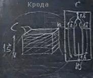
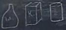

# Обряд Крода

Обряд кродирования, т.е. совершения Кроды, используется для отправления умершего в его последний путь в Мире Яви, и продолжения его жизни в Мире Слави. Само понятие «Крода» означает отправление человека «**К-Роду**». Кродой так же называется погребальный костёр. Крода сотворяется, как правило, из берёзы, дуба, кедра и других Священных деревьев. Т.е. деревья – это излучатели, они и жар, и силу излучают, и эта сила вся передаётся умершему. Мы уже записывали на Юджизме, как это всё происходит: Круг Абсолюта, похороны, сколько им жрецы занимаются, сколько он лежит у себя дома.

1. Крода  
2. Курган  
3. Трапеза

## Крода

**Делается Крода 1 сажень в высоту** (213 см): проложили ряд брёвен, перебросили сухой травой, ветками, сеном, берестой или ещё чем, затем следующий ряд. Ширина и длина зависит от тела умершего, при этом расстояние от края до головы, плеч и ног – 1 аршин. Брёвна пропитываются маслом, т.е. разогревают растительное масло и обливают им все брёвна. Существует понятие двух Крод, т.е. если погибший был воин или знатный родович, поверх полога ставили ещё сруб или погребальную ладью. Но от края бортов ладьи до края Кроды так же будет 1 аршин. Поджигается Крода факелами.  
\* Когда накладывается сама Крода, делается так, чтобы в первую очередь было красиво, она делается праздничной, торжественной, потому как мы не просто скорбим, а наоборот мы радуемся, что провожаем дальше, Душа идёт дальше по развитию своему.  
\* Следующий момент – между брёвен для красоты втыкают веточки зелени, летом разных деревьев, зимой хвойные, как украшение. И именно зелёные ветки дают дым, а так вообще дыма нет никакого.

**Крода располагается головой на север**. С южной стороны подставляли лестницу, по ней заносили умершего, а сходили с полога по лестнице с северной стороны. Также и родные могли подняться с южной стороны, попрощаться, поцеловать его в чело и спуститься по северной стороне. Но иногда, если места ограниченно, то поднимались и спускались по одной и той же лестнице, тогда поднявшись на полог, обходили умершего с восточной стороны и возвращались к лестнице по западной, т.е. они стояли как бы по сердцу от данного человека, чтобы попрощаться. После прощания, жрец или проводящий обряд накрывал лицо умершего и всё тело белым покровом, и мог подоткнуть под тело, чтобы, когда загорится, его сразу же не унесло огненным потоком.  
\* Лестницы потом убираются и тоже сжигаются.

**Руки вдоль тела**, либо иногда накладывали их на перси, ладонью одной руки закрывая другую. Т.е. никаких пут покойному нет, когда руки и ноги перевязаны. В некоторых Весях сухожилия надрезали на пятках и на руках возле кисти, потому что жар очень сильный и бывали случаи, что сухожилия высыхают, стягиваются, и многим кажется, что покойный поднимается, ноги подгибаются, и некоторым могло плохо стать.

**Вокруг Кроды очерчивали круг**, т.е. просто прокапывали или дёрн снимали, потому что температура такая будет, что трава начнёт гореть, и чтобы огонь дальше не распространился надо круг очертить.

Поджигая Кроду, произносили фразу (один из вариантов):  
- «Отправляется (*имярек*) в Сваргу Пречистую к Роду своему».  
- «Отправляется (*имярек*) в Правь к Роду своему».  
- «Отправляется (*имярек*) в Славь к Роду своему».  
А там уже его дальше направят.

**Поджигают Кроду в 16:00** по современному времени. Т.е. погребальный костёр горит несколько часов, и с заходом Солнца (Души же уходят вслед за Солнцем) как бы Душа отправилась в Правь, и Солнце ей дорогу освещает. И к утру здесь будет кродное пепелище. Далее, берётся домовина и собирается прах.

Те, кто принимают участие в обряде (копают меру, кладут кроду, держат факела) у них **левая рука должна быть спрятана под белой материей**, как правило, для этого используют белые полотенца – обматывают его вокруг левой руки.

## Курган

**Домовина** (или дом) делается в виде кувшина из глины, либо в виде урны из камня, мрамора, либо из бересты, может быть из стекла, даже просто трёхлитровая банка. И туда, не руками, а лопаточкой собирается прах, остатки косточек, если остались, но, как правило, при таком сильном огне кости все сгорают. Бывало, там где леса мало, основные кости сгорали, но оставался череп, тогда его ставили возле Куммира своего Рода. Но обычно сгорает всё, прах собирается в домовину, или некоторые делают две домовины: одну, чтобы курган создать, вторую, чтобы поставить дома. Кто-то делает себе кожаный мешочек с кожаной тесьмой, наполняет её пеплом Предков, и как ладонку носит на шее.

Остальной пепел, который остался, многие его тоже собирают в специальный большой туесок, чтобы этот прах развеять либо над рекой, либо над своим полем. Т.е. потом человек за это поле за эту территорию голову сложит, но врага туда не пустит, потому что данный участок полит потом и прахом его Предков.

**Курган**. После того, как собрали прах в домовину, выкапывается углубление в земле с размерами мера на меру (1х1 метр), в глубину иногда доходит от меры до сажени. По центру устанавливается столб, туда же можно положить кости, сверху на столб приколачивают квадратную дощечку, по углам 4 столбика, и между ними ставиться домовина, тут же требы, благовония можно поставить, огневицу зажечь. Если много родичей пришло, столб выходит за пределы колодца, т.е. над поверхностью земли, если родственников мало, то может быть ниже уровня земли.

Сверху всё это закрывается крышкой с загнутыми краями, делают из дерева, иногда из металла. Её просто на столбики надели и получилась крыша. Потом это всё покрывают платом – платок из белой материи, и он свисает ниже всего, потому что родственники потом берут землю руками и засыпают, а она опадает, и у нас получается, что плато натягивается, подворачивается, и держит крышку и домовину, и всё у нас целиком закрыто. Если рассматривать это замкнутое пространство, то мы опять создаём утробу, т.е. человек из утробы материнской пришёл, и в утробу Природную вернулся, точнее его тело, а Душа с Небес пришла и в Небеса и вернулась.

**Камень**. Потом выше уровня земли набрасывается ещё земля и получается курган. И на этот курган ставится камень, но никаких крестов и пятиконечных звёзд. Камень может быть любой, хоть валун, но на камне раньше писали: Здесь покоится прах такого-то из Рода такого-то, рождённый, если женщина, то допустим, Мария Ивановна Петрова, урождённая Сидорова, т.е. в девичестве Сидорова, т.е. из какого Рода её взяли. И Лета ставятся наши, допустим: Рождена в Лето 7432, умерла в 7510. Ниже можно указать современные даты.

**Символ**. На женских, как правило, ставится символ - Звезда Лады-Богородицы, чтобы Лада, как покровительствовавшая им на Земле, продолжала покровительствовать им и дальше в последующей жизни. На мужских ставятся солярники или символы его Рода.

## Трапеза

После того как сотворили курган, оставили требы на кургане, руки омывают водой. И чтобы все помянули, родичи умершего подготавливают **кродную трапезу**, потому что Душа умершего стоит рядом, и она смотрит - по тому, как обильно или нет угощают всех присутствующих, она судит, как к ней данные люди относились при жизни. Потом уже это курганное место называется - погост, туда приходят погостить, как бы с родственниками свидеться. Но после введения христианства, погостом начали называть кладбище, хотя кладбище – это место, где тело погребено.

В кродной трапезе, когда поминают, **не должно быть вилок**, потому что представьте, Душа умершего стоит рядом и хочет взять какой-то кусочек, а вы его вилкой – этого нельзя. Тем более вилки же появились недавно, а до этого были ложки.

Делается **кутья** - любое зерно, в основном пшеница, рожь, на пару готовится и добавляется мёд, ягоды, сейчас многие добавляют изюм.  
*\* Храмослужение, курс 2, урок 8.*
