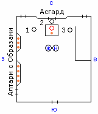

# Обряд освящения Семейного Союза

Данный обряд проходят только те, кто прошёл Обряд наречения женихом и невестой. (Последние два столетия этот обряд проходили те семейные пары, которые уже жили совместно, получив родительское благословение, но не могли пройти сей обряд в виду удалённости от Капища, Святилища или Городища).

На рисунке показан Алтарь (перед Асгардом), вокруг него жрецы, перед алтарём жених и невеста, у западной стены – алтари с Образами, туда молодожёны ставят свечи за здравие и за упокой.

1. Подготовка к Обряду  
2. Служба  
3. После Обряда

## Подготовка к Обряду

**1**. Для прохождения Обряда освящения Семейного Союза, так же как и при наречении женихом и невестой, необходимо **полное родительское благословление**, т.е. благословление всех родителей – и родных и посажённых. При этом желательно, чтобы все родители присутствовали на Обряде, и сами ответствовали перед Куммиром Рода, что они дают своё благословение, т.е. чтобы не было такого: «Родители дали благословение?», – «Дали!» А родители ни слухом, ни Духом.

**2**. На данном Обряде присутствуют ближние молодожёнов (**дружка и подружка**), которые в последствие станут посажёнными родителями вновь создаваемой семьи, и для её детей. Т.е. этих молодых людей (дружка и подружка) садят рядом за одним столом с молодожёнами, и ответственность о жизни нового человека лежит уже на этих четырёх. И когда уже нынешние молодожёны будут отдавать замуж свою дочь или женить своего сына, те будут печь пирожки с начинкой для этих четверых, и кто угадает, значит так и назовут ребёнка.

**3**. На Обряде молодым необходимо иметь: 3 свечи каждому, Символ Хорса (серебряные кольца, которое будут упокоены на безымянном персте левой руки молодых), и два вида сока – тёмный (красный) сок и светлый сок, допустим, вишнёвый и светлый виноградный, либо виноградный тёмный и яблочный и т.д. Этот сок для Чаш Судеб. Помимо всего, молодым необходим каравай, хлеб, соль, свадебный рушник.

Два ломтики хлеба кладутся в жертвенные чаши, эти требы приносят родители, либо дружка и подружка, когда молодые стоят, т.е. молодым даже не надо об этом и голову ломать.

**4**. Перед алтарём **невеста – справа, жених – слева**. Но они не весь обряд так стоят, а в определённый момент поменяются местами. На алтаре стоит Куммир Рода, перед ним огневица. Обряд проводят, как правило, 1-3 священнослужителя, каждый занимается своим делом. Обряд может провести и один священнослужитель, но, как правило – один читает, а второй проводит обряд, либо один читает, второй подготавливает обряд, а третий его проводит. Находятся жрецы, как правило, в точках 1, 2, 3.

## Обряд освящения Семейного Союза

Читается сама служба:  
- Во исполнение законов Рода Небеснаго и Многомудрых Предков наша, предстали пред Образа и Куммиры Бозех наша потомки Рода Небеснаго.

- Дети Расы Великой, живущие во Святой земле Расы (*имярек* - т.е. называются взрослые общинные имена), по доброй ли воле и без принуждения избрали вы сей совместный путь? (**Да** или нет. Если кто-то ответил «Нет», то обряд прекращается).  
- В Родичах ли ходят древние Роды ваши? (Да или **нет**. Ответ должен быть: «Нет», т.к. родственные союзы запрещены).  
- Во дни сии благословили ли вас Родители ваши? (**Да** или нет. После молодых на данный вопрос отвечают сначала все родители жениха, а после - все родители невесты).  
- Все ли родители присутствуют во Капище Божьем? (Да или нет. Если нет кровных родителей, то присутствуют ли посажённые родители, или лица, их замещающие? Допустим, отец не может придти, потому что инвалид, тогда он может отрядить на обряд своего брата, который будет выступать от имени отца, потому что они с ним единокровные. Т.е. замещать могут только родные братья, а не посторонние люди).

Молодым людям жрец даёт в руки зажжённые свечи, которые он зажигает от огневицы перед Куммиром Рода, произнося фразу: «От Живого Огня к Живому Огню во светлую память ушедших в Мир Нави и Слави».

- Зажгите огонь в сердцах своих во светлую память ушедших в Мир Нави и Слави Родичей и Предков ваших, поставьте сию огневицу пред Образа и Куммиры. (молодые зажигают первые свечи и ставят их пред образами к южному алтарю на западной стороне, после чего возвращаются к алатырь-камню).

Жрец зажигает ещё две свечи и произносит фразу: «От Живого Огня к Живому Огню за здравие отсутствующих близких». Жрец передаёт свечи молодым, после чего читается:  
- Зажгите огонь в сердцах своих за здравие отсутствующих Родичей и ближних ваших и поставьте огневицу во славу их пред Образа и Куммиры. (молодые идут к северному алтарю на западной стороне и ставят свечи за здравие ближним и родичам. Возвращаются к алатырь–камню).

- По сердцу ли тебе (*имярек*) избранница твоя? (**Да** или нет)  
- По Душе ли тебе (*имярек*) избранник твой? (**Да** или нет)  
- По Небесному Закону Светлых Богов наших стань, дщерь Божия, по сердцу избранника твоего, дабы тепло сердца его согревало тебя во вси дни совместного вашего проживания.  
(*теперь невеста становится по левую руку от жениха*).

Жрец берёт две «Чаши Судеб», как правило, это хрусталь, и наполняет их соком, произнося фразу: «Что Мать–Природа произвела, то Чаша Судеб приняла». Тёмным (красным) соком наполняется для жениха, а светлым - для невесты. Это символизирует, что красное, как кровь – это продолжение кровного родства, т.е. продолжение Рода, продолжение крови, а светлый (золотистый) сок невесты - как символ чистоты.

После этого жрец подносит «Чашу Судьбы» с тёмным напитком к жениху и говорит:  
«Прими в руку свою Чашу Судьбы своей»  
После это он подносит Чашу со светлым напитком невесте и произносит ту же фразу:  
«Прими в руку свою Чашу Судьбы своей»

Молодые принимают Чаши левой рукой, а потом держат Чаши в правой руке, т.к. правая рука излучает, и сок начинает их энергетикой наполняться. Жрец произносит:  
- Каждый из вас в руке своей держит Образ Судьбы своей, так испейте же един глоток одинокой судьбы своей. (Молодые делают по одному глотку из своей чаши).

\* «**Чаши Судеб**». Здесь прообраз, не только психологически что-то меняется, а заметьте, жрец произносит, что это Мать–Природа вливается, т.е. не Мать Сыра Земля, а вся Природа, все силы Природы, и эта Сила в хрустальной чаше, а хрусталь всегда символизировался с трансформированием всевозможных божественных энергий, поэтому многие гадалки использовали хрустальный шар, чтобы увидеть будущее, грядущее, прошлое. А тут – в хрустальный кубок наливается сок, на который начитывается, и в котором как бы вся Природная сила. И молодые левой рукой кубки взяли, затем в правую руку перенесли, т.е. левой рукой приняли в себя Природную силу, а в правой руке эта Природная сила начинает взаимодействовать с энергией своей собственной, т.е. пока читается Обряд, в кубке происходит насыщение энергий. И молодые делают по одному глотку, т.е. помимо зрительных и слуховых, у них ещё и вкусовое чувство. Един глоток одинокой судьбы.

- Испробовав вкус судьбы, готов ли ты, (*имярек*), соединить свою судьбу с судьбой избранницы своей и признать в ней Богиню-Хранительницу домашнего очага, и продолжательницу Древнего Рода вашего? (**Да** або нет).  
- Испробовав вкус судьбы, готова ли ты, (*имярек*), соединить свою судьбу с судьбой избранника своего и признать в нём Бога-Защитника нового Рода вашего, и продолжателя Древнего Рода вашего? (**Да** або нет).  
- Так соедините же Судьбы свои во славу Богов и Предков ваших! (Молодые одновременно выливают содержимое своих Чаш Судеб в третью Чашу Единой Судьбы, которую выносит из Асгарда жрец).

После того, как Судьбы слились, жрец продолжает:  
- Вот вы и соединили Судьбы свои. Так испейте же и Единую Чашу Судеб своих, какая бы она ни была, горькая или медовая. (Молодые выпивают по глотку из Единой Чаши Судеб по очереди, передавая её друг другу, пока Чаша не опустеет).  
- С сего часа у вас единая жизнь и единая судьба. Так будьте же друг другу поддержкой и опорой во времена тяжкие, во дни испытаний, а такоже во дни Счастья и Радости. (Жрец укрывает молодых «Покрывалом Судеб», закрепляя его Глазом Свентовита).

\* «**Покров Судеб**» - это шёлковая материя золотистого цвета с красными кружочками, которые символизируют кровь обоих Родов, и вышиты две свастики, когда молодых укрывают, получается у них на спине две свастики навстречу друг другу, а спереди заколочка, которая называется Глаз Свентовита. Т.е. молодых укутали, и это символизирует, что они не только испили Чашу Судьбы, но они и как две половинки единого целого соединены под одним Покрывалом Судеб, размер которого примерно сажень на меру (см. Пядевая система). Т.е. две половинки становятся единым целым, как бы мужское и женское слилось воедино. Изнутри они слились, потому что испили Единую Чашу Судеб, и снаружи как бы их ауры соединены Покрывалом Судеб. Т.е. всё как бы объединено воедино, но ведь это же надо ещё как бы включить, запустить в действие, чтобы работало.

Жрец читает:  
- В знак Любви, мира и согласия пред Куммиром Рода ты, (*имярек*), надень избраннице своей символ Хорса Небеснаго на безымянный перст шуйей (т.е. левой) руки. (Жрец подаёт молодым блюдо, на котором находятся два серебряных кольца, и жених надевает кольцо невесте на левую руку).  
- Отныне безымянный перст супруги нарекается «перстом мужа». (Т.е. они супруг и супруга, а персты у них – мужа и жены; у неё безымянный палец левой руки теперь - перст мужа).  
- В знак Любви, мира, согласия и почитания Бога – защитника вашего пред Куммиром Рода ты, (*имярек*), надень избраннику своему символ Хорса Небесного на безымянный перст шуйей руки. (Невеста одевает кольцо жениху).  
- Отныне безымянный перст супруга нарекается «перстом жены».  
- Во исполнение Закона Рода Небесного и согласно древней Веры нашей, вы (*имярек жениха и невесты*, т.е. произносятся их общинные имена. Родительские имена здесь не называются), нарекаетесь супругами, ибо предстоит вам пройти совместный путь по жизни вашей. И дабы не погас огонь и свет в сердцах ваших, примите в руци свои Огонь Священный. (Жрец подаёт молодым две свечи, зажжённые от огневицы перед Куммиром Рода. Свечи даются: супругу в правую руку, супруге в левую). Жрец, зажигая свечи, произносит: «От Живого Огня к Живому Огню во славу Рода Небесного, дабы не иссяк Огнь сердец светлых».

- Дабы темень не легла на чела ваши, да осветятся чела ваши символом Ярилы–Солнца. (На челе молодых изображается освящённым маслом свастичный символ Ярилы–Солнца (см. Сваор), начиная с супруга).

- Возьмите же друг друга за руки, дети Расы Великой, (супруг левой рукой берёт правую руку супруги), и идите по жизни бок о бок, поддерживая и оберегая друг друга. (Жрец–Священнослужитель берёт молодых за соединённые руки и ведёт вокруг Куммира, **навстречу Яриле–Солнцу**, т.е. как бы сейчас сказали - против часовой стрелки, потому что он ведёт их к свету, к жизни, а не к смерти, ведь за Солнцем, на запад - это уходят Души умерших. Вот почему против часовой стрелки. И подводит их к Родителям, к Родичам и гостям).

Далее жрец говорит:  
- Примите в свой Родовой Круг новый Семейный Союз и воздайте детям вашим поздравления ваши. И помните, что с сего дня Породнёнными стали древние Рода ваши. И пусть Свет Любомира осветит все хоромы ваши.

Жрец-Священнослужитель даёт напутствие молодым супругам, его речь может быть и длинной и кратенькой.

## После Обряда

Жрецы провели Обряд, но на нём ничего не заканчивается. Заметьте, жрец привёл молодых к родителям. Что происходит дальше? Мать невесты, т.е. уже молодой супруги, принимает от своего супруга (т.е. отца невесты) свадебный рушник на котором находится каравай с солью, т.е. в центре рушника вышивка - Свадебник, и на нём стоит каравай, он как бы вкруг соединяет. Т.е. мать невесты получила рушник с караваем от своего супруга, и подносит его своему уже зятю, тот либо откусывал от каравая и щепоточку соли в рот, как это сейчас делают, либо пальцами отламывал кусочек каравая, макал в соль и съедал. После этого мать невесты говорит: «**Приобрела себе сына**», и передаёт рушник с хлебом-солью матери жениха, та подносит его невесте, она тоже либо откусывает, либо отламывает кусочек и съедает. Мать жениха говорит: «**Приобрела себе дочь**». Затем мать жениха этот каравай отдаёт своему супругу и произносит: «С прибавлением в Роду твоём, с новообретённой дочерью твоей». И отдаёт ему каравай. После этого молодые либо пальцами тушат свечи, либо тушат свечу о свечу, состыковав их вместе горящими концами. С них снимается Покров Судеб, и они начинают принимать поздравления от всех, кто там присутствует.

\* **Рушник**. У славян нет такого как в христианской церкви: один рушник под караваем, а второй бросают под ноги. У нас такое считается недопустимым, т.к. на рушниках всегда вышивались солнечные (солярные) символы, которые нельзя втаптывать, т.е. чистоту и свет топчут в землю. Поэтому у нас нет такого понятия, как бросить рушник под ноги.  
\* **Хлеб-соль**. Т.е. каравай из Рода, где была невеста, перешёл в Род жениха, здесь каравай выступал в качестве символа плодородия земли, а соль, как символ Солнца, т.е. Плодородие и Солнце переходят в новый Род, чтобы дети были всегда здоровые, чистые, светлые, а чрево, чтобы всегда было плодородно, как земля, и родило здоровых детей.  
\* **Свечи**. Т.е. после свадьбы у молодых получается три свечи (первая – с которой они проходят Обряд Совершеннолетия – Имянаречения; вторая свеча – Обряд наречения женихом и невестой; третья – от Обряда освящения Семейного Союза). Вот эти свечи выбирают, как правило, большие, и молодые их хранят. Т.е. как бы на «чёрный день», допустим, если невзгоды, тяжесть на Душе, на сердце неспокойно - свою свечу зажигает и смотрит на неё 1-2 минуты, огонь весь негатив уничтожает, и пальчиками левой руки пламя притушить, свечу на место положить. Т.е. все эти три свечи хранятся, и без разницы в каком порядке их использовать, они все настроены на внутреннюю гармонизацию, на уничтожение невзгод, переживаний ненужных внутри. Т.е. в общем должно храниться 6 свечей на двоих. И заметьте, если из одно центра эти шесть огненных лепестков нарисовать, их даже потом вырезали, как символ «Громовник», его ещё называют «Перунник» - Перун же семьям покровительствует. Т.е. эти шесть лепестков пламени из единого центра, это шесть ваших свечек, которыми вы в своей семье пользуетесь.

**Отрезанный ломоть**. Далее, каждый из родителей подходит к алтарному столу и в требные чаши кладёт отрезанный ломоть со словами: «Во славу Рода!». Т.е. это они могут сделать и перед началом, но, как правило, делают уже, когда молодых нарекли супругами, потому что вдруг не состоится, молодые не так ответят. Ломоть должен быть именно отрезанным, а не отломанным, и не горбушка, а должна быть мякоть, и вокруг неё корочка. Выражение «Отрезанный ломоть» означает, что у человека начинается самостоятельная семейная жизнь.

**Жертвоприношение**. После этого, молодые выходят из Капища или Святилища рука об руку (заметьте, не под ручку, а рука об руку), родители и их ближние родичи посыпают путь молодых и головы зерном, чтобы у них в семье был достаток. И вот когда молодые прошли родственников, им подают две небольшие чашечки с зерном, молодые берут эти чашечки, идут к Дунье – Огненному жертвеннику, чтобы совершить первое безкровное семейное жертвоприношение. Т.е. в Огненный жертвенник они от сердца приносят зерно. Чашечку держат в левой руке, отсыпали из неё немного зерна в правую руку, прижали к сердцу, подержали, и от сердца в огонь: «Во славу Богов и Предков!», потом опять отсыпали зерна, подержали у сердца, и от сердца: «Во славу Богов и Предков!».

**Трапеза**. После жертвоприношения на подворье рядом с Капищем или Святилищем устраивается свадебная лёгкая трапеза для всех вместе с молодыми. Но никакого спиртного, наши Предки спиртное не употребляли. Зачем свои мозги туманить? Т.е. сначала лёгкая трапеза с чаем, печунюшками, а уже после неё, едут к молодым домой, чтобы завершить свадебным пиром, устраиваемым дома.

\* СВА-ДЬ-БА – это Небесное Деяние Богов (СВА – Небеса, ДЬ – деяние, БА – Боги).
