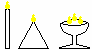

# Огневица: свеча, лучина, лампада

**Огневица** – это один из сопутствующих богослужениям предметов. Огневицы бывают нескольких видов:

• **Свеча** - это восковая палочка с фитильком.  
• **Пирамида** - это свеча пирамидальной формы, основание может быть любым: квадратным, круглым… Эта огневица горит очень долго.  
• **Лучина** - это высушенная щепа, пропитанная в различных маслах, чтобы долго горела. Лучины использовали из разных деревьев и разные масла, то есть они давали не только свет, но и источали благовоние.  
• **Лампады, лампы, светильники** (а также светильники: трёхлучник и солярник = 4 луча) - в чашу наливается лампадное масло с добавлением благовоний и сверху ставятся фитили, то есть в одной лампадке зажигают три или четыре фитиля, это зависит от службы, допустим, на Триглав зажигают трёхлучник.

## Как правильно зажечь огневицу

> «От Живого Огня к Живому Огню. Во славу Богов и Предков наших».

Самое важное, многие забывают, когда вы зажигаете огневицу, допустим, свечу зажигаете от свечи, вы всегда должны произносить фразу: «От Живого Огня к Живому Огню. Во славу Богов и Предков наших».
