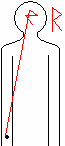
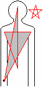

# Перуница (молния) - Святое знамение

**Перуница** (молния) – это Святое знамение, которым славяне осеняют себя во время богослужений, Правьславлений, обрядов, ритуалов, при вхождении в Капища и Святилища.

При совершении Святого знамения три перста правой руки (большой, безымянный, малый) концами соединяются вместе в честь Великого Триглава Мира Яви – Сварога, Перуна, Свентовита, которые есть суть – Совесть, Свобода (Воля), Свет; а два перста (указательный и средний) соединяются прямыми вместе, и означают Род Небесный и Ладу-Богородицу. Сложенные таким образом два перста налагают сначала на чело, после на очи (на левое, потом на правое), и затем на уста. Т.е. получается как бы молния, она освещает.

**Святое знамение активизирует центры**. Т.е. если у христиан так называемое крестное знамение, они наносят на себя крест – закрываются от окружающего мира. То славяне наоборот активизируют энергетические центры, чтобы соединиться с окружающим миром, не только Явным, но и всеми остальными. Т.е. когда вы обращаетесь к Предкам, надо активизировать центры, чтобы то, что идёт из вашего сердца, из ваших уст, дошло до Богов и Предков.

Если посмотреть всю траекторию, рисунок Святого знамения, то получается буква «R» - это Руна Расы, т.е. объединение всех белых: на Земле, в Небесах, во Вселенной. Т.е. этим знамением мы как бы соединяемся со всеми белыми народами.

## «Крестное знамение»

Христиане только говорят, что крестятся, на самом деле получается Маген Шломо (**Звезда Соломона**), т.е. пятиконечная звезда, не путайте с Маген Давид – шестиконечной звездой. На Западе крестятся слева направо, но разницы нет, у них получается старый масонский знак Архитектора.

Чтобы убедиться, кому служат христиане, сходите в христианскую церковь, послушайте, кому они поют славу: во славу Израиля, во славу бога Израиля, бога Авраама, Исаака и т.п.
