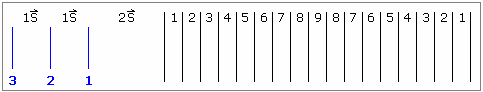

# Славянские «Игры Богов»

**Игра развивает ловкость, глазомер и сообразительность**. В упрощённом виде игра сохранилась у ирландцев и шотландцев, но они бросали три разных камня, а потом даже без линовки, просто – кто дальше бросит, т.е. чем больше камень и кто его дальше бросит, тот более ловкий и сильный. У нас «Игры Богов» сохранились в изначальном виде.

## Игровое поле

Площадка делится на 3 межи (слева), расстояние между ними 1 сажень (213 см) – от этих трёх линий игроки по очереди бросают камни. Дальше, отступив 2 сажени, идут разграничения, расстояние между которыми 1 мера (106 см), но если площадка малая, тогда делают в 1 аршин. Должно получится поле, где сначала числа увеличиваются от 1 до 9, затем идёт обратный счёт: 8, 7, 6…1.

\* Линии либо рисовали на песке, либо втыкали колышки и натягивали верёвочки. А после игрищ, верёвочки смотали и Природа чиста. Были и постоянные места для «Игр Богов», где земля утоптана, там делали небольшие канавочки и известняком их засыпали. Допустим, такое делалось в Урочищах рядом с Погостом, где проводили Тризну.

## Правила игры

Участники «Игр Богов» делают по три броска от каждой межи. Сначала от первой межи три броска, затем от второй, т.е. расстояние увеличивается на 1 сажень, и от третьей межи три броска. Побеждает тот, кто наберёт больше очков, т.е. смотрели, кто в каждой из трёх попыток больше всего попадёт в девятку.

Как правило, дети, которым исполнилось 12 лет, т.е. 108 месяцев жизни прожили, начинали играть в Игры Богов наравне со взрослыми.

**Инвентарь**. Для игры нужны три камня или шары (каменные, деревянные, костяные), иногда брали небольшой шар, но железный. Очень удобен шар для боулинга. Можно вырезать шары из дерева, они могут быть одинаковые, либо разного диаметра, допустим: пядь, пядь с вершком, пядь с двумя вершками. Можно играть одним шаром, но лучше три, чтобы игрок бросил все три камня, а потом считать очки.

## Подсчёт очков

\* Допустим, игрок попал в линии 4, 6, 7 – эти три числа суммируются, получается 17. Затем к этому числу прибавляется сумма, как по правилам х’Арийской арифметики, т.е. складываем до одного числа (1+7 = 8). А результатом будет сумма двух чисел: 17+8 = 25. Значит, человек набрал 25 очков.

\* Максимальное количество очков в одной попытке – 36, т.е. игрок выбил три девятки (тридевять = 27), плюс их сумма = 9, результат 36 очков.

\* Общий результат складывается из трёх попыток, т.е. от первой, второй и третьей межи. Допустим, все девять шаров попали в девятку: 3х36 = 108 – это максимальное количество очков, которое можно набрать в игре.

\* Если шар попал в черту, допустим, между 4 и 5, то считается в пользу меньшего числа, т.е. будет 4.

\* Иногда выгоднее выбить меньшее число, допустим: 5, 6, 8 – это 19+2 = 21, т.е. здесь добавили всего 2 очка. Значит третьим шаром надо было выбить не 8, а 7, тогда добавленное число было бы 9, и сумма на 6 очков больше (5, 6, 7 = 18+9 = 27).
