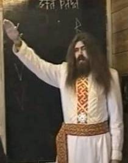

# Знамение Славы

**Для сотворения Знамения Славы** правая рука ладонью полагается на сердце, и затем поднимаем её вперёд и вверх по направлению к Небесам. Т.е. если смотреть сбоку, то рука как бы чертит букву Ижица (похожа на латинскую «V», но левый «луч» короче правого, т.е. рука на сердце, и после к Небесам). Поэтому в текстах, где следует сотворить Знамение Славы, ставят букву «V».

Сотворяют Знамение Славы во время прославления Богов и Предков наших в Капищах, Святилищах, в Куммирнях возле Куммиров, возле жертвенников в Городищах во время празднования Светлых дней в Священных Рощах и Дубравах, на берегах Священных рек и водоёмов.

При использовании Знамения Славы, есть расхождения в ответной форме:  
- Когда идёт обращение, Правьславление Богов: «Слава Бозем Наша», т.е. «Слава Богам нашим», или слава какому-то Богу, то в ответ говорят: «**Вечная Слава**» (и делают Знамение Славы).  
- Когда мы славим Предков, т.е. дедов, пращуров: «Слава Великим Предкам Наша», то в ответ говорят: «**Во веки веков**».  
- Когда мы их объединяем: «Слава Богам и Предкам Наша», здесь ответная форма будет: «**От Круга до Круга**» (имеется в виду Сварожий Круг – им заведуют Боги, и Круг Жизни – им заведуют наши Предки). Т.е. как бы соединяем Земной и Небесный Круг воедино.  
*\* Символы, используемые в Правьславлении (Храмослужение, Курс 1, Урок 2).*
