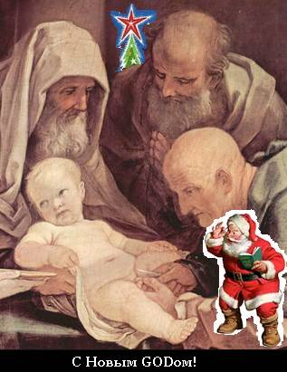

# 1 января – Обрезание Господне

Что празднуют 1 января? В декабре месяце Лета 7208 Пётр I издал указ: 1 генваря поздравлять друг друга с «Новым годом» (хотя на Руси всегда встречали Новолетие).

**Почему «Новый год» перенесли на январь?** Потому что при дворе все были христиане. Староверов притесняли, и даже старообрядцев, навязывалось новое христианство, вводили всё западное. А в христианстве рождество Христово 25 декабря, и как сказано в Библии: младенец **Иисус был обрезан на восьмой день** по иудейскому обряду. Т.е. с 25-го числа восьмой день это 1 января. И заметьте, при дворе никто не говорил «царь Пётр», все говорили «гер Питер» по-голландски, немецки, а «god» означало «бог». То есть, 1 января поздравляли «С новым обрезанным богом!». И до сих пор поздравляют.

Поэтому наши Предки и не пользовались данной календарной системой. Зачем вести своё летоисчисление от чьего-то обрезания? Это же абсурд. При этом говорят – от рождества. Но если бы ввели от рождества Христова, тогда отмечали бы Новолетие 25 декабря, но никак не 1 января.
