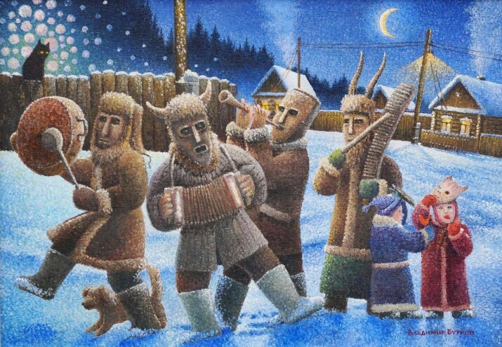
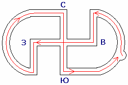

# Праздник Коляда – Менари / День Перемен

**Коляда** (**Менари**, **День Перемен**) – древнейший славянский праздник, который связан с переменами в жизни Свята Расы. В этот день славяне празднуют освобождение Предков из Пекла, а также перемены в Природе - Солнце изменяет продолжительность ночи и дня. Поэтому праздник называется *День Перемен* или как бы раньше сказали *Менари* (*отсюда и слово «мена»*). Поскольку управляет Великими Переменами в жизни Расы Бог Коляда, то праздник ещё называют *Коляда*. Праздник отмечают в **день зимнего Солнцестояния** (13 Бейлетъ по славянскому календарю).

Колядки / Праздник Коляда у древних славян - худ. Владимир Бутков

## Суть праздника Коляда – День Перемен

Праздник Коляда или Менари празднуется с глубокой древности. В основе праздника лежат основания добровольных поселений в Даарии. Но позднее праздник получил новую окраску: Бог Перун освободил наших Предков из Пекла (это событие произошло 40 000 лет назад). Кроме того, праздник Коляда приходится на день зимнего Солнцестояния, когда самая длинная ночь и самый короткий день, затем начинается постепенное удлинение дня и сокращение ночи.

Сегодня праздник Коляда связан с двумя событиями:  
**1. Бог Перун освободил из Пекла наших Предков**  
**2. Солнце изменяет продолжительность ночи и дня**

Поэтому во время колядования по домам ходят мужчины в шкурах животных, которые символизируют нежить из Мира Пекла. А другая группа колядовщиков ходит в праздничной одежде и несёт символ Солнца.

## Великие Перемены в жизни Свята Расы

В **день зимнего солнцестояния** самая длинная ночь и самый короткий день. Но это событие у нас второе, потому что произошло 13 тысяч лет назад (Великое похолодание), когда наклонилась ось Земли, и получилась длинная ночь и короткий день. Т.е. с тех пор, как не стало Луны Фатты.

А событие, когда **Перун освободил наших Пращуров из Пекла** происходило раньше. Во времена второго пришествия Перуна на Мидгард, он прошёл сквозь Врата Междумирья в Пекло и освободил оттуда людей Великой Расы и существ различных миров (не только гуманоидные, но и другие мыслящие формы жизни), коих туда завлекли силой или обманом.  
*\* **Пекло - это Мир Тьмы**. Сейчас бы сказали – Рай, но христианский Рай и славянское Пекло, это одно и тоже место.*

Но когда люди выходили из Врат Междумирья на Мидгарде, а с ними также выходили освобождённые существа других Миров, то под видом чужеземельных существ **на Мидгард проникли коренные жители Пекла** – нежить и всяческие бесы.

После освобождения последнего узника, Перун завалил Врата Междумирья ведущие в Пекло Кавказскими горами. Затем в течение девяти дней Перун уничтожал всю нечесть, проникшую на Мидгард.

## Путь Перуна

Путь Перуна

В поисках нежити и всяческих бесов Перун шёл по определённым путям, впоследствии люди просчитали этот путь и нарисовали его как символ, а также выкладывали его около Капищ, Городищ... и в Зимний День Перуна ходили по нему босиком 9 кругов, повторяя путь Перуна.

Бог Перун шёл с востока на запад, т.е. по движению Солнца, потом повернул на север, освобождая северные земли, затем прошёлся на юг, и опять на восток. Так прошёл 9 кругов.

«**И победиша злые силы вонзил в землю сияющий меч Бог Перун**», и с той поры в этот День зажигают меч, как символ победы над злыми силами, т.е. 33-го Бейлетъ в зимний день Перуна. Есть ещё летний день Перуна 33-го Хейлетъ – это его другое пришествие.

*\* Многие спрашивают: «почему меч горит и на День Перуна, и на Купалу, Числобога…?». А здесь везде **сияющий меч** – это символ победы Света над Тьмой.*

## Праздничный цикл

Праздник Коляда (Менари - День Перемен) начинает праздничный цикл, в который входят следующие даты (славянские праздники):

- 13 Бейлетъ – **День Перемен. Коляда** (встреча Предков и откуп от нежети)
- 22 Бейлетъ – **День Великого Покоя** (в этот день Бог Перун завалил Врата Междумирья, ведущие в Пекло, Кавказскими горами, и на Землю перестала поступать негативная энергия)
- 23 Бейлетъ – **Неделя Памяти Праотцев** (вернулись из Пекла не все, многие погибли, поэтому в память о погибших была отведена целая Неделя. То есть через некоторое время после Коляды наступает *Неделя Памяти Предков*, 9 дней поминают всех своих Пращуров, Предков. 29 Бейлетъ ещё праздник Родогощь)
- 33 Бейлетъ – **День Бога Перуна**

## Колядки и встреча Предков

**Колядки повторяют сюжет прошлого**, когда по домам ходила нечесть, чтобы забрать Предков в Пекло, а люди им дают булочки, ватрушки, сладости, и те уходят, потому что не выносят эмоции радости.

Потом этот праздник переняли христиане, но традиция осталась – на столы также ставят дополнительные тарелки для Предков, а по домам ходят ряженые в масках, с рогами, т.е. изображают бесов и прочую нежить из Пекла, чтобы не забывали те события. Хозяева встречают ряженых радостные и обязательно угощают булочками, сладостями, т.е. радостными эмоциями, добром их как бы отпугивают.

## Зимний День Перуна

Пока люди праздновали в честь встречи живых и справляли Тризну по убитым и пропавшим, и вообще по всем своим Предкам (Неделя Памяти Праотцев), Бог Перун в это время ходил и всю нечистую силу уничтожал.

Перун прошёл один круг, и нежить считала, что если уже прошёл этим путём, то больше им не пойдёт. А он девять раз прошёл этим путём. Поэтому по окончании Дней Памяти Предков наступает другой праздник - **Зимний День Перуна**, т.е. когда он полностью всю нечисть уничтожил, завалил вход во Врата горами Кавказскими, и победив злую силу, вонзил в землю сияющий меч.

Таким образом, **праздник Коляда** (**День Перемен**) – это перемены не только в Природе: меняется период дня и ночи, зима идёт на уменьшение, солнца больше, а значит тепла больше, но и перемены в жизни народа. Сначала наши Предки прибыли на Мидгард (поселения в Даарии), как бы жизнь изменилась, другие условия; затем возвращение из Пекла, т.е. Предки вернулись – перемены. Поэтому и назвали праздник *День Перемен* или др.-слав. **Мѣнари**.

\* Правьславление Коляды или Колядки
