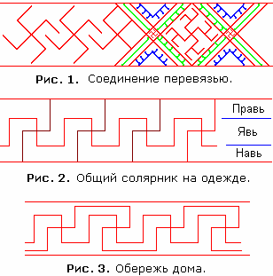
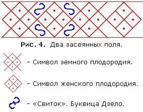
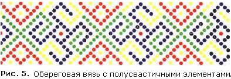
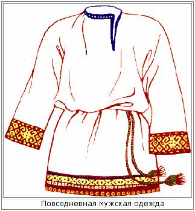
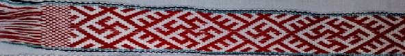
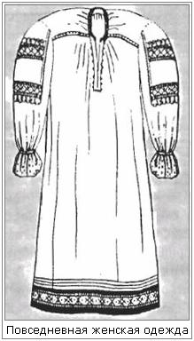

# Рубаха славянская (покрой и вышивка)

Раньше у каждого Рода была своя символика (символы Родов), эта символика шла в Обереговой вязи на одежде и домашней утвари, а также использовались обереговые символы, притягивающие дополнительные Стихии, т.е. к своим Родовым Богам добавляли ещё и символы вспомогательных Богов, чтобы они помогали.

1. Обереговая вязь  
2. Покрой славянской рубахи  
3. Пояс  
4. Покрой женской одежды

## Обереговая вязь

На рубахе Обереговая вязь шла по низу подола, низу рукавов, на груди и вороте, т.е. физическое тело и внутренние энергии полностью защищены символами Рода - все деды, бабки, прадеды, в общем весь Род до изначалья, вся сила идёт в Обережь. При этом **орнамент одинаковый по всей рубахе**, допустим: Коловрат и Цветок папоротника – эта обереговая вязь будет и на рукавах, и на груди, и на поясе. Мужчины здоровались оберучи - за предплечье, т.е. сравнивали обереговую вязь на рукавах, по которой сразу видно из какого Рода-Племени человек и к какой касте профессиональной принадлежит.

**Рис. 1. Соединение перевязью.** Здесь ещё добавляются природные силы (зелёный цвет). Если надо показать что природные силы у человека находятся в активном состоянии, добавляются штрихи, т.е. показывают как бы лучи, излучение. Вставки в верхней и нижней части (синим цветом) указывают, что человеку помогают все Боги его Рода (верх) и все Предки (низ), и их помощь определяется солярником, т.е. какой солярник между вставками, такую помощь и надо человеку.

**Рис. 2. Общий солярник.** Люди, которые были лишены возможности иметь знания о своих Предках, т.е. хотят вернуться, но не знают какие Боги, какие Силы им помогают, они делают общий Солярник – соединение Прави, Нави, Яви, и это всё освещено солярной символикой. Некоторые ещё украшают, делают какие-либо дополнения. На данном рисунке показан пример самого простого Общего солярника, как бы волна (красным) и ступеньки (бордовым), на одежде изображаются конечно одним цветом. Мысленно проведите горизонтальные линии - Правь (верхняя часть), Навь (нижняя), Явь (средняя).

**Рис. 3. Обережь дома.** Если надо сделать Обережь дома, т.е. для защиты дома, общий солярник делается немного по-другому. Примерно такой же солярник до сих пор существует на здании Центральной городской библиотеки им. А.И. Герцена в г. Екатеринбурге, а также в Эрмитаже.

 **Рис. 4. Обереговая вязь засеянным полем.**  
Здесь чередуются два символа плодородия (земного и женского). Как правило, символы плодородия в обереговую вязь вставляли женщины, или мужья своим жёнам в подарок делали берегини или заказывали клипсы и пр. с такой символикой. Символы плодородия были только в женском орнаменте, на мужских вышивках таких символов не было.  
Между символами плодородия обозначали «*свиток*» (изображаются зеркально) – это буквица Дзело (S), она означает «весьма», «много», т.е. как бы активизирует, усиливает. Иногда Дзело изображали с чёрточкой посередине.

  
**Рис. 5. Полусвастичные знаки.** В женской символистике также добавляются так называемые полусвастичные элементы, допустим: Славец, Огневица, Радинец, Всеславец и т.д. (их значение и начертание см. Солярные символы). В данном объединённом орнаменте имеется несколько символов:  
\* Природный Славец (зелёный цвет) дарует здоровье;  
\* Небесный Благовест (синий цвет) дарует защиту Родовых Богов;  
\* Звёзды (златый цвет) даруют благую судьбу;  
\* Часть знака Духовной силы (красный цвет) даёт трудолюбие.  
Сия вязь вышивается в основном на женских рубахах, ею украшают воротник и рукава. Вышивается точками, либо крестиком (х), либо болгарским крестом (\*).

## Покрой славянской рубахи

**Мужская повседневная рубаха** всегда была с косоворотом (с левой стороны), т.е. сердце нараспашку. Когда открываешь, считается что человек не только ворот, но и сердце открывает. Глубина разреза рубахи 1,5 пяди. Длина рубахи была до колен или чуть выше и подпоясывалась поясом. Для тех, кто занимался конями, с боков делали разрезы расшитые, чтобы на коня удобнее садиться, не подтягивать рубаку. На праздничной рубахе грудь украшали обереговой вязью.

**Мужская воинская рубаха** была чуть длиннее повседневной, и разрез ворота был по середине, глубиной до солнечного сплетения. Рубаху изготавливали из плотной ткани, ибо одевали под кольчугу, и кроме символов Рода вышивалась ещё особая воинская обереговая символика.

**Мужская ритуальная рубаха** была до пят, прикрывала ноги, а грудь расшивалась богатым орнаментом. У жрецов орнамент идёт до пояса (до поясной чакры).

## Пояс

  
**Пояс** – это неизменное дополнение к мужской рубахе.  
\* Повседневную рубаху подпоясывали тонким полвершковым поясом (**2,2 см**) с Обереговой вязью, или подпоясывали вервью, сплетённой из разноцветной тесьмы.  
\* Праздничную рубаху подпоясывали вершковым поясом (**4,4 см**) с Обереговой символикой.  
\* Ритуальную рубаху подпоясывали широким поясом в полвтора (**6,5 см**) или два вершка (9 см).  
\* Воинскую рубаху подпоясывали различными поясами, но только если носили в повседневном обиходе. Когда одевали доспехи, пояс не использовали.  
\* Детские рубахи до совершеннолетия (т.е. до 12 лет) носили без поясов.

**Носить рубаху без пояса считалось неприлично**, про таких говорили: «распоясанный» или «расхлёстанный», т.е. отказавшийся от Родового оберега. Даже когда воины шли биться на смерть, они снимали рубахи, а пояс оставляли. Но если в битве снял рубаху, значит всё - бьётся на смерть, подсознательно на это настраивается, и уже не думает что с ним будет, одна цель – уничтожить врага.

## Женская одежда

**Женская повседневная одежда** отличалась покроем и символикой, по которым можно было узнать замужем они или нет, и какие Боги-Покровители оберегают Род в котором она живёт.  
\* Рукава у замужней женщины внутри подвязаны тесьмой, т.е. низ рукава расширяется, а у девицы – как манжета.  
\* Ворот женской рубахи застёгивается на пуговицу или пряжку, а у девицы завязывается вовнутрь плетёной верёвочкой.  
\* Разрез на рубахе у девицы от горла на 1 пядь (17 см), а у замужней на 2 пяди (35 см), так удобнее кормить ребёнка.

**Праздничная женская одежда** была более богато украшена обереговой символикой, знаками женского и земного плодородия, орнаментами из которых можно узнать о Роде супруга и в каком Роду она воспитывалась, какие Боги ей покровительствуют. На праздничном платье незамужней девушки вышивка была в основном на рукавах и подоле, а у женщины вышивка охватывала подол, грудь, рукава, ворот.

Веды: Символика в быту (одежда, обереги, волосы)
