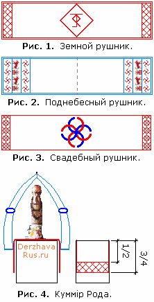

# Рушник

**Рушник** – это предмет народной культуры славян, используется в разнообразных обрядах: на похоронах, свадьбе, родинах. Изготавливается из льняного полотна, с нанесением определённой вышивки.

1. Земной рушник  
2. Поднебесный рушник  
3. Свадебный рушник

## Земной рушник

Земной рушник расположен в Красном углу на подставке (образно: Алатырь-камне), Куммир должен стоять на покрове. Рушник закрывает подставку на 3/4, а вышивка идёт снизу до середины (см. рис. 4 – вид справа).  
\* **В центре земного рушника** в ромбе или круге вышивается Руна Рода - если стоит Куммир Рода, т.е. вышивается руна того Бога, который стоит у вас в Красном углу. Куммир ставится на центральную руну и закрывает её, эта Руна изображена (проявлена) на самом Куммире. Если в Красном углу несколько Куммиров, то ромбы вышиваются в ряд с соответствующими рунами под каждого Куммира, но Род всегда посередине. Если перед Куммирами стоят требные чаши, то ромбы вышиваются в два ряда – дальний ряд с рунами, на них ставят Куммиров, а ближний ряд с огневицами.  
\* **Вышивка по торцам** рушника зависит от того, какие Куммиры на нём стоят, и в этот орнамент вставляют, вплетают Руны Богов, установленных на этом рушнике.  
\* **По краю земного рушника** идёт небольшая вязь примерно в нокоть (1 см), как правило, красной нитью. Она может идти сплошняком, допустим крестиками.

## Поднебесный рушник

Поднебесный рушник закрывает Куммир сверху. Рушник закрепляют на гвоздике, а по бокам на уровне рук Куммира или чуть ниже делают обвязки и вставляют в них концы рушника, так чтобы рушник свисал до первой четверти подставки (Алатыря). На ночь рушник достают из обвязок и как шторками закрывают Куммир, т.е. люди идут на покой, и Богам отдых нужен.  
\* Этот славянский обряд переняли христиане - в левом углу делали полочку, ставили на неё иконы, с боков прикрывали рушником, и на ночь закрывали.  
\* **В центре поднебесного рушника** нет вышивки, там только пускают нить «волной», чтобы рушник можно было стянуть и повестить за нить на гвоздик над Куммиром.  
\* **Вышивка по торцам** рушника идёт в следующем порядке: орнамент, символьное поле, и опять орнамент. Тоже самое с другой стороны. Орнамент мог быть различный, но как правило зеркальный, допустим: в первом поле Цветок Папоротника, а в третьем Одолень Трава (см. Солярные символы). На символьном поле изображают: грифонов (полуптиц); если стоит Куммир Лады или Рожаны, то изображают коней, оленей, лосей; у Даждьбога допустим леопарды; у Перуна – соколы, орлы… т.е. как образы.  
\* **По краю поднебесный рушник** обшивается синим или небесным цветом.  
Поднебесный – потому что есть Небеса, а он ниже и прикрывает Куммира.

## Свадебный рушник

Свадебный рушник – элемент традиционной славянской свадьбы. Он хранится и передаётся через поколения. Т.е. делается много рушников, но когда женят первородного сына, то на свадьбе передают рушник, который использовал его отец, так как мощь Рода передаётся через первородного сына. Если женили второго, третьего и следующих сыновей, то делали уже новые рушники. Когда рушник становится ветхим – вышивается новый такой же, а сверху накладывают старый рушник и подносят молодым, потом уже передаётся новый рушник, а старый просто хранится.  
\* **В центре свадебного рушника** вышивается Свадебник, размером примерно с каравай, на него ставят хлеб и соль. Хлеб символизирует землю, плоды человеческого труда на ней, а соль – Природу и Солнце. Молодожёны обязательно пробуют хлеб, т.е. показывают, что с этой поры едят одну пищу, а совсем не то, как сейчас это преподносят – кто хозяином будет. У славян совершенно другой смысл, более глубинный, более значимый, т.е. они обживают, облагораживают одну землю, совместно трудятся на благо одного Рода.  
\* **Вышивка по торцам** рушника символизировала достаток, любовь, радость, счастье, полноценное потомство. Пример: Ладинец, Звезда Лады-Богородицы, женское плодородие, олени, лоси и т.п. Иногда символикой вышит весь рушник до центрального поля, не касаясь Свадебника в круге.
