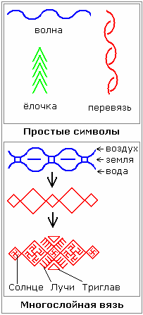

# Вязание (основные символы)

Раньше вязкой занимались в основном мужчины. Потом уже мужчина сделал прялку, веретено для женщины, обучил её. И вязали не просто однотонную белую или серую одежду, а вязали с орнаментами и разноцветными нитками, либо в самой вязке орнамент шёл. Основными символами были:  
\* **волна** - символ воды;  
\* **ёлочка** – символ леса;  
\* **перевязь** (вьюны) – символ объединения нескольких потоков силы, допустим: человеческой силы и силы Бога.

Это самые простые, были и другие орнаменты, допустим **многослойная вязь** – соединение в единую силу: воды, воздуха и земли. А когда такую вязь вышивали разноцветной, она обретала другую структуру, как бы более жёсткую – **ромбики**. Иногда эти ромбики соединялись в другую вязь, допустим: нужно соединить структуру с природными элементами, а самый хороший элемент – это Ярило-Солнце, поэтому вставляли в ромб **солярник**, и показывали штрихами лучи, что Солнце освещает структуры изнутри и во вне. Изнутри и снаружи вставлялся Триглав (треугольники), как бы плодородие. А в большом ромбе мог изображаться символ преображения, допустим Цветок Папоротника или Одолень Трава (см. Обереги).

## Видеоурок - Вязание

*\* Культура и Традиция: курс 1, урок 5.*

**Вопросы:**  
1. Можно ли сделать узор по всей спине?  
Вышивка не могла идти по всей спине, потому что тогда она перебивает все потоки, которые получает позвоночник. Вышивкой могли скрыть шов, допустим, на рукаве у плеча.

2. Можно ли пришить к рубахе готовый узор для красоты?  
А зачем, во всём должен быть смысл. Если просто, чтобы было красиво, и при этом нарушить структуру, тогда зачем шить славянскую рубаху?

\* Значение цветов
