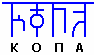

# КОПА

**КОПА – это Общинный Круг**. Если читать по Рунам: Руна Ка - это союз, объединение; Руна Отцов; Руна Путей; Руна Азъ (т.е. Боги), получается образ (справа налево): «Божьи Пути Отцы собрали воедино», т.е. это система объединения. От корня «КОП» происходят многие слова, допустим: копить, копна, [всем] скопом, т. е. всем вместе что-то сделать.

**КОПА – это извечный Родовой Устой**, накопивший за многие поколения принципы Славяно-Арийской морали в своеобразную Культуру и неповторимую Традицию.  
**КОПА – это общинный свод правил**, укрепляющий взаимоотношения между Родами, и система принятия жизненно важных решений. В своей основе Копа несёт Родовые традиции, правила, объединяющие различные Рода, а также она несёт определённую систему разрешения возникающих конфликтных ситуаций и проблем (вопросы войны и мира, строительства, обустройства территории, защиты границ и т.д.).

**КОПА бывает Большая и Малая:**  
\* Малая Копа состоит из Глав Родов (Старцев), Жрецов (Старейшин Общин) и Воевод.  
\* Большая Копа объединяла всех общинников, признанных продолжателями Родов, т.е. тех, кто создал семью. За остальных на Копе слово говорят их родители.

## Правило Копы

**Основное правило Копы – никто не может быть лишён слова**. Т.е. высказывались все присутствующие на Копе, но первым всегда говорит самый старый человек данной Общины (называли его по-разному: Ведун, Ведич, Многолетище). Т.е. первым говорит не Жрец, а самый старый человек. И всё, что говорилось на Копе, записывал карунг (как бы летописец), он записывал Рунами образ того, что сказал тот или иной человек по данному вопросу.

**Слово даётся в определённом порядке**. Т.е. вопросы известны заранее, люди их дома могут обсудить, а затем на Копе высказываются по очереди:  
\* Сначала по первому вопросу высказывается самый старый человек Общины.  
\* Затем по старшинству Старцы.  
\* Потом Главы Родов и их супруги, если ей есть что дополнить или её мнение по данному вопросу отличалось от мнения мужа.  
\* Когда глава Рода и супруга высказались, даётся слово их детям, которые уже создали свои семьи, они также высказываются по старшинству, и сначала говорит глава, затем его супруга, если её мнение отличается.

После того, как все высказались по первому вопросу, Жрец подводит это всё как бы к единому знаменателю, т.е. он услышал мнение всех и подводил итог по данному вопросу. Если все согласны со Жрецом – вопрос считается решённым, и переходят к следующему вопросу. Если хотя бы 1 человек не согласен, начиналось совместное обсуждение, т.е. тот, кто не согласен с данным решением, он говорил, по какой именно причине не согласен, и затем каждый мог высказаться по поводу того, что этот человек недопонял, объяснить ему - не заставить, а убедить, доказать, чтобы он понял, что это необходимо для всех.

## Нарушение Устоев Копы

**Всяк не принявший решение Общины на Копе - уходит из Общины** и переселяется на вольные места, где он сам или со своим Родом будет жить. При этом у него никто ничего не отбирает, и он всегда может вернуться. Т.е. он может 5-10 лет прожить един, но если до него дойдёт, что Община была права, он может вернуться.

**Если кто-то нарушил Устои Копы – уходит из Общины**. Т.е. за неоднократное нарушение Общинных правил или серьёзное преступление, допустим, в ссоре, драке убил человека, то его отсылали жить отдельно. У славян не было кровной мести, как у кавказцев, преступника просто изгоняли, т.е. живи среди зверей, раз с людьми жить не можешь, поживи несколько лет един и подумай над тем, что ты совершил.

\* За неосторожное убийство – от 1,5 до 3 лет.  
\* Если намеренно убил, допустим: не поделили что-то, он пошёл, поджёг дом и погибли люди – от 3 до 5 лет изгнания.  
\* Смертной казни не было, потому что знали о реинкарнации и пр., т.е. убить преступника - значит, как бы лишить его возможности осмыслить то, что он сделал. Поэтому, допустим, в Асгарде Ирийском недалеко посреди Иртыша был остров, и если кто-то нарушил Общинные правила, он мог сам уйти из Общины или его отправляли на остров, там был дом и приусадебный участок.

Такими были старые правила и они работали, потому что воспитывали раньше в совершенно другой системе, там пойти против своих – никто даже подумать такого не мог. Это сейчас дети на улице могут подраться, а раньше такого не было, воспитание было другое, уважительное, игры были совершенно другие, там с детских лет играли – защитить свой дом, родителей, Общину и пр.

Продолжение: Родовой Устой
