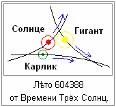

# Летоисчисление славян

**Летоисчисление** – это система определения времени по Летам (годам), посредством счёта от какого-либо условленного момента, допустим: у христиан от рождества Христова, а у славян от Сотворения Мира в Звёздном Храме - это пока последнее летоисчисление, но есть и более древние.

**Примеры славянских летосчислений** (на 2014 год от Р.Х.).  
Лето 7522 от Сотворения Мира в Звёздном Храме (5508 до Р.Х.)  
Лето 13022 от Великой Стужи (Великого Похолодания).  
Лето 40018 от Третьего Прибытия Вайтманы Перуна.  
Лето 44558 от Сотворения Великого Коло Рассении.  
Лето 106792 от Основания Асгарда Ирийского (от 9 Тайлетъ).  
Лето 111820 от Великого Переселения из Даарии.  
Лето 143004 от Периода Трёх Лун.  
Лето 153380 от Асса Деи.  
Лето 165044 от Времени Тары.  
Лето 185780 от Времени Туле.  
Лето 211700 от Времени Свага.  
Лето 273908 от Времени х’Арра.  
Лето 460532 от Времени Дары.  
Лето 604388 от Времени Трёх Солнц.

Это лишь основные большие события, от которых велось летоисчисление. Первая Вайтмара Великой Расы прибыла на Мидгард-Землю **больше миллиарда лет назад**. Но климат Мидгарда не всегда был благоприятен для белых поселенцев, т.е. воздух был более плотный, климат более влажный, жаркий. Поэтому сначала наши Предки заселили спутники Земли Ния, Стрибога, Перуна, потом была заселена и обжита Земля Деи, затем Орея, потом Мидгард.

## Сотворение Мира в Звёздном Храме (Лето 7522)

Сотворением Мира в древние времена называли заключение мирного договора между воюющими народами, а **Звёздный Храм** – это название годины по Круголету Числобога. Данное летосчисление появилось после победы Великой Расы над Великим Драконом (Древний Китай) 7522 Лета назад. Эту победу наши Предки отобразили в виде образа – **Витязь на коне поражает копьём Дракона**. Но после насильственного крещения Руси, христиане приписали все достижения наших Предков себе, и данный образ начали трактовать, как христианский святой великомученик Георгий Победоносец побеждает змия, который опустошал земли языческого царя. «Сотворение Мира» стали воспринимать буквально, как будто 7 тысяч лет назад Бог сотворил Мир. Затем вообще заменили летоисчисление на годоисчисление от Рождества Христова, уничтожили упоминания о реальной истории славян и внедрили библейскую исТОРЫю.

Победа над Великим Драконом была столь тяжёлой и значимой, что наши Предки начали новый отсчёт Лет от этого события. Чтобы связь времён сохранилась, мирный договор заключили в День Осеннего Равноденствия (Новолетие), т.е. 1-й день Лета 5500 от Великой Стужи одновременно стал и 1-ым днём 1-го Лета от СМЗХ. В память о тех событиях нашими Предками была написана Азъ-Веста, т.е. «Первая Весть» или как её называют «Авеста» на 12000 воловьих шкур. Этот памятник был уничтожен по приказу Александра Македонского, а позднее миру стала известна искажённая «Зенд-Авеста» Заратустры с его комментариями и исправлениями.

## Великая Стужа (Лето 13022)

Это летосчисление связано с падением на Мидгард-Землю осколков **Луны Фатты**. В результате чего изменился наклон земной оси, раскололись материки, гигантская волна трижды обошла землю, возросшая вулканическая активность привела к загрязнению атмосферы, что явилось одной из причин Великого Похолодания, которое продолжалось несколько столетий. Отсюда кстати и слово «фатальность» (от названия Луны Фатты).

## Третье Прибытие Вайтманы Перуна (Лето 40018)

Вайтмана Перуна прибыла на Мидгард с Урай-Земли из Чертога Орла. В Асгарде Ирийском в течение 9 дней Жрецы и Вои Свята Расы общались с Перуном, он поведал им Мудрость из Мира Прави, которую волхвы записали в Сантиях Перуна.

Подтверждение прибытия одного из Вышних Славяно-Арийских Богов можно найти в фильмах «Тайны Богов», «Колесницы Богов» снятых по книгам и изысканиям Эриха Деникина, который говорит - люди жили в пещерах, а 40000 лет назад вдруг начали строить такие мегаполисы, такие сооружения, которые современные технологии не в состоянии повторить. Допустим, древний город Баальбек, там колонны на высоте 40 метров с отклонением в микроны, а современные технологии на высоте 20 метров допускают отклонение в несколько сантиметров. Но Эрих высказывая свою точку зрения о прилёте инопланетян, всё пытается привязать к Библии, ссылается на книгу Еноха, на Сынов неба и Стражей неба… но мы то знаем, что 40 тысяч лет назад прибыл Перун, поэтому и прогресс в строительстве.

## Сотворение Великого Коло Рассении (Лето 44558)

Коло – это круг, т.е. речь идёт об **объединении Славяно-Арийских Родов** для совместного проживания. Было несколько этапов заселения Мидгард-Земли. Сначала в Даарии, потом во времена Великой Ассы было переселение с Земли Орея (Марс), поэтому часть славянских племён называли себя «дети Орея», были переселенцы с Ингард-Земли, а это прародина Тарха Даждьбога, поэтому были «внуки Даждьбожьи», кто-то с других Земель. В общем, было несколько заселений и в разных местах селились, но это всё одна РАСА – белые люди, а Рассения – это земля по которой расселилась Раса. Почти 45 тысяч лет назад они прислали представителей – старших Родов, которые сотворили Великий Круг, т.е. взаимообмен и прочее, чтобы жить и созидать вместе.

## Основание Асгарда Ирийского (Лето 106792)

Это летосчисление начали от основания Асгарда Ирийского, т.е. города Богов на реке Ирий Тишайший (ныне Иртыш). Но он был основан не в осеннее равноденствие, а чуть раньше, в месяц Тайлетъ день 9.

## Великое Переселение из Даарии (Лето 111820)

**Даария** – это континент на Северном полюсе Мидгард-Земли, где много тысячелетий жили наши Предки. Даария затонула в результате разрушения Луны Лели, на которой было 50 морей. Но наши Предки успели переселиться, их предупредил о приближающейся катастрофе жрец по имени Спас, который во время служения увидел в Небесах события, что будет разрушена Луна Леля, её осколки и воды прольются на Мидгард и волна захлестнёт Даарию. Люди перешли по перешейку между восточным и западным морями (ныне Уральские горы) в район острова Буян (Западно-Сисбирская возвышенность).

## Три Луны (Лето 143004)

До этого у Мидгард-Земли было 2 Луны (Леля и Месяц), затем наши Предки перетащили от Земли Деи ещё одну Луну Фатту, и поместили её между орбитами Месяца и Лели, т.е. у Месяца период обращения 29,5 дней, у Лели 7 суток, у Фатты 13 суток.

## Асса Деи (Лето 153380)

Асса – это война между Силами Света и Тьмы, она проходит не только в Мире Яви, но и в многомерных Мирах Слави и Прави, т.е. Асса Деи – это **начало войны за Землю Деи**. Потом наши перетащили Фатту (греч. Фаэтон) к Мидгарду, а там оставался ещё один спутник Лютиция, которую захватили тёмные силы и пытались разрушить Дею. Но как говорят предания, жрецы использовали силу неких кристаллов и Дея перешла в иномирье, т.е. иной Мир, а за ней пространственная структура захлопнулась, и этим оружием Лютицию разорвало на множество частей, получился пояс астероидов.

## Тара (Лето 165044)

Это летосчисление связано с первым посещением Мидгард-Земли Богиней Тарой, она привезла с собой семена Священных Деревьев и помимо той флоры, которая была на Мидгарде, она ещё насадила лесов. Поэтому до сих пор Тару считают покровительницей деревьев, дающих силу.

## Туле (Лето 185780)

Даария была разделена четырьмя реками, и было 4 провинции – Свага, Харра, Рае, Туле, там был и город **Туле – город мастеров**, они снабжали всех необходимыми инструментами, механизмами и пр. Как говорят предания, инструменты делали, которые могли изменять окружающий мир не нанося вреда природе, такие как магические кристаллы и пр. Кстати, поэтому мистический орден в Германии и был назван «Туле», т.е. как бы прообраз того великолепия, которое было в Северной Даарии.

## Свага (Лето 211700)

Свага – это Небесный Путь, т.е. данное летосчисление идёт от времени, когда на Мидгард-Землю прибыли новые переселенцы.

## х’Арра (Лето 273908)

Это ещё одна волна переселения. Прибытие на Мидгард-Землю х’Арийцев из Чертога Финиста Ясного Сокола (Ророга) или созвездие Орион.

## Дары (Лето 460532)

Прибытие Да’Арийцев на Вайтмарах из Звёздной Системы Зимун – Небесной Коровы (Малая Медведица).

## Три Солнца (Лето 604388)

Данное редкое явление зафиксировали наши Предки более 600 тысяч лет назад, когда вследствие вращения вокруг центра нашей галактики произошло сближение нашей Солнечной системы с двумя другими системами, т.е. на небосклоне можно было наблюдать кроме Ярилы-Солнца ещё два Светила серебристого и зелёного цвета.  
См. **рис. 1** - представьте, что орбита нашей системы Ярилы-Солнца пересеклась с орбитами двух Звёздных систем: одна с Белым карликом, вторая с Белым гигантом (находятся они в разных плоскостях). Т.е. системы находятся очень далеко, но по яркости два Светила (карлик и гигант) для жителей Мидгард-Земли будут схожи с Солнцем, поэтому на небосклоне наши Предки и наблюдали как бы три Солнца. Потом Звёздные системы опять удалились друг от друга.

\* 1 января – Обрезание Господне  
\* Зачем Петр I заменил календарь?
