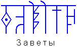

# История и исТОРЫя (Наследие Предков, урок 1)

Предмет называется «Наследие Предков» или «ЗАВЕТЫ», т.е. Земных Богов Мудрость Истинная Утверждена и Сохранена для потомков. Поэтому Мудрость, которая сохранена нашими Предками (Земными Богами) - мы называем Наследие Предков. Предмет образно разделили на две части: **История** и **Древние Веды**. Но и то, и другое входит в понятие ЗАВЕТЫ. Историей будем называть близлежащие события, а то, что уходит в глубь времён – это Древние Веды, древнейшая Мудрость.

## История и исТОРЫя

Кроме того, понятие «История», т.е. близлежащие события, также делится на две части, потому что **есть наша история (реальная), и есть официальная история** государства Российского, написанная Карамзиным, Татищевым и пр., т.е. история, которую изучают в школе - эта история ничего общего с нашей Историей не имеет, потому что в школе преподают историю, которая была придумана начиная с правления дома Романовых, и каждый правитель переписывал историю для себя (чёрное в белое, белое в красное и т.д.), т.е. официальная история не соответствует исторической действительности. И до них ещё христиане писали из Торы (в английском языке даже так и пишут: *HisTory – «это Тора»*). То есть, **современная всемирная история - это всё что связано с Торой** (Пятикнижием Моисеевым), всё сведено под библейские тексты. Но наша Iсторiя не соответствует ей, то, что мы будем изучать, никоим образом не касаемо того, что называется официальной историей. Поэтому научитесь отличать нашу историю (Iсторiя) от того, что изучали в школе (исТОРЫя) - эти два слова у вас даже в написании должны отличаться.

**ICTOPIЯ** – это определённые временные процессы в жизни людей, государств, Держав, в определённые отрезки времени и как они отражены.

**ИСТОРИЯ** - это временной период, когда какой-либо правитель или правящий класс создавал свой собственный взгляд на проходящие процессы в государстве и в жизни людей. Как правило, каждый правитель отрицал все старые события (как тёмные и нехорошие), и всё благостное правление он начинал от себя, допустим: менял свою родословную, приписывал себе великих Предков, и таким образом становился как бы законным наследником.

## Пример: Романовы захватили престол

В исторической официальной науке считается, что правление на Руси шло по естественному пути передачи власти: **Рюриковичи – Годуновы – Романовы**. Но в действительности это не так. Иван Грозный и Годунов – это Рюриковичи, а Романовы – нет. Но чтобы исказить и вывести Годунова как недостойного быть царём, его записали по маме (мама у него была Годунова), а себе приписали родство не только с Нарышкиными, но и с Рюриковичами. И получилось, что Годуновы словно незаконные - их убрали. Наступил хаос, смутное время, безвластие… и Романовы как спасители приняли (будто их упросили) престол. На самом деле **Романовы захватили престол**. Поскольку в Московии официальной религией было христианство, власть захватил не достойнейший, а более хитрый и изворотливый. Захватил Филарет, он же Михаил Фёдорович Романов, т.е. глава христианской церкви, которому не давали покоя лавры Папы Римского. Ведь Папа – не просто глава католической церкви, он называл себя ещё «Царь царей и король королей», т.е. как бы миропомазал каждого короля, барона и пр. и считался над ними главным. Романову тоже хотелось быть таким правителем.

**Как переписывали историю?** Очень просто - летописи изымались из обращения и писались новые. Чтобы народ не мог отвергнуть эту писанину, оставляли 90% правды и добавляли 10% лжи, потом ещё 10% лжи и т.д. А народ, который слушал летописи или имел доступ читать, помнил от родителей что-то об этих событиях, и вроде бы они описаны, но уже под другим углом (появился новый персонаж, или исчез и пр.). Так на протяжении времён летописи искажались, и получилось то, что мы имеем сегодня.

Продолжение: Соборное уложение 1649 года (о христианском «миролюбии»)
