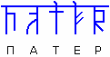

# Патер Дий – это Владыка, верховный жрец

**Дий** (жен. **Диса**) – это как бы верховный жрец, т.е. возглавляет Весь. У славян деление земли идёт по Весям – это духовно-административно-территориальные округа (у христиан это называется *епархия*). Отсюда и выражение «По городам и Весям», т.е. по городам и духовно-административным районам (губерниям). Так вот Веси возглавляют Дии, а если возглавляла женщина, то она называлась Диса (кто изучал скандинавские предания, замечал, что жена Одина имела титул Диса, т.е. была жрицей). Отсюда и жрица леса – Друидиса (друидесса), т.е. та, которая служит лесу.

**Патер** – это верховный хранитель мудрости, или Владыка, но не в современном понимании «владыка», как повелитель и прочее, нет, у славян «владычествует» - значит, владеет знанием. Т.е. не людьми, не вещами, а именно знаниями – Владыка. И само слово ПАТЕР никакого отношения ни к Папе, ни к латинскому священнику патеру не имеет, это древнее слово надо читать в рунической форме: Путь, Азъ (Боги), Твердо, Высшее бытие, Раса – т.е. «Патер» - это обозначение верховного жреца, тот, кто хранит мудрость.

## Как выбирали Патер Диев

**Патер Дием мог стать жрец из любого Рода, в любом возрасте, но не моложе 24 лет**. Хотя в тяжёлые времена, т.е. после набегов, войн, когда погибало много народа, могли быть и 21-летние, но в основном после 24 лет. Потому что в 21 заканчивается обучение воинское и профессиональное, он становится мужчиной, т.е. имеет право создать семью, плюс 3 года специального обучения, и потом уже Круг мог поставить молодого главой Церкви.

Многие удивляются, почему в христианской церкви и других конфессиях переход идёт чуть ли не от самого старого к самому старому, а здесь от старца вся власть переходит к молодому. Связано это с тем, что у славян даётся возможность что-то сделать на благо Родов, Державы, на благо Церкви - молодой больше успеет сделать, у него молодые свежие идеи, он с оптимизмом смотрит на жизнь. А старцы этот Мир уже весь изучили, уже выполнили долг перед Родом, выполнили деяния на Земле, и уже как бы смотрят в будущую жизнь, идущую за Явью, изучают следующий Мир. Т.е. к ним идут за советом, опытом, а избирать верховным жрецом всегда старались молодого.

И ещё отличие – Патер Дии мало чем отличались от простых людей. Допустим, если сравнить с христианами, то у них простой христианин или мирянин к патриарху даже не подойдёт, всё через определённый силовой кабинет института христианства, чтобы добраться до патриарха. А в славянской системе нет чинопочитания, здесь шло уважение, и любой может прийти пообщаться с Патер Дием, за одним столом оттрапезничать, и при этом смотрят, чтобы Совесть была мерилом деяний. Поэтому уважали и чтили Патер Диев за их деяния и за их мудрость.

**Выбирал Патер Дия Круг Ведичей**, т.е. ведающих людей или как сейчас говорят «Совет старейшин». Это мог быть приемник или жрец, избранный на Круге, или капен или волхв. И когда собирался Круг Ведичей, задавался всего один вопрос: «**Цель?**». Т.е. молодой священнослужитель, которого избрали, должен объявить цель, и ему давалось 9 лет на достижение данной цели. Уложился в 9 лет, достиг поставленной цели – он становится полноправным Главой, остаётся дальше до момента отречения или до момента перехода в иной Мир, т.е. ему оставлено право, что он может передать всё молодому, допустим, если заболел или уже стар, и чтобы не тянуть это всё, он передаёт молодому. Но если не справляется со своими обязательствами, или не уложился в 9 лет, то Круг Ведичей или Собор избирает нового Патер Дия. Т.е. «Взялся за гуж, не говори, что не дюж».

\* Устроения Храмов и Духовная иерархия
