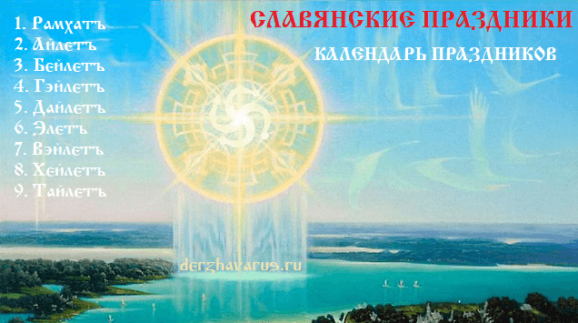
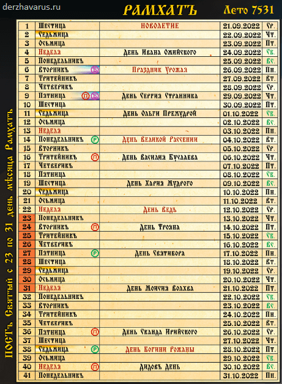
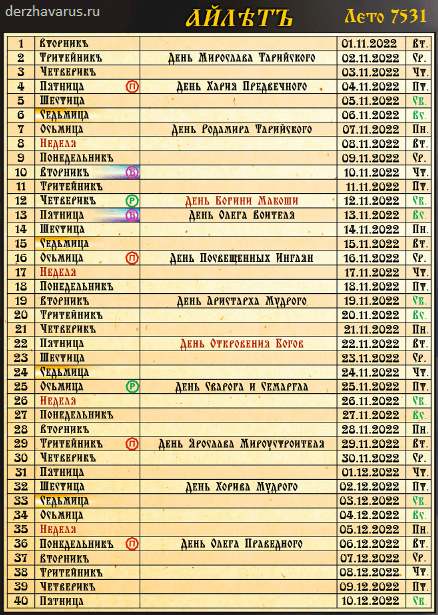
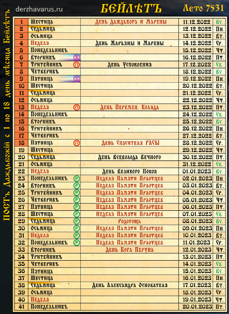
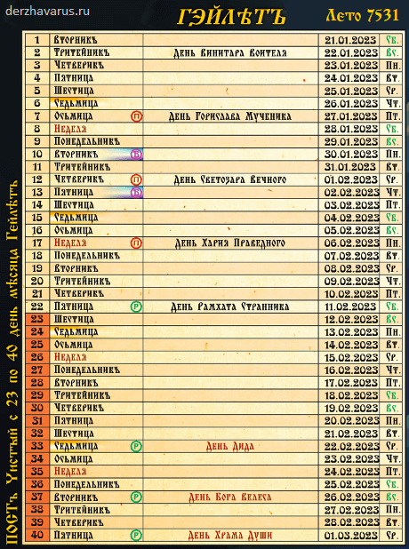
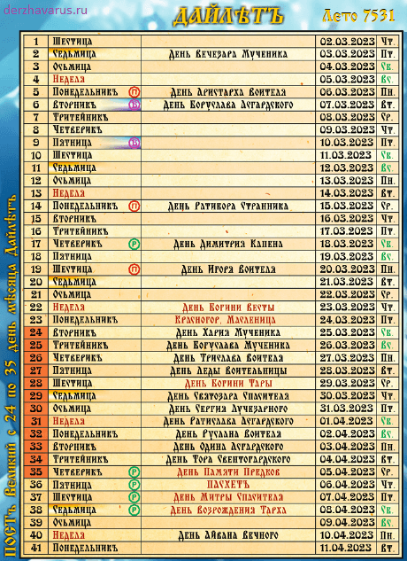
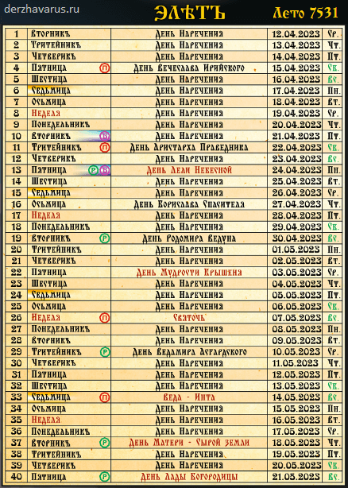
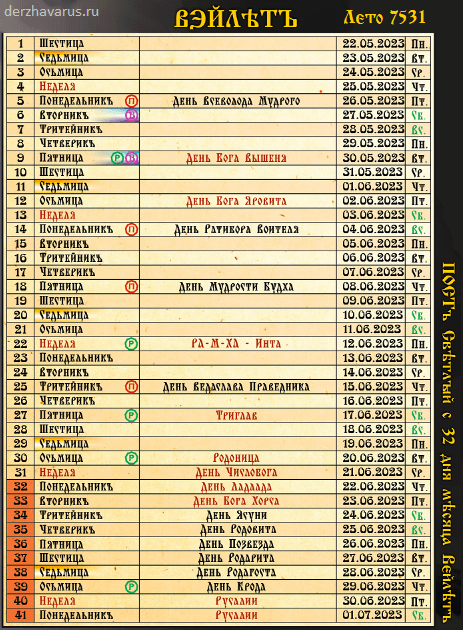
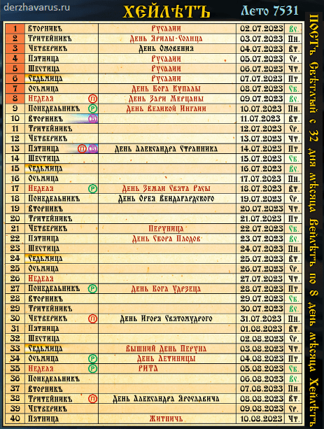
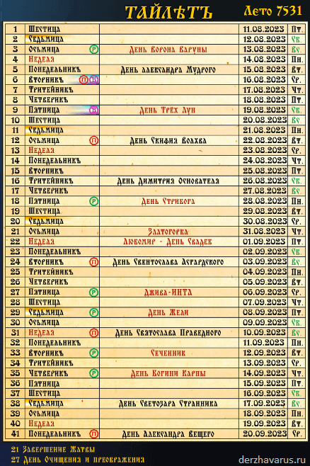

# Славянские праздники / Календарь праздников

**Славянские праздники** связаны с Природой и Наследием Предков. Каждый славянский праздник посвящён воспоминанию важнейших событий в жизни Расы и памяти великих Предков. При этом **календарь праздников** учитывает положение Солнца (дни равноденствий и солнцестояний), смену сезонов (Осень, Зима, Весна) и другие природные циклы, чтобы человек жил в одном биоритме с Природой. Живите в радости и гармонии с Природой.

Славянские праздники / Календарь праздников – 9 месяцев

В славянском календаре **9 месяцев** по 40 и 41 дню (сороковники). Праздники отмечаются каждое Лето в одни и те же дни. В праздники следует возжигать дома огневицу, приносить дары (угощение) Богам и Предкам, читать гимны и обращения, заповеди Богов.

**Сороковники:**  
1. Рамхатъ  
2. Айлетъ  
3. Бейлетъ  
4. Гэйлетъ  
5. Дайлетъ  
6. Элетъ  
7. Вэйлетъ  
8. Хейлетъ  
9. Тайлетъ

## Славянские праздники / Календарь праздников

Далее представлен календарь праздников на Лето 7531 в качестве примера, однако, как сказано выше, **даты славянских праздников не меняются**.

4 праздника (равноденствия и солнцестояния):

- Новолетие (1 Рамхатъ) – Осеннее равноденствие
- Коляда (13 Бейлетъ) – Зимнее солнцестояние
- День Богини Весты (22 Дайлетъ) – Весеннее равноденствие
- День Числобога (31 Вэйлетъ) – Летнее солнцестояние

### 1. РАМХАТЪ (сентябрь-октябрь)

Славянские праздники / месяц Рамхатъ | Отмечены: ПОСТЪ, Вещие сны (сиреневый круг), Родительские Дни (зелёный круг), Дни памяти и почитания Предков (красный круг).

**1 – НОВОЛЕТИЕ** / Осеннее равноденствие  
\* Рамха-Ита (Новолетие) - Осеннее равноденствие, то есть после сбора урожая, Новое Лето начинается с полных закрамов. В праздник Новолетия с каждым ударом Большого колокола человеку даётся возможность избавиться от одного греха (Большой колокол бьёт в этот праздник ровно 108 раз), и в течении первого месяца Нового Лета человек, совершивший неблаговидные поступки, должен исправить сложившееся положение.  
**4** – День Ивана Омийскаго  
**6** – Праздник Урожая  
**9** – День Сергия Странника (День памяти и почитания Предков)  
**11** – День Ольги Премудрой  
**14** – День Великой Рассении (Родительский день)  
\* Рассения (или Расея, то есть «земля Расы») - это территория, по которой расселились Роды Свята Расы после перехода из Даарии.  
**16** – День Василия Буслаева (День памяти и почитания Предков)  
**19** – День Хария Мудраго  
**22** – День Великаго Знания  
**24** – День Трояна (День памяти и почитания Предков)  
\* Троян - Бог-Покровитель жизненных путей.  
**27** – День Святибора (Родительский день)  
**31** – День Моисия Волхва  
**36** – День Сканда Ирийскаго (День памяти и почитания Предков)  
**38** – День Богини Рожаны (Родительский день)  
\* Рожана покровительствует роженицам.  
**40** – Дидов День / День Мудрых Странников (День памяти и почитания Предков)

> Чтите Свято все праздники, что оставили вам Предки ваши, украшайте жизнь свою радостью и деяниями благими, да во Славу Богов и Предков ваших. - *Бог Рамхат*

### 2. АЙЛЕТЪ (ноябрь-декабрь)

Календарь праздников / месяц Айлетъ / Лето 7531

**2** – День Мирослава Тарийскаго  
**4** – День Хария Предвечнаго (День памяти и почитания Предков)  
**7** – День Родамира Тарийскаго  
**12** – День Богини Макоши (Родительский день)  
\* Макошь - Богиня наших судеб, вместе с дочерьми Долей и Недолей прядёт нить наших судеб. Даже Боги подчиняются её нитям.  
**13** – День Олега Воителя  
**16** – День Посвящённых Инглян (День памяти и почитания Предков)  
**19** – День Аристарха Мудраго  
**22** – День Откровения Богов  
**25** – День Сварога и Семаргла (Родительский день)  
\* Сварог - Верховный Небесный Бог, управляющий течением Жизни нашей и всем Мироустройством Вселенной в Явном Мире. Бог Сварог и его сын Семаргл победили Чёрнаго змея и провели рубеж по землям Мира Яви. Тёмная Навь была совлечена ниже Яви, а Славь осталась выше.  
**29** – День Ярослава Мироустроителя (День памяти и почитания Предков)  
**32** - День Хорива Мудраго  
**36** – День Олега Праведнаго (День памяти и почитания Предков)

> Не произносите имени Бога Единаго в суе, а глагольте его только в Великие праздники. - *Бог Рамхат*

### 3. БЕЙЛЕТЪ (декабрь-январь)

Славянские праздники / месяц Бейлетъ / Коляда и ПОСТъ Даждьбожий

**1** – День Даждьбога и Марены  
\* Свадьба Даждьбога с Богиней Мареной.  
**4** – День Марьяны и Марены  
**7** – День Успокоения (День памяти и почитания Предков)  
**13 – День Перемен. КОЛЯДА** (День памяти и почитания Предков)  
\* Зимнее солнцестояние - самая длинная ночь и самый короткий день. С этого дня света становится больше, то есть перемены в Природе; а главное большие перемены в жизни Расы - возвращение наших Предков из Пекла. Бог Перун победил зверя Скипетра и освободил из Пекла наших Предков, завлечённых туда обманом. Поэтому праздник называется День Перемен (Менари) или Коляда, потому что Великими Переменами в жизни Родов Расы Великой управляет Бог Коляда.  
**18** – День Спасителя Расы (День памяти и почитания Предков)  
**20** – День Всеволода Вечнаго  
**22** – День Великаго Покоя  
\* В этот день Бог Перун завалил Врата Междумирья ведущие в Пекло Кавказскими горами, и на Землю перестала поступать негативная энергия. После начинается Неделя чествования Праотцев, освобождённых из Пекла.  
**23** – Неделя Памяти Праотцев (Родительский день)  
**24** – Неделя Памяти Праотцев (Родительский день)  
**25** – Неделя Памяти Праотцев (Родительский день)  
**26** – Неделя Памяти Праотцев (Родительский день)  
**27** – Неделя Памяти Праотцев (Родительский день)  
**28** – Неделя Памяти Праотцев (Родительский день)  
**29** – Родогощь (Родительский день)  
\* День победы Бога Велеса над Кощеем.  
**30** – Неделя Памяти Праотцев (Родительский день)  
**31** – Неделя Памяти Праотцев (Родительский день)  
**32** – Неделя Памяти Праотцев (Родительский день)  
**33** – День Бога Перуна  
\* Зимний День Перуна - то есть когда он полностью уничтожил на Мидгарде нечесть, и вонзил в землю сияющий меч.  
**38** – День Александра Основателя

> Почитайте вы три дня в неделе: третий, седьмый и девятый. Почитайте Великие Праздники. - *Бог Сварог*

### 4. ГЭЙЛЕТЪ (январь-февраль)

Славянские праздники / месяц Гэйлетъ / Чистый ПОСТ

**2** – День Винитара Воителя  
**7** – День Горислава Мученика (День памяти и почитания Предков)  
**12** – День Светозара Вечнаго (День памяти и почитания предков)  
**17** – День Хария Праведнаго (День памяти и почитания Предков)  
**22** – День Рамхата Странника (Родительский день)  
**33** – День Дида (Родительский день)  
\* День поминовения всех дедов по Родовой (отцовской) Линии с посещением кладбищ, погостов, отдельных могил и курганов.  
**37** – День Бога Велеса (Родительский день)  
\* Велес - верховный Хранитель Небесных Врат Междумирья, кои находятся на Золотом Пути Духовнаго Развития, который ведёт в Небесный Асгард, а также в Небесный Вырий и в Светлые Чертоги Волхаллы. Через эти Небесные Врата, Бог Велес пропускает во Сваргу Пречистую Души только тех усопших, кто не щадил своей жизни во защиту Родов своих, во защиту земель Отцов и Дедов, во зашиту древней Веры; которые усердно и созидательно трудились для процветания своих Родов и которые от чистаго сердца выполняли Два Великих Принципа: 1) Свято чтить Богов и Предков своих и 2) жить по Совести в гармонии с Матерью-Природой.  
**40** – День Храма Души (Родительский день)  
\* День, когда человек должен навести порядок в своей Душе. Он должен посетить службу в Храме, принести дары Богам и Предкам, принять Чистый Свет в свою Душу от Храмовой Огневицы. Этот день завершает Чистый Пост.

> Не допускайте, люди, зло и гнев неправедный в Души ваши, ибо очернят они Души ваши, и сердца ваши станут чёрствыми. - *Бог Ладаад*

### 5. ДАЙЛЕТЪ (март-апрель)

Календарь праздников / Дайлетъ / День Богини Весты, ПАСХЕТЪ и Великий Пост

**2** – День Вечезара Мученика  
**5** – День Аристарха Воителя (День памяти и почитания Предков)  
**6** – День Боруслава Асгардскаго  
**14** – День Ратибора Странника (День памяти и почитания Предков)  
**17** – День Димитрия Капена (Родительский день)  
**19** – День Игоря Воителя (День памяти и почитания Предков)  
**22 – ДЕНЬ БОГИНИ ВЕСТЫ**  
\* Весеннее равноденствие - встреча Богини Весты, празднуется приход Весны, прилёт птиц. Богиня Веста управляет приходом весны и пробуждением Природы, её называют Покровительницей Обновляющегося Мира, в Её честь устраивают всенародное гуляние, пекут из теста фигурки жаворонков, куличи, печенье с Солнечной символикой, и обязательно блины, как символ Ярилы-Солнца.  
**23 – Красногор. Масленица**  
\* Второй день Весеннего равноденствия - проводы Богини Марены, празднуется уход Зимы. Марена - Богиня Зимы и покоя, старшая сестра Богини Весты. В этот день провожают Марену в её Ледяные Чертоги, находящиеся на Севере, и сжигают куклу из соломы, которая символизирует Зиму, а не Богиню Марену, как многие думают. Вместе с куклой в огонь кладутся блины и зёрна (просо, овёс для произрастания обильной пищи для домашней скотины), чтобы Боги даровали обильный урожай. Проводятся народные гуляния, хороводы, игрища и прыжки черег отдельное (не жертвенное) огневище, чтобы очистить свою Душу и телеса. См. Красногор, Масленица - проводы Зимы  
**24** – День Хария Мученика  
**25** – День Богуслава Мученика  
**26** – День Трислава Воителя  
\* Узнать подробней о Триславе-Воителе (Лета Жизни 5495-5537 от С.М.З.Х.).  
**27** – День Леды Воительницы  
**28** – День Богини Тары  
\* Богиня Тара - Небесная Хранительница Священных Рощ, Лесов, Дубрав и Священных Деревьев: Дуб, Кедр, Вяз, Берёза и Ясень. В этот день Таре преподносятся Дары и Требы. В огненный жертвенник ложат семена и зёрна для обильного урожая, необходимого для питания людей. В Её честь проводится служба и Великая Братчина - совместная трапеза, чаепитие, пир. Учавствующие в празднике приносят яства, которые они создали собственными руками для общего стола. Перед началом Великой Трапезы от каждого блюда берётся понемногу, чтобы принести Жертву Богине Таре и остальным Богам и Предкам.  
**29** – День Светозара Спасителя  
**30** – День Сергия Лучезарнаго  
**31** – День Ратислава Асгардскаго  
**32** – День Руслана Воителя  
\* Узнать подробней о Руслане-Воителе (Лета Жизни 5840-5896 от С.М.З.Х.).  
**33** – День Одина Асгардскаго  
**34** – День Тора Свентогардскаго  
**35** – День Памяти Предков (Родительский день)  
\* День, в который почитаются все Предки всех Родов. В этот день совершаются службы на всех кладбищах и погостах, на могилах и курганах наводится чистота и порядок. Помимо Даров и Треб умершим родичам, на их последнем пристанище зажигаются священные огни (огневицы).  
**36** - ПАСХЕТЪ (Родительский день)  
\* ПАСХЕТЪ - это аббревиатура: «Путь АСами Ходяше Есть Твердо Сотворение» - день памяти о 15-летнем переселении наших Великих Предков из Даарии в Рассению. Память о том, как Предки наши в 16-ое лето славили всех Богов и жреца Спаса за спасение от Потопа Великаго.  
**37** – День Митры Спасителя (Родительский день)  
\* День почитания Бога Митры, который спас Роды Рассенов и Святорусов от засухи, даровал им воду и пищу и указал каким Родам в какие земли цветущие переселиться. За то, что Митра спас Роды, тёмные силы его приковали цепями к горам Кавказским и посылали диких птиц клевать его плоть. Митра три дня находлся между Жизнью и Смертью. Из Родов Святорусов была избрана дружина из тридевяти наилучших воинов, которую возглавила Жрица-Воительница Ас'Тара. Она привела воинов к месту мучения Митры, где были разбиты тёмные силы, освободила Митру от оков, оживила его Силой своей Любви, после чего на Огненной Божественной Колеснице поднялась с Митрой в Небеса. С той поры многие Роды Южной Скифии почитали Ас'Тару как Богиню Высшей Спасительной Любви и Возрождения. Отсюда появились легенды о том, что распятые Боги в третий день воскресают, так как на Кавказских горах был распят и Тарх Даждьбог, спасённый Лебедью Дживой.  
**38** – День Возрождения Тарха (Родительский день)  
\* Тарх Даждьбог сражался с тёмными силами и они запросили пощады, перемирия и устроили пир. На пире в питьё Тарху подсыпали Сонного Зелья, а когда он уснул, приковали его цепями к горам Кавказским, чтобы хищные птицы и звери терзали его плоть. Богиня Джива освободила его от оков, перенесла на своих Лебединых Крыльях в урочище Тары на слияние Раты и Ирия, где вместе с сестрой Тарха - Богиней Тарой они залечили его телесные раны, а Богиня Джива силой Высшей Спасительной Любви и Возрождения вдохнула в него новые силы и Жизнь, после чего состоялась свадьба Тарха Даждьбога и Богини Дживы. Даждьбог, так же, как и Митра был три дня прикован к Кавказским горам и находился между Жизнью и Смертью.  
**40** – День Айвана Вечнаго

> Почитайте ПАСХЕТЪ, и помните о пятнадцатилетнем переходе из Даарии в Рассению, как шестнадцатое Лето Предки славили Род Небесный за спасение от Потопа Великаго. - *Бог Сварог*

### 6. ЭЛЕТЪ (апрель-май)

Календарь праздников Лета 7531 / месяц Элетъ

**1 - 40** - День Наречения  
\* Каждый день месяца Элетъ - День Наречения. То есть в месяц Элетъ Природа расцветает, и на земле просыпаются все Природные Силы, поэтому проводят обряды наречения (новым именем, женихом и невестой, Жрецами, Волхвами, Князьями, Витязями, Дружинниками и т.д.).  
**4** – День Вечеслава Ирийскаго (День памяти и почитания Предков)  
**11** - День Аристарха Праведника (День памяти и почитания Предков)  
**13** – День Лели Небесной (Родительский день)  
\* В этот день празднуется Победа Даждьбога над Тёмными силами, которых Кощеи собрали на Леле (ближайшей к Мидгарду Луне, в то время было три Луны). Даждьбог разрушил малую Луну Лелю и уничтожил тёмные силы, которые готовились к захвату Мидгарда. С той поры существует обычай на день Лели Небесной красить птичьи яйца и стукать их друг об друга. Разбившееся яйцо называют Яйцом Кощея, а целое - Силой Даждьбога. Разбитое яйцо отдают недругам или животным, а целое съедают сами. Также, в этот день прославляется Богиня Леля, в честь которой в древнейшие времена люди и назвали ближайшую Луну Мидгарда. Богиня Леля - дочь Лады Богородицы, охранительница извечной, взаимной, чистой и постоянной Любви, семейного счастья, супружескаго согласия и всяческаго благополучия.  
**16** – День Борислава Спасителя  
**19** – День Родомира Ведуна (Родительский день)  
**22** – День Мудрости Крышеня  
**26** – Святочь (День памяти и почитания Предков)  
**29** – День Ведамира Асгардскаго (Родительский день)  
**33** – Веда-Инта  (День памяти и почитания Предков)  
\* ИНТА (Истина Наши Твердо Асы) - день когда почитается Мудрость, которую оставили нам все Светлые Боги и Многомудрые Предки.  
**37** – День Матери - Сырой Земли (Родительский день)  
\* День чествования Богини Матери Сырой Земли. В этот день Ей приносят в жертву лучшие семена, фрукты, овощи и просят, чтобы всё, что идёт в огонь, было в изобилии в Родах. В этот день многие овощи и фрукты высаживаются в открытый грунт, а также высеваются различные злаковые культуры.  
**40** – День Лады Богородицы (Родительский день)  
\* Лада-Матушка (Матерь Сва) - Великая Небесная Мать, Богородица. Любящая и нежная Мать большинства светлых Богов Расы Великой, Богородица-Покровительница всех Народов Великой Рассении (територии Великой Расы) и Чертога Лося во Сварожьем Круге. Покровительница семьи, гармонии, красоты и любви.

> Живите, люди, в Союзе с Природою, возмножая её, а не губя её. - *Лада-Богородица*

### 7. ВЭЙЛЕТЪ (май-июнь)

Славянские праздники / месяц Вэйлетъ / День Числобога и Светлый ПОСТ

**5** – День Всеволода Мудрого (День памяти и почитания Предков)  
**9** – День Бога Вышеня (Родительский день)  
\* Вышень - Бог-Покровитель нашей Вселенной в Светлых Мирах Нави, т.е. в Мирах Слави. Заботливый и могучий Отец Бога Сварога. Справедливый судья, разрешающий любые споры, которые возникают между Богами различных Миров или между людьми.  
**12** – День Бога Яровита  
**14** – День Ратибора Воителя (День памяти и почитания Предков)  
**18** – День Мудрости Будха (День памяти и почитания Предков)  
**22** – Ра-М-Ха-Инта (Родительский день)  
\* Ра-М-Ха ИНТА (Истина Наши Твердо Асы) - Мудрость Ра-М-Хи. Ра-М-Ха (РАМХА) - Единый Творец-Созидатель, Вышняя Непознаваемая Сущность, излучающая Изначальный Жизньродящий Свет Радости и Первичный Огонь Мироздания (Жизньнесущую Инглию), из которого появились все ныне существующие, а также существовавшие в прошлом видимые и невидимые Вселенные и всевозможные обитаемые Миры.  
**25** – День Ведаслава Праведника (День памяти и почитания Предков)  
**27** – Триглав (Родительский день)  
\* День когда почитаются Великие Триглавы.  
**30** – Родоница (Родительский день)  
**31 – ДЕНЬ ЧИСЛОБОГА**  
\* Числобог - Мудрый, Вышний Бог, управляющий течением Реки Времени, а также Бог-Хранитель Даарийскаго Круголета и различных жреческих систем Славяно-Арийскаго летоисчисления.  
**32** – День Ладаада  
**33** – День Бога Хорса  
\* Праздник начинается с правьславления Бога Хорса и принесения жертв (круглые куличи) на жертвенник. После чего устраиваются хороводы, хороводные пляски - медленные движения с подражаньем словам хороводной, протяжной песни. В летний праздник Бога Хорса с горы к реке обязательно скатывают большое горящее колесо, символизирующее солярный знак солнца.  
**34** – День Ясуни  
**35** – День Родовита  
**36** – День Позвезда  
**37** – День Родарита  
**38** – День Родагоста  
**39** – День Крода (Родительский день)  
**40** – Русалии  
**41** – Русалии

> Почитайте люди, вы, дни русальские, соблюдайте Божии праздники. - *Бог Перун*

### 8. ХЕЙЛЕТЪ (июль-август)

Славянские праздники / месяц Хейлетъ / Светлый ПОСТЪ и День Бога Купалы

**1** – Русалии  
**2** – День Ярилы-Солнца  
\* Почитается наше Солнце, которое дарует нам тепло и свет.  
**3** – День Омовения  
**4** – Русалии  
**5** – Русалии  
**6** – Русалии  
**7** – День Бога Купалы  
\* Почитается Бог Купала, и люди проходят очищение стихиями. Это день Очищения в мире Славян.  
**8** – День Зари-Мерцаны (День памяти и почитания Предков)  
**9** – День Великой Инглии (Родительский день)  
**13** – День Александра Странника (День памяти и почитания Предков)  
**17** – День Земли Свята Расы (Родительский день)  
**18** – День Орея Вендагардскаго  
**21** – Перуница  
\* День почитания Жены Бога Перуна - Дивы.  
**22** – День Сбора Плодов  
**27** – День Бога Удрзеца (Родительский день)  
**30** – День Игоря Святомудраго (День памяти и почитания Предков)  
**33** – Вышний День Перуна  
\* День почитания Бога Перуна.  
**34** – День Летиницы (Родительский день)  
**35** – РИТА (Родительский день)  
**38** – День Александра Ярославича (День памяти и почитания Предков)  
**40** – Житничь  
\* Начало Жатвы.

> Почитайте Великую Инглию и Богов Ваших, которые суть посланцы Бога Рода Единаго. - *Бог Сварог*

### 9. ТАЙЛЕТЪ (август-сентябрь)

Календарь праздников / месяц Тайлетъ

**3** – День Ворона Варуны (Родительский день)  
**6** – День Александра Мудраго (День памяти и почитания Предков)  
**9** – День Трёх Лун  
\* В древние времена, когда вокруг Земли вращались три Луны, в этот день они сошлись на небосводе в одном месте. В этот день было начато строительство Асгарда Ирийскаго и Великаго Капища Инглии (Великаго Храма Священнаго Первичнаго Огня). Этот день считается днём основания Священнаго Города Богов, построенного на слиянии рек Ирий и Омь.  
**12** – День Скифия Волхва (День памяти и почитания Предков)  
**16** – День Димитрия Основателя  
**18** – День Стрибога (Родительский день)  
\* Почитание Бога управляющего ветрами - Стрибог.  
**21** – Златогорка  
**22** – Любомир (День Свадеб)  
\* День Свадеб называется Любомир.  
**24** – День Свентослава Асгардскаго (День памяти и почитания Предков)  
**27** – Джива-ИНТА (Родительский день)  
\* Время очищения и преображения.  
**29** – День Жели (Родительский день)  
**31** – День Святослава Праведнаго (День памяти и почитания Предков)  
**33** – Сеченник (Родительский день)  
**35** – День Богини Карны (Родительский день)  
\* Почитание Богини Карны (сестры Жели). Она отвечает за перерождение Душ в Явном Мире, которые не исполнили свой долг.  
**38** – День Светозара Странника  
**41** – День Александра Вещего (День памяти и почитания Предков)

> Почитайте память Предков своих жертвоприношениями безкровными, ибо что пожертвуете вы им, то и возымеют они. - *Стрибог*
