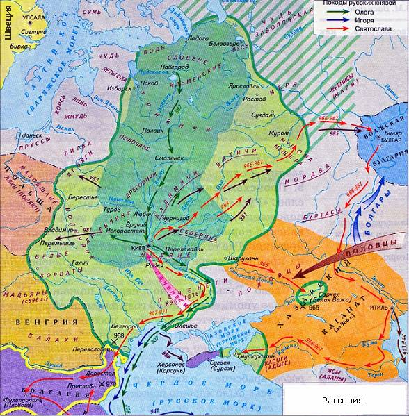

# Расселение западных славян

**Венея** – это славянское название Европы, т.е. наши Предки, заселяя данную территорию, не говорили Европа, а говорили Венея – земля, которую населяют землепашцы. А вся территория от Востока, где Беловодье и до Венеи, называлась **Расея**, т.е. земля Расы, земля по которой расселилась Великая Раса. Потом славянские названия Рассения, Расея при переводе не мёртвый латинский язык получились Рутения, Русь.

1. Сканды  
2. Анты и Росы  
3. Божья Русь  
4. Поморцы и Даны  
5. Булгары  
6. Марийцы  
7. Ваны

## Сканды

Когда **князь Сканд** вернулся из второго Харийского похода (III тыс. до н.э.), жрец Óдин благословил его Рода на переселение в европейскую часть материка. Они прошли мимо Урала и вышли на реку Мутную, здесь около Чудь озера **волхв Моисий** умер, и в честь него озеро назвали Моиск, а реку назвали Волхвом (ныне р. Волхов), т.е. река, возле которой умер волхв. После этого сканды пошли дальше на север, там был построен новый Асгард Свитьодский, т.е. одно из племён **свеев** (ныне шведов) – славянское племя, построили новы Город Богов, но после пожара, когда византийские и другие купцы завезли чуму, город сгорел, и на его месте построили новый город Уппсала. Князь Сканд перед смертью сказал: «Моя Душа будет охранять сию землю от набегов», поэтому её назвали **Скандинавия**, т.е. охраняемая Душой Сканда (у славян Душа – это НАВИЯ, т.е. из Мира Нави).  
\* **Волхв Моисий** никакого отношения к иудохристианству не имеет. У иудеев Моше или Мойша, но никакого Моисея не было - это русификация иностранного слова. Волхв Моисий раньше прошёл до территории нынешней Скандинавии, убедился что ледник ушёл и потом привёл туда Роды Скандов.

## Анты и Росы

**Анты** в XVI тысячелетии до н.э. освоили большой остров в Атлантическом океане, который назвали Антлань, т.е. земля Антов (греч. Атлантида). После того как Антлань затонула, анты переселились на север Африканского континента и создали Державу ТАКЕМ (т.е. чёрная земля или земля чёрных, или выжженная земля под палящим солнцем) и устроили там свои города на южном Средиземноморье, но греки называли этих белых людей «кемерийцы», т.е. анты, живущие в Кемерии (ТА - т.е. «это»; КЕМИ, или Кемерия). После великой засухи, когда погибли многие урожаи, анты переселились на северо-запад от Чёрного моря, и жили рядом с племенем **Рось**. Земля росов была восточнее, где Киев и Переяславль, а анты жили западнее до Дуная. Потом у них появилась совместная Держава **Киевская Рось** (Русь), но её территория была только до Чернигова, а дальше начиналась территория Божьей Руси.  
\* Украинцы – это потомки Антов и Росов

## Божья Русь

**Божья Русь** – Смоленск, Минск, Литва, Польша – это всё относилось к Божьей Руси (Боруси). А ещё выше - Латвия по Даугаве, Волге, и далее до Печоры была Славия или Новгородская земля, которую скандинавы называли Гардарика, т.е. страна городов (поселений с крепостными стенами). После того, как пустующие западные земли начали заселять племена красных русов (червонные русы), появилась Червонная Рось, она доходила до Вислы и Немана, и разделила Божью Русь на две, восточная стала Белая Русь (**Беларусь**), а западная стала Божьей Русью (**Борусь**).  
\* **Красные русы** – это племена Росов, воинское сословие (поэтому «красные»), которые отделились и пошли за своим князем осваивать пустынные земли.  
\* **Славия** – потому что столицей был город Словенск, который построил князь Словен. «Лета 3113 Великий князь Словен поставиша град и именоваше его именем своим Словенск на реце Мутная, ныне завомая Волховом, и на бреге езера Моиском завомого».  
Впоследствии в честь сестры князя Словена Илмеры озеро было переименовано в Илмер, потом изменилось на Ильмер, а после - Ильмень озеро.

## Поморцы и Даны

По берегу Варяжского и Белого морей также расселялись русские племена, которые называли «Поморские Русы» или **Поморцы**, т.к. наши Предки сокращали названия, поэтому и Поморская Русь превратилась в Пруссию, она уходила по Балтике на запад до Дании, где жили **Даны** – тоже входили в состав русских территорий.

## Булгары

На восток от Божьей Руси была **Волжская Булгария**, и когда Хазария пошла на восток по Волге к Булгарии, часть Родов булгар не захотели подчиниться Хазарии, хан Аспарух забрал их, и они переселились на Дунай, устроили здесь свои города и до сих пор там проживают - это **Болгария**. Но заметьте, Дунайских болгар современная историография причисляет к славянам, а их восточных братьев – Волжских, Казанских болгар к тюркам, к татарам. Такое разделение произошло вследствие того, что на Дунае из Царьграда навязывалось христианство, а на Волге навязывался ислам, и так как в древности ислам принимали в основном тюркские племена, поэтому волжских болгар стали причислять к тюркам, хотя это славянские племена, которые сначала не приняли христианства, но потом им навязали ислам. Но не все племена булгар признали даже и ислам, многие, особенно по Вятке и ближе к Каспию, они ислам не приняли, остались верны древней Вере Предков и жили особняком. Поэтому они до сих пор говорят, что мы **белые булгары** или чистые булгары, т.е. не принявшие ни Христа, ни учения Магомета.

## Марийцы

**Марийцы – это малые арийцы**, многие из их Родов до сих пор не приняли ни ислама, ни христианства, а исповедуют свою Родовую Веру, т.е. они входят в состав нашей Церкви Православных Староверов-Инглингов, и Веру свою называют либо Старая Вера, либо *чимари*, т.е. чистые марийцы, которые не приняли чуждых учений, не пошли под их влияние. Вот эти чистые марийцы они существуют до сей поры, также как и чистые булгары.

## Ваны

Между Каспием и Чёрным морем была Великая Скифия - это территория нынешнего Краснодарского края, Ставропольского края, Ростова на Дону, т.е. по Северному Донцу до Днепра, это Таврия (ныне Крым), Северный Донецк, Волга - это всё была Скифия – страна священных городов или священных поселений, поскольку города имели крепостные стены, а здесь их не было, т.е. жили в дружбе со всеми. У озера Ван, где ныне находится Армения, жили ваны, было **Ванское царство**. Но после семилетней засухи, т.е. урожаи погибали, ваны переселились на территорию Нидерландов, и чтобы их потомки помнили откуда они переселились, оставили приставку к своему родовому имени – ВАН (Ван Гог, Ван Бастон, Людвиг Ван Бетховен и т.д.).

То есть не было такого, как сейчас говорят: народ умножался, умножался, а потом часть его переселялась на свободную территорию. Нет, народ переселялся полностью, оставляя города в целости и сохранности, а потом засуха заканчивалась, и сюда с юга переселялись племена других народов. Т.е. в один прекрасный момент приехали на торжище, видят пустые города, или там остались древние старцы, которые не захотели никуда уходить, и пришедшие спрашивают: «Ара (т.е. уважаемый), а где все?», те отвечают: «Они ушли в лучшие земли». И торговцы начали переселяться со всем своим хозяйством сюда и занимать уже обжитые места. Потом всю историю, которая была до них сохранённая, стали переписывать под себя, и т.к. «ария» или «ара» означал уважаемый, то они стали себя называть «уважаемыми людьми», т.е. АРА – МЕН или Армения. Но также сюда начали переселяться так называемые 10 колен Израилевых, т.е. потерянных колен. И потом уже отсюда начали переселяться на территории южного Черноморского побережья, сегодняшние Турция и Туркестан, и в более южные районы на территорию Византийской или как говорили наши Предки – Ромейской империи, т.к. столицей был город Рома.

\* Ереван, Ванское царство – основали Предки голландцев
