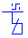
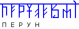

# Руны (Каруна)

**Руна - это тайный Образ**, а не буква или слог; т.е. это ключ к тайне глубинной сути явления. Каждая Руна — это уникальный концепт с множеством самостоятельных образов; соединение этих образов открывает и порождает новые самостоятельные образы. Допустим, санскрит (это упрощённая форма х’Арийской Каруны) содержит до 50 самостоятельных образов: 48 Рун и 2 знака препинания, при этом каждая следующая Руна в тексте влияет на предыдущую и получается как бы другой образ. Поэтому если 50 человек переведут текст на санскрите, у каждого получится свой перевод, потому что каждый будет видеть один из Образов, который несёт в себе санскрит.

**Каруна – это сборник Рун**, т.е. Ка-Руна («КА» в начале слова означает – «союз», «объединение»; Каруна – это союз всех образов и понятий). В основном сборнике 144 Руны, но к этим основным Рунам ещё идут Руны времени, Руны пространства, Руны единых образов и т.д., то есть Рун много, допустим, в Книге Света используется 256 Рун. Но на самом деле существует **несколько миллионов Рун**, потому что есть Руны, которые несут в себе одно единственное образное значение, т.е. передают только 1 Образ.  
Пример: Руна Ярилы-Солнца означает и падание жизни, и тепло, и свет, и образ светлых чистых отношений, и другие светлые образы, которые будут зависеть от того, какая Руна впереди или позади. Но если к этой Руне сверху добавлен символ «суть», то у данной Руны уже будет единственный образ, который будет означать само Ярило-Солнце - Светило находящееся в центре звёздной системы.  
*\* См. Наследие Предков – Саньтии Веды Перуна, урок 2.*

**Руны записывают под общей чертой**, которая называется - поднебесная.  
\* Если над Руной стоит дополнительная небольшая черта, значит надо читать её структурный порядок (или как мы сейчас в очень-очень упрощённом виде называем – цифирь или число), т.е. в данном случае основной Образ который она несёт в тексте, это числительная образная система.  
\* Некоторые места рунического текста при чтении могут звучать как буквица, как слог, как двуслоговая система или трёхслоговая, т.е. всё ещё зависит от тех знаков, которые стоят наверху, над поднебесной чертой.

## Чтение рунического текста

Для выявления Образа, заложенного в руническом тексте, помимо простого поверхностного чтения, производится ещё **три глубоких чтения**. Т.е. сначала читают первое поверхностное письмо, потом первое глубокое чтение по образам каждой Руны, и в обратном порядке. Так узнают Руну-ключ, определяющую образный смысл данного текста. Затем эта Руна-ключ подставляется к тексту, и она уже управляет сверху, из поднебесной остальными Рунами, т.е. получается совсем другой текст – это называется второе глубокое чтение. Получают второй Ключ, т.е. Образ, и теперь этот Образ управляет из поднебесной – получается другая информация, это третье глубокое чтение. Потом все чтения соединяются воедино, т.е. получают полный текст, и совершенно другая информация, нежели несёт первое простое чтение, хотя оно всё равно так или иначе связано с тремя глубокими чтениями.

Поэтому Каруна испокон веков считалась чисто жреческим языком. Многие люди даже если и использовали Каруну, то только либо её первое простое чтение, либо первое глубокое чтение.

**Пример:** рунический текст начала гимна-обращения к Перуну: «Перуне! Вми призывающих Тя…» – это первое простое чтение, т.е. здесь говорится: «Перун! Услышь, внемли моим словам, моему обращению». Такой текст народу легко прочитать и запомнить. Но жрецы хранят другое чтение, они читают Образы: «Путь Есть Ратная Утеха Наша [ПЕРУН]; Есть Вневрменные Миры Высших Структур [т.е. Земли вне нашей системы расположенные]… и т.д.». То есть это уже совершенно другая информация, и это только первое глубокое чтение. При этом слово «Перун» может быть записано в разных текстах разными руническими знаками, т.е. нести в себе абсолютно различные Образы.
