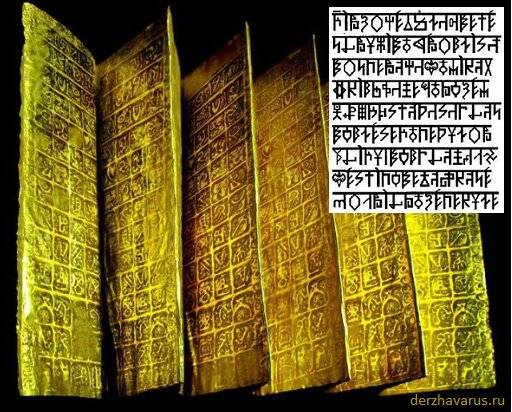

# Саньтии - листы из драгметалла с Рунами

**Саньтии** – это листы из благородного металла (золото, серебро, платина), на которых начертаны Руны. Кроме того, что Руны продавлены, они ещё и заполнены красной краской, типа киновари, но не им, а специальной краской по металлу, она очень долго держится. Саньтии - долговечный материал для письма.

Саньтии - листы из благородного металла с Рунами / Материал для письма.

## Система письма Саньтий

Система написания Саньтий строчная:

- в строке по 16 Рун;
- 9 строк – это шлока;
- 16 шлок образуют Саньтию;
- 9 Саньтий образуют Круг, т.е. 144 шлоки (9х16).

К примеру, Саньтии Веды Перуна состоят из 9 Кругов, это связано с тем, что когда Бог Перун в третий раз посещал Мидгард, он целую неделю общался с людьми, и вот беседа одного дня записывалась в Круг [в славянской неделе 9 дней]. Поэтому когда вы заканчиваете читать Первый Круг Саньтий, то в конце видите: «На этом заканчивается Круг Первый Саньтий Веды Перуна и первый день общения Расы Великой и потомков Рода Небеснаго со Святомудрым и Всепрекрасным Перуном», т.е. заканчивается первый день общения.

**Саньтии записаны Рунами** – это тайные Образы. Если над Руной стоит дополнительная небольшая черта, значит её основной образ – это числительная образная система (т.е. цифра, если говорить современным языком), поэтому все числовые обозначения, допустим: первая шлока или первый Круг, тоже проставлены Рунами. Записывали Саньтии, как правило, х’Арийской Каруной («КаРуна» означает – Сборник тайных Образов). В основном сборнике 144 Руны (поэтому в Даарийском Круголете Числобога, в оригинале, там в каждой клеточке Руны, а не цифры). Но кроме 144 основных Рун, есть ещё Руны времени, Руны пространства и т.д., то есть Рун много.

### См. также

- Саньтии Даков
- Славянские формы письма
- ДревлеСЛОВенская Буквица
- Харатьи, дощи, скрижали — материал для письма
