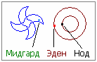

# Серые

Серые прибыли на Мидгард-Землю из системы 10-и тысяч планет, т.е. по-славянски это **Мир Тьмы** (10000 – это число «Тьма»). Т.е. они прибыли не из Мира Мрака, а из Мира 10 тысяч планет, который также называют - **Пекло** или «жаркая», потому что это молодая галактика, там много молодых Звёзд, горячих, т.е. ещё только пекётся, создаётся жизнь. В Мире Тьмы развитие пошло по технократическому пути и законы там имперские (как их сейчас называют), т.е. демократия – власть рабовладельцев. И в нашем Мире они хитростью и ложью ищут новых рабов, которых отправляют на свои Земли в Пекло.  
\* На рисунке показана наша галактика свастичной формы, и галактика серых - круговая, она находится восточнее Млечного Пути.

В Саньтиях Веды Перуна говорится, что Серые – это чужеземные вороги, у них серый цвет кожи, глаза цвета мрака и они двуполые, а правители у них Кощеи.

1. Рождение серых на Эден и Нод  
2. Прибытие на Мидгард-Землю  
3. Подмена истории  
4. Захват Палестины  
5. Уничтожение древних знаний

## Рождение серых на Эден и Нод

В Библии описан **энерго-биогенетический эксперимент**, который проводился на одной из Земель Мира Тьмы (см. Два человечества в Библии). Сначала создали энергетическую субстанцию «Душа», потом она была разделена на две части – мужскую и женскую, затем их облекли в телесную форму, получилось две особи – **Адам и Лилит**. В ранних апокрифах христианства говорится, что Сатанаил создал Адама и его первую жену Лилит по подобию ангелов второго неба, и они начали спорить, кто из них старше. И сказано, что спор был велик, даже Сатанаил устал от их спора, поэтому он отделил Адама от Лилит, и создал новое тело, поместил там ангела первого неба в образе женщины и назвал её **Ева**, а Лилит отдал в жёны Самаэлю (ангел смерти). Лилит зачала и родила сына Саваофа. Когда **Саваоф** вырос, Сатанаил дал ему власть над всем своим звёздным воинством.  
\* Поэтому, заходя в христианскую церковь, вы видите изображение дедушки, сидящего на тучке и написано: «Господь воинств Вседержитель Саваоф», т.е. воинств Сатанаила (в просторечии – Сатаны). Они даже не скрывают этого и всё показывают.

Согласно Библии **эксперимент проходил на Земле Эден** (Эдем или Рай), но наши Предки называли ЕТУН (Ётунхейм), «хейм» - это далёкая Земля. Жители Етуна высокого роста, поскольку там сила тяжести меньше чем на Мидгарде, поэтому в изотерической литературе говорится, что серые пришельцы по 3 метра ростом, а рядом с ними как роботы, ростом чуть больше метра, и глаза у всех «ётунов» чёрные, цвета мрака, т.е. как бы без белка – чёрные. Также известно, что восточнее Эдена есть **Земля Нод, где поселился Каин**, когда Господь изгнал его из Эдена. Там Каин познал жену, и родила она Еноха, и построил Каин город в честь сына своего.  
\* Спрашивается – если были только мама и папа, то где он жену взял? И зачем строить целый город для одного сына?

## Прибытие на Мидгард-Землю

Когда Серые расплодились и объединились с двух Земель Эден и Нод, они прибыли на Мидгард-Землю в Лето 1748 от СМЗХ, **поселились на Ланке** (Шри-Ланка, Цейлон). Серые существа были двуполыми, и в зависимости от фаз Луны у них проявлялось то мужское, то женское начало. В Библии (Бытие, гл. 6) говорится, что пришедшие с неба стали ходить к дочерям человеческим и стали брать их в жёны, т.е. **начали смешиваться с людьми** - сначала с племенами дравидов и нагов на территории древней Индии (на севере она граничит с Ланкой), и у них начали появляться однополые дети. Потом серые начали брать себе в жёны жёлтых, и тоже кроме двуполых появлялись однополые. И это всё длилось очень долго. Даже сейчас скрывают медицинские данные о рождении гермафродитов, преподносят как ошибки природы, но никакой ошибки нет, это всё генетически взаимосвязано. Часто двуполость выражается в человекообразных потомках в виде гомосексуализма, лесбиянства, бисексуализма. Чтобы себя не выдать, серые скрывают тела под одеждой и внедряют заповеди: «*да не оголи тела ближнего своего*». У хасидов это дошло то того, что они детей зачинают через небольшую дырочку в простыни.

То есть, серые приносили главам Родов, старейшинам племён дорогие подарки и брали женщин себе. Эта система выкупа у чёрных осталась до сих пор. Тоже самое делали потом с жёлтыми (лаосцы, китайцы и пр.), называется система – **калым**, т.е. отдают за дочь богатство, и она становится их собственностью, а раз собственность… поэтому в данных религиозных системах женщину за человека не считают, её не видно и не слышно.

Впоследствии серые давали и своих женщин, чтобы обновлять кровь, потому что **у серых генофонд передаётся по материнской линии**, т.е. у всех народов по отцовской, а у них по материнской. При этом все считали, что они ассимилируются, а на самом деле происходило **мимикрирование**, т.е. внешность у них изменялась, но внутри они оставались теми же серыми. И с раннего детства среди серых ведётся психическая обработка об их исключительности, что они прибыли сюда с небес как боги, чтобы здесь всех просвещать и всеми управлять.

## Подмена истории

Показывая своё якобы миролюбие и любопытство, используя лесть и обман, серые проникали в другие народы (сначала к чёрным и жёлтым) и узнавали от местных жителей Древнее Наследие или как сейчас говорят - историю Мидгард-Земли. Потом от жёлтых они узнали про белые народы и что они всячески охраняют свою Культуру и Традиции, ничего общего не имеют ни с чёрными, ни с жёлтыми, держат дистанцию, т.е. мы живём своей жизнью, вы живите своей и не мешаем друг другу. Не желание наших идти на контакт с серыми, вызывало у последних настороженность и недовольство.

Постепенно серые изменили Наследие дравидов, **создали как бы другую историю**, в которой начали скрывать своё происхождение, т.е. подчёркивали, что они потомки богов, но стали себя приписывать, что они изначально существуют на Земле. Хотя даже, будем говорить, их последователь – Гумилёв, автор теории пассионарности, заявил, что еврейский народ – это единственный народ на Земле, который не имеет своей прародины, но один раз упомянул и потом замолчал, видать сказали: «не болтай лишнего».

Серые отдавали своих детей в обучение к жрецам, шаманам, колдунам и прочим ведунам у разных народов, и те собирали знания, которым владел Род или Племя. Потом, обучившись, они уже сами становились жрецами этого племени, и подменяли всё в нужном им направлении. Допустим, сначала 95% правды и добавляли 5% ложной информации, через некоторое время ещё 5% лжи, и так по чуть-чуть из поколения в поколение доходило до того, что **95% было ложью, и только 5% правды**.

Те народы, которые не шли с серыми на контакт - записывались в разряд врагов. Сначала против них использовали обман, подкуп, вероломство, а если это не помогало, то применялось открытое вторжение на уничтожение. Об этом также можно прочитать в Библии, в одной только **Палестине было полностью уничтожено более 150 народов**, уничтожали всех: мужчин, женщин, стариков, детей.

## Захват Палестины

Древнеиндийский эпос «Рамаяна» называет верховного руководителя серых – **Раван** (т.е. равин), ему подчиняются **ракшасы**. Равану понравилась Сита - жена Рамхата (индусы называют его Рама) и он похитил её. Рама через своего помощника хана-Умана обратился к царю лесных людей, ему дали воинскую помощь, и на Небесных Колесницах они перелетели из Индии на Ланку, войска ракшасов были разбиты, а Равана пленили, но уничтожать всех серых не стали, потому что наша гуманность не позволяла уничтожать виды (в природе всё взаимосвязано).

Дальше в Саньтиях Веды Перуна сказано, что серых отправили в страну Гор Рукотворных для перевоспитания, т.е. как бы сослали, чтобы они научились выращивать злаки для питания детей своих, а не жили за счёт других. Рукотворные горы – это пирамиды, зиккураты т.е. их отправили в Египет и на Ближний Восток (Междуречье). Но перевоспитываться серые не захотели, и **Моисей увёл евреев в Синайскую пустыню**. Перейти её можно пешком за неделю, а евреи там 40 лет бродили. Зачем? А затем, чтобы попасть в «Землю Обетованную». Для этого левиты стравили два народа – греки напали на Трою. При этом евреи продавали оружие и продукты питания и тем и другим, т.е. ещё и обогащались на этой войне. **Их цель – чтобы Троя пала**. Поэтому они 40 лет и ходили по пустыни, потому что если бы раньше Мойша ввёл войска, то Троя просто бы их уничтожила. А так за 10 лет войны многие погибли, остальные уплыли после падения Трои, т.е. заходи и бери Опалённый стан или как сейчас говорят Палестан (Палестина) - Земля Обетованная.

## Уничтожение древних знаний

Для серых важно уничтожить древние знания, реальную историю. Из Библии известно, что народы Земли хотели построить башню высотой до Небес, чтобы достичь Бога. Но на самом деле смысл **Вавилонской башни** был совсем в другом. Ещё до серых народы Мидгард-Земли хотели собрать всю Мудрость в одном месте, т.е. сделать огромную библиотеку Наследия Предков, даже успели заполнить три нижних этажа. Серые подожгли (по другим источникам – взорвали) башню, а часть книг присвоили себе.

Наши Предки оставляли свои знания не только в «книгах», но и на картах, стенах пирамид, зиккуратов, т.е. это были тоже хранилища информации, поэтому серые уничтожали всё, особенно после христианизации - античные храмы разбивались в мелкий щебень, фрески, мозаики, росписи сбивались, под видом борьбы с ересью уничтожали все древнейшие письменные источники и даже учебники для обучения детей. Уничтожена **Александрийская библиотека**, богатейшая библиотека была на архипелаге, который сейчас называется **Санторин**, уничтожены хранилища папирусов в **Фивах**, уничтожена библиотека этрусков в **Риме**, библиотека в **Афинах** (Храм Артемиды), пропала без вести громадная библиотека в **Царьграде**, а когда христиане добрались до Руси, была уничтожена **Киевская библиотека, Московская**, и самая мощная библиотека Руси, которая находилась в **Великом Новгороде**.

Со временем серые перешли на глобальный захват всей Земли, для этого Савл (он же Павел) создал прекрасное идеологическое оружие под названием «христианство» для порабощения всего мира. Испытали оружие на Римской империи и она пала, потом решили уничтожить центр белых людей, т.е. руские земли.

\* Христианство: план уничтожения  
\* Их символы
