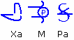

# Тьраги – это да’Арийская система записи

**Тьраги – это да’Арийская образная система письма**, она отличается от руники - х’Арийской Каруны. Тьраги читаются в 4-х направлениях: первый смысл идёт к сердцу – справа налево, второй от сердца – слева направо, после горизонтального чтения идёт по вертикали: нисходящим и восходящим – вниз, вверх. Поэтому многие тексты с Тьрагами, когда переписывались, то их делали таблицами. При этом в строке может стоять только одна Тьрага, тогда её образ будет распространяться на всю строку, но управляющей она будет только для того вертикального ряда, в клетке которого она стоит.

**Пример (см. Рис. 1):** Тьраги читаются справа налево, т.е. написано «Ра-М-Ха», а при обратном чтении, «Х» в индусских и многих других языках не произносимо, поэтому будет читаться «Амрита» - напиток Богов, дающий безсмертие, т.е. источник вечной жизни. Получается: Рамха – тот, от кого отошёл Свет, материализованный в Мирах, и несущий положительную Силу; и в обратном – который является источником жизни, проявленном во всех структурах Мироздания.

\* Тьраги – это громадные образы, чтобы описать только одну Тьрагу, может получиться полкнижки. Но все Тьраги взаимосвязаны. При переводе там ещё как ссылки, комментарии вставляются.  
\* При чтении древних текстов сразу обращайте внимание, сколько Рун в строке, если 16 Рун - это изначальная Каруна, если 32 Руны – значит перевод с Тьраги.

**Тьраги - это очень древняя система, ей пользовались да’Арийцы у себя на Родине**, т.е. где они жили до переселения на Мидгард. Видимо им так удобнее – использовать одну Тьрагу для обозначения какого-то образа-действия.  
Допустим, данная Тьрага имеет смысл – остановиться во времени для осмысления действия. И заметьте, где бы мы могли использовать такую Тьрагу? В поезде рядом с указателем «стоп-кран» - чтобы не писать длинно «стоп-кран», а поставить одну Тьрагу, и это значит: остановка во времени для осмысления действия.

Но эта система пока сложная для вашего восприятия, тем более что она не вписывается в систему, которой вы пользуетесь изначально, т.е. в Буквицу.
