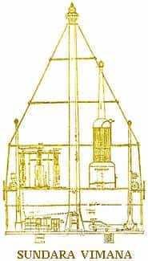

# Вайтмана

**Вайтмана** – это летающая Небесная Колесница, т.е. космический корабль, на котором Боги и люди путешествуют между Землями (планетами).

1. Этимология  
2. Вайтмана и Вайтмара  
3. Вайтманы в индийских ведах

## Этимология

Вайтмана — это не просто название, это образная структура.  
**Мана** - заметьте, в русском языке есть понятие «манна небесная», т.е. с небес посыпалась манна; или «манная каша» до сих пор. Но говорят, что это пришло с еврейского, с Библии, хотя в еврейском языке и в Библии нет слова «манна». Т.е. это наши вставили наш прообраз примерно соответствующий образной структуре того языка. «Манна» - это наше слово. И манной ещё называли сияющий лунный диск. Поэтому и в санскрите есть тоже выражение «mana» - сияет как лунный диск, или сияет как Луна.  
**Вай** (ваю) – ветер.

Поэтому, если дословно переводить образ Вайтмана - это как сравнительная структура, которая по облику напоминает **сияющий диск Луны, излучающий ветер**.

## Вайтмана и Вайтмара

**Вайтмара** – это большая Небесная Колесница, межгалактический корабль для перелёта из одной Галактики в другую, он на землю никогда не опускается, потому что корабли такого типа очень большие, могут быть размером с Землю и больше. Вайтмары способны переносить в своём чреве до 144 Вайтман.

**Вайтмана** – это малая Небесная Колесница, на которой спускаются на землю, т.е. как бы исследовательский корабль. И в Саньтиях Веды Перуна сказано, что когда Вайтмана опускается на Землю «великое сияние и пламень окружают её», это лишний раз подтверждает, что Вайтмана сияет, т.е. как лик Луны - он же сияет в небесах, особенно когда полнолуние; и она ещё имела огненную форму, т.е. либо излучатель какой-то, или просто как пламя сопла корректирующего. Это всё образное, не дословное описание.

## Вайтманы в индийских Ведах

В «Рамаяне», в «Ригведе» (II тысячелетие до н.э.) и других произведениях дошедших до нас из глубокой древности, встречается описание различных летающих объектов, которые называются «**Виманы**» - это искажённое наименование Вайтманы, искажение произошло при переводе с х’Арийского языка на Санскрит. Допустим, в «Ригведе» говорится, как грозный Бог Индра мчался в пространстве в воздушном корабле, ведя войну против демонов, уничтожая города своим страшным оружием.

Называются 4 типа летательных аппаратов:  
\* **Рукма-Вимана** - трёхъярусный летательный аппарат конической формы с движителем в основании. На втором «этаже» — кабины для пассажиров.  
\* **Сундара-Вимана** - во многом похожа на «Рукма-Вимана», но имеет более обтекаемую форму.  
\* **Трипура-Вимана** — более крупный корабль, причём он многоцелевой и может быть использован как для воздушных, так и для подводных путешествий.  
\* **Шакуна-Вимана** – этот летательный аппарат самый сложный в техническом и конструктивном отношении, но и наиболее манёвренный.

Древние источники утверждают, что существовали летательные аппараты для странствий в пределах «сурья мандалы» и «накшатра мандалы». Что это за пределы? «Сурья» на санскрите и современном хинди значит - солнце; «накшатра» – звезда; «мандала» – сфера, область. Нет ли здесь указания на полёты внутри Солнечной системы и на межзвёздные расстояния?
