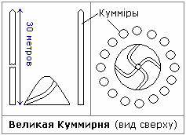

# Врата Междумирья на Алтае

В Лето 1004 от основания Асгарда Ирийского на берегу х’Арийского моря (Байкал) спустились с небес четыре Вайтманы, они привезли для строительства Капища множество разных дивных камений, кои сыскали на Лунах далёких, возле Земель Стрибога и Ния. От месяца Дайлетъ дня 10-го до месяца Элетъ дня 36-го миряне Круга Родов (т.е.16 Родов) освобождали чрево Вайтман от многодивной ноши, и каждый Род представил для деяния благого по три полных Круга мужей своих (т.е. по 432 человека. Полный Круг = 144).

Многие дары, кои принесли Вайтманы с небес во чреве своём, направили зодчим, сотворяющим **Капище Рода в х’Арийских горах** (Алтай). В сём Капище Рода по Божеской воле надлежало быть Кругу Многовратному место. В месяц ветров (Вейлетъ) дня 9-го в полдень, круг х’Арийских Родов приступил к созиданию Капища Рода. В одной из пещер были убраны стрелы каменные, что смотрели друг на друга сверху и снизу (т.е. сталактиты и сталагмиты).  
\* В Капище Рода Йогиня собирала детей-сирот.

**Используя силу Вышнего Взора, они размягчали каменья пещеры**, и круг путей торили в недра пещеры, в глубины земли постоянно спускаясь. На 150 и ещё 7 саженей спустились под землю зодчие мудрые, там каждый путь завершался залом пристойным, от них ниспускаясь спиралью древней снова пути уходили под землю (т.е. от каждого зала отходили 16 путей). На шаге девятом (то есть на 9 уровне) одной из спиралей был установлен **Круг Многовратный, на коем начертаны Руны Чертогов** (т.е. символы созвездий, см. Сварожий Круг). Из шага 8-го в залу со Кругом ворок путей устремляли дороги, но по одному лишь возможно добраться (т.е. делали лабиринт). Тридевять залов (27), лежащих под Кругом, хранили кристаллы Силы (энергии) Мидгарда. Вход в залы те был доступен лишь Диям. За два тридевятых положенных Лета построили Капище и в День Числобога отворили Врата (т.е. **строили 54 года**).

Во всех залах Капища и в путях тайных на вышних треногах хранились сварожичи, что тьму отгоняли светом лучистым и не нуждались в питании древесном (т.е. на высоких треногах были источники света). Многие залы определили под схроны (тайники), в них размещали дары всем Богам. Пути до тех схронов были потаённые, никто, кроме ведающих их не отыщет. Перед Капищем Рода в роще Перуновой (т.е. дубовой) была сотворена **Куммирня Великая**, где в вышину 7 саженей великих 16 могучих Куммиров стояло, а в центре меж ними Свасти кружилась и поднималась на 8 аршин к требнику сильному рядом со Дунией.  
\* Великая сажень = 426,72 см, т.е. Куммиры были сделаны выстой почти 30 метров. В центре был холм высотой почти 6 метров, на его вершине установлен требник, к которому спиралью (Свати) шло четыре пути, т.е. с каждой стороны света.

После того как, призвав Числобога, Круг Многовратный раскрыл своё сердце, к Чертогу Медведя отправились три странника, кои ушли в Чертоги Сварожьи, из них принеся Великих Сварожичей (т.е. какие-то светильники), и звали их Гавата, Доброга и Карсттин из Чертога Медведя. Призвали их, чтобы деяния творили и свет принесли в благодатье Чертогов для Капищ Инглии, что стояли в Асгарде. Сих Сварожичей в схроны спустили, что в глубь уходили таённой тропою, и **схроны закрыли неведомой силой**, что вход открывался в те тайные схроны по слову заветному в Рунах сокрытому. Лишь жрец, рекущий слова те заветные мог стены раздвинуть и в схроны спуститься.

Из залы, где покоился Круг Многовратный, **40 путей проложили к колодцам**, что уходили во чрево земное. Эти пути нарекли обережными, для тёмных созданий их предназначили, для тех, кто проникнет тайком на Мидгард, используя Силу Кругов Многовратных (т.е. даже если кто-то из тёмных проникнет через Врата Междумирья, не выйдет из пещеры).

## Комментарий

То есть, в древнем тексте говорится, что в 103773 году до н.э. на Мидгард-Землю прибыли 4 грузовые Вайтманы, которые привезли камни со спутников Сатурна и Нептуна для строительства Капища Рода и Врат Междумирья в Алтайских горах. С помощью энергетического излучателя (Вышней Силы) размягчали камень и пробивали проходы в горе. Сделали 9 подземных уровней, на каждом уровне 16 залов - лабиринт с тайными ходами и ловушками. На первом уровне было Капище Рода, а на девятом Врата Междумирья, путь к ним закрыли неведомой силой, т.е. речевая система – чтобы раздвинуть стены надо знать определённую фразу, которая скрыта в Рунах.

**Другие Врата Междумирья**. Известно, что Врата Междумирья были в Кавказских горах, но Перун их разрушил, потому что они вели в Пекло. Были Врата в Карпатах, в Болгарии, в Опалённом стане, в Такеми (Египет), т.е. Врат Междумирья было много.

> «Воздавайте уважение Богам вашим и Творцу Единому, и обрящете мир и покой в жизни вашей, и да будут открыты Врата Междумирья для вас» - Бог Рамхат.
