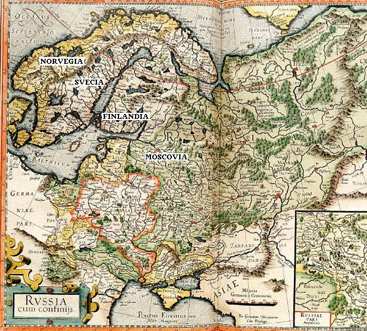
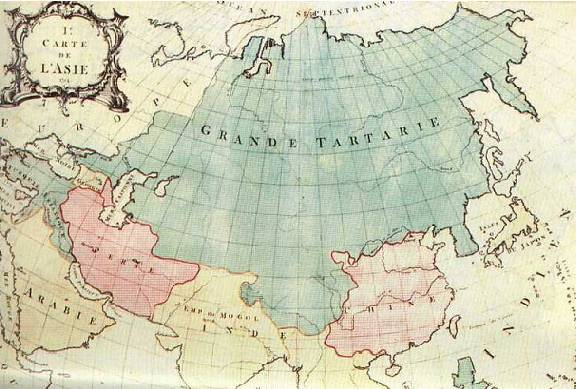

# Земли Свята Расы

1. Киевская Русь, Пруссия, Славия, Скандинавия  
2. Карта славянских земель  
3. Славяне – северные, южные, западные, восточные  
4. Скифия и Гардарика  
5. Иоакимовская летопись

## Киевская Русь, Пруссия, Славия, Скандинавия

Согласно советской и христианской истории, славяне занимали только маленький участок, который называют «Киевская Русь» - это название появилось во времена христианизации, а до этого здесь было как бы два княжества: Русь и Рось, т.е. Русь населяли Анты, а Рось – Росы, сейчас их называют малоросы или украинцы, которые жили на краю славянских земель. Т.е. **христианская и советская история ограничивают земли славян только Киевской Русью**, а остальные наши земли сделали как бы не нашими, допустим: поляки – разве это не восточные славяне?

**Пруссия** - Поморская Русь, здесь жили поморы, и она шла аж до Печоры и далее – разве это не наша земля?

**Славия** – название пошло от города Словенска на Волхове, который построил князь Словен, мы уже это разбирали на прошлом уроке (см. Расселение западных славян): «В Лето 3113 великий князь Словен поставиша град и именоваше его именем своим Словенск [ныне Великий Новгород]».

**Скандивнаия** - земля князя Сканда («Душа Сканда») – разве это не славянская земля? Когда мы разбирали князя Сканда: он сходил в Дравидию (Индию), навёл там порядок, вернулся, и Патер Дий Одина благословил его на переселение. Его повёл волхв по имени Моиск или как его ещё называют – МоИсей, и когда они дошли до озера, волхв умер и озеро нарекли в его честь, поэтому в летописях пишут: «Река Волхв впадает в езеро Моиском завомого», т.е. в честь волхва Моисея – Моиск. А князь Сканд пошёл дальше, и построили они Асгард Свитьодский – название происходит от Свии – несущие свет Одина. И когда князь умирал, его спросили: «Что, нам уходить с этой холодной земли?», он ответил: «Нет, моя Душа будет охранять землю сию». А по-славянски Душа умершего – «навия», поэтому и земля, которой покровительствует Душа славянского князя Сканда, названа СкандиНавия.

Найдём подтверждение в старых картах.

## Карта славянских земель

Карта «**Руссия и сопредельные**» (фрагмент), 1594 год. Составитель: Герард Меркатор, карта впервые опубликована в Дуйсберге в 1595 г. в Атласе Меркатора.  
*\* В более крупном масштабе карту можно найти в Google Картинки.*  

На карте видим, что даже в XVI веке европеец Меркатор признавал, что русские земли - это вся **Скандинавия, Дания, Польша, Украина, Бессарабия… до Стамбула** - всё наше, и до Рипейских гор, т.е. до Урала – это всё Русские земли («Rvssia»). Идёт Обь, Иртыш, а восточная сторона – территория Лукоморье. Также на этой карте отмечена на юго-востоке большая территория «Asiae pars», т.е. «территория Асов», и далее «Tartarjae pars», т.е. «территория Тартарии». «Germaniae pars» - германские территории. Всё что за Уралом – это **Великая Тартария**, но многие переводят неправильно, как «татары». Тать-Арии – «враги-арийцы», т.е. записали нас в татары. Хотя на самом деле «Тартария» - это производная от двух имён: Бога Тарха и Богини Тары, получилась Тартария.

Следующая карта 1754 года, французская. Россия даже не указана, а просто показана большая территория от Урала - «**Grande Tartarie**» - Великая Тартария. Розовым цветом указаны два протектората: Аримия (она же Китай, Chine) и Персия (где жили «Перуна сыны»), а также северная, центральная и восточная Индия. Поэтому для европейцев эти земли были далёкие. Для аримов была установлена граница, за пределы этого рубежа переходить им было запрещено – это Великая изгородь или Великая Китайская стена, т.е. Кийтай (Кий – «изгородь», Тай – «великая»).

Сохранились и другие карты, подтверждающие, что это всё наши исконные территории. Т.е. **всё Северное полушарие принадлежало белым народам**. И абсолютно неверно утверждение, что Киев – мать городов русских. Правильнее сказать, Киев – мать городов, с которых началась христианизация. Но христианизация у нас была недавно, всего лишь 1000 лет, а городам словенским и славянским многие десятки тысяч лет.

## Славяне – северные, южные, западные, восточные

\* Скандинавия, Пруссия и пр. – это северные славяне.  
\* Югославия, Турция – южные славяне.  
\* Европа вплоть до Британских островов – западные славяне.  
\* Дальше на восток - восточные славяне.

Заметьте, сейчас северных славян вообще не упоминают.

На славянских землях были построены Асгарды (Грады Богов): в Беловодье – Асгард Ирийский, в Скандинваии – Асгард Свитьодский, в районе Ашхабада – Асгард Согдийский.

**Италия** – это была территория этрусков (т.е. этнос руский) или как они сами себя называли – Расены. Но греки и эллины называли их по-своему – «тиррены», т.е. тираны, потому что как только придут к ним скот угонять, сразу по шее получат, всё - тираны, обижают.

Кроме того, греки любили воевать с другим славянским племенем – Анты или «атланты» как их называли греки. И заметьте, даже у Платона в «Критий» и других, с кем греки воюют? С антами (атланты). То, что сейчас пишут об атлантах в книжках, что ростом они были под сто метров и пр. - это всё выдумки. История другая.

**Названия морей:**  
\* Чёрное море называлось Роским морем, и оно не разделялось на Азовское море, а было одно море, просто сейчас изменилась береговая линия.  
\* Где Белое море – там у нас уже пошёл Студёный океан. Студёный - потому что до наклона земной оси, эти моря были тёплыми. А после наклона и потопа произошло похолодание в связи с тем, что атмосфера была закрыта, и вода там остыла. Поэтому вода стала студёная, т.е. холодная. Т.е. всё это показывает, что история на самом деле была несколько иная, чем нам её преподносят.  
\* Балтийское море у наших Предков записано как Словенское море. Но в последствии Балтию греки и европейцы называли Скифским, потому что там плавал наш флот. Хотя Каспийское море было Скифским морем, а в последствии Хвалынским.

## Скифия и Гардарика

**Скифия** (Скития - страна священных городов), захватывает Ростовскую область, Краснодарский край, Ставропольский край, Адыгею, весь Кавказ, и территорию по ту сторону Кавказа. Скифия - это где у нас озеро Ван, так называемое Ванское царство. И заметьте, на юге Ванское царство (Скифия) граничила с территорией Асов. Скандинавские предания как раз и сообщают о том, что иногда возникали конфликты между Асами и Ванами, но потом они обменялись как бы представителями, но некоторые перевели, как обменялись заложниками, что абсолютно неправильно - представьте, кто будет заложников назначать князьями, верховными жрецами, правителями? Может такое быть в реальности? Нет. Т.е. это уже христиане свои домыслы пытаются ввернуть в историю.

**Гардарика** (страна сотен городов) – так жители Скандинавии, т.е. северных русских княжеств называли земли Славии и Поморья, потому что там все города были огорожены («Гард» - это крепостная стена), потому что с других земель водным путём можно проникнуть по Неве, Печоре, Оби, Нямунасу, Даугаве к другим городам, поэтому их ограждали стеной.

Восточнее Чёрного моря проходили караваны, поэтому всегда начеку все были, и вокруг городов не ставили такой мощной крепостной стены, поэтому здесь жили не как город в современном понимании, а как город-скит, отсюда и пошло название Скития – страна Священных городов, потому что в них постоянно горел Священный огонь, рядом с торжищами находились всевозможные культовые сооружения. Представитель любого народа (неважно: белый, чёрный, жёлтый) мог придти в любом городе в своё Капище, т.е. в Храм своего бога и исполнить то, что положено. Допустим, кто-то умер в дороге, то здесь его могли похоронить по обряду, который в их землях существует. Поэтому когда археологи раскапывают древние города Скифии - начинают спорить между собой, одни говорят, что здесь была тюркская культура, другие говорят – нет, арабская, а здесь чуть ли не эфиопская, т.е. не знают к какой культуре отнести. А на самом деле там всё наше славянское, просто те приезжали на торжища и имели здесь свои культовые сооружения.

## Иоакимовская летопись

«Лето 3099 Словен и Рус с Роды своими отлучашися от Эксиннопонта [это греческое название Чёрного моря] и от Роду своего и от братии и хождаху по странам вселенныя, яко крылатии орли перелетаху пустыни многие, ищущие себе места на селение; и во многих местах почивающе мечующе их, и нигде же не обретоше себе селения. 14 лет пустынны места и страны обхождаху, дондеже дошедша езера некоего великого, Моиска зовомого [т.е. от Чёрного моря на юг дошли до озера Моиск], последи Ирмер проименовася во имя сестры их Ирмеры [потом уже переименовали в Ильмень]. Тогда волхование повеле им наследником места того бытии. И старейший Словен с Родом своим и со всеми иже под рукой его сиде на реце зовомой тогда Мутная, посреди Волхов проименовасе во имя старейшего сына Словена, Волхова зовома».

И заметьте, что происходит дальше:  
«Лето 3113 великий князь Словен поставиша град и именоваша его именем своим Словенск, иже ныне зовётся **Великий Новград**, от устья великого езера Ильмера по реце Волхова полтретья поприща. И от того времени новопришельцы скифы начаша именоваться словения [т.е. по князю Словену]... А Скиф остася у Понта Имиотиса и в пустынях обитати питася от скот и прозвася эта страна **Скифия Великая**».

\* Заметьте, это греки и христиане переписывали нашу историю, Скифия у них происходит уже от Скифа, а не от того, что там были тысячи городов. И Скифия осталась только восточнее Чёрного моря.

«По устроению Великого града умрея Словен князь, а по нём в ладаху сыновья его и внуки сотни лет. И бег князь Вандал в ладая со славянами ходя всюду на север, восток и запад **морем и землею**, многие земли с краю моря повоева и народы себе покоряя и возвратился во град великий, а Вандал все земли от моря до моря себе покорил».

\* Т.е. князь Вандал ходил морем и землёю, а сейчас говорят, что первые корабли появились только при Петре I.  
\*\* «Все земли покорил» - получается, что не варяги к нам пришли и научили, а наши эти все территории освоили, всю Скандинавию, все острова. И здесь же говориться, что потомки Словена были новгородские князья, ведущие свой Род от сына Словена Вандала (это христиане так назвали, а по-славянски он Венд).

**Посчитаем, когда был основан город Словенск (Великий Новгород).**  
От Чёрного моря они вышли в Лето 3099, и через 14 лет был построен град Словенск. Сейчас у нас Лето 7523 – 3113 = 4410 лет назад, т.е. город основан в **2396 году до н.э.** Ну и куда там Киев со своей 1,5 тыс. лет? Или Москва 850-летняя? При этом сказано, что Словен со своими Родами дошёл до озера Моиском зовомого, т.е. перед этим там уже прошли славяне – волхв Моисий и князь Сканд, которого жрец Один из Асгарда Ирийского благословил на переселение. Т.е. это было ещё раньше. Уже история богатейшая, и флот был, и грады строили, а нам говорят о диких варварах, которые в землянках жили.
