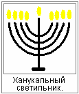

# Ханука

**Ханука** (обновление) – для евреев это праздник света, праздник обновления. Этот праздник посвящён победе Маккавеев в борьбе с греческими завоевателями во II веке до н.э. (т.е. сначала же греки захватили еврейское царство, братья Маккавеи изгнали греков, а потом уже пришли римляне). Ханука наступает после окончания осенних праздников, 25 числа месяца кислев (ноябрь, декабрь).  
\* В 1996 году Ханука начиналась с 12 на 13 декабря, в это время в России устроили выборы в Госдуму, в Совет Федерации, принимали Конституцию, т.е. всё это делалось как раз на Хануку.

В Торе нет заповеди, чтобы отмечать этот праздник, т.е. он имеет более позднее происхождение. **Рассказ об этом празднике сохранился в Библии**, в Маккавейских книгах, которые не вошли в еврейский канон. В ту эпоху (II век до н.э.) Иудея попала под власть греков, которыми управляли Селевкиды. После этого произошли следующие события:

> «Царь Антиох написал всему царству своему, чтобы все были одним народом, и чтобы каждый оставил свой закон. И согласились все народы по слову царя. И многие из Израиля приняли идолослужение его и приняли идолопоклонство его, и принесли жертву идолам, и осквернили субботу. Царь послал через вестников грамоты в Иерусалим и в города Иудейские, чтобы они следовали узаконениям».

Царь Антиох IV Епифан строго следил за исполнением своего указа. Он разослал гонцов по всем городам Иудеи с приказом строить языческие храмы, и приносить жертвы идолам. Царь запретил соблюдать субботы и праздники, другие законы иудейской религии. Для того чтобы следить за исполнением указа в городах были оставлены надсмотрщики. Многие евреи подчинились воле царя, и лишь некоторые преданные религии отцов отказались его принять, и укрылись в горах и убежищах. Иерусалимский храм превратили в языческое Капище. Во всех городах приносились жертвы идолам, язычники сжигали книги Торы, и убивали тех, кто продолжал соблюдать иудейские законы. Еврейскому народу угрожала утрата своей религии и веры отцов. В ответ вспыхнуло народное восстание, его возглавил священник **Мататьягу Хашмонай** (в руском переводе Маттафия Хасмоней и его пять сыновей возглавили). После смерти Мататьягу вождём стал его сын Иехуда (Иуда), прозванный «**Маккавей**» (по-еврейски: «молот»). По его имени это восстание было названо «Маккавейским». В результате тяжёлой борьбы евреи освободили Иерусалим и очистили храм от языческих жертвоприношений. Они построили новый жертвенник, и в 25-й день девятого месяца встали весьма рано и принесли жертву по закону на новоустроенном жертвеннике всесожжения.

## Значение праздника

> «В то время в тот самый день, в который язычники оскверняли жертвенник, обновлён он с песнями, пирами, с гуслями и кимвалами. И весь народ падал на лицо своё, и молились и воссылали благодарение на небо к Богопоспешившему им. Так совершали обновление жертвенника восемь дней с весельем, принося всесожжения и вознося жертву спасения и хвалы. И украсили переднюю сторону Храма золотыми венцами и щитами, и возобновили ворота и хранилища и сделали для них двери. И была весьма великая радость в народе и отвращено было поношение язычников. И установил Иуда и братья его и всё собрание Израиля, чтобы дни обновления жертвенника празднуемые были с весельем и радостью, в своё время, каждый год восемь дней». *(1Макк. 4:36-59)*

В Талмуде также рассказывается о чуде, которое случилось в те дни. Когда греки вошли в храм, они осквернили всё масло в храме, а когда царский дом Хасмонея победил их, стали искать чистое масло для светильника, нашли только маленький сосуд, запечатанный печатью первосвященника, в нём было масло лишь на одни день. Произошло чудо и в светильнике это масло горело восемь дней. За это время успели приготовить новое масло, а эти **восемь дней стали праздновать в память о чуде**. Поэтому на праздник ханука принято зажигать свечи, в первый день зажигают одну свечу, во второй две, в третий три, и так до восьми. По традиции свечи зажигают от особой свечи, называемой «шамаш». Ханукальные светильники очень разнообразны по исполнению. Некоторые из них настоящие произведения искусства. Это могут быть и подсвечники и масляные светильники, но общим в них является **количество огней = 9**. Восемь свечей посвящены дню хануки, и одна свеча – шамаш. Светильники зажигают вечером, при этом произносят благословение и поют гимн «Маоз цур йешуати», что переводится как «крепкая скала спасения моего». Зажигать ханукальные свечи – почётная обязанность еврейских женщин.

На хануку принято дарить детям деньги, и играть в волчок – **дрейдл**. Это азартная игра в которую играют только на хануку. В этот праздник так же готовится специальное блюдо, жаренные на масле картофельные оладьи, которые называются **латкес**. Возможно, этот обычай должен напоминать о чуде, связанном со священным маслом для храмового светильника.

Праздник Ханука означает для евреев: праздник освобождения от греческой оккупации, освобождение ихнего Иерусалимского храма, праздник воссоздания нового жертвенника и возобновления своих богослужений, и одновременно чудо с маслом, которое вместо одного дня горело восемь дней. Это праздник радости, спасения и игр.
