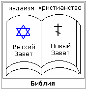
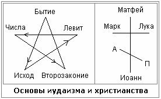

# Иудо-христианство

**Библия** – это одна книга, разделённая на две части, как две скрижали – Ветхий Завет и Новый Завет.  
**Ветхий Завет** – это Законы и Пророки, т.е. Тора и Танах. Основа Ветхого Завета – Тора (Пятикнижие Моисеево), генезис мы разбирали «Книга Бытия», а по-ихнему: «Бе-решит», или как говорят по-русски: «брешет» (ну этот Мойша и брешет). Пророки - это Книги Царств, Ездры, Илия и пр. - это всё иудаизм.  
**Новый Завет** состоит из 27 книг, 4 из них это Евангелия, как основа.

1. Звезда и крест (основы иудаизма и христианства)  
2. Догматы иудеохристианства  
3. Крепостное право - захват чужого имущества  
4. Геноцид и ментицид  
5. Нацизм (для Бога нет ни эллина, ни иудея?)  
6. Речь Алексия II перед раввинами

## Звезда и крест (основы иудаизма и христианства)

**Пятикнижие изображают как пентаграмму**, т.е. книги: Бытие, Исход, Левит, Числа, Второзаконие. Это как бы символ основы. Но иногда изображают в виде шестиконечной звезды, т.е. 5 книг Моисея и Танах. А в Новом Завете основа - **4 Евангелие, изображаются в виде креста**. Но иногда к кресту добавляют наклонную черту и помечают: «Послания» и «Апокалипсис» или Откровения Иоанна Богослова. Т.е. получилась как бы ещё одна система - называется «христианство».

Но заметьте, две религиозные системы, а учение одно и то же, одно продолжение другого. Поэтому, более правильное название учения: «**иудеохристианство**» или «иудо-христианство». А раз христианство имеет в основе своей иудаизм, значит, мы должны рассматривать христианство не само по себе, как нечто оторванное, а во взаимосвязи с иудаизмом.

## Догматы иудеохристианства

Что же они несут людям, какую основу? Ведь говоря словами Иисуса Христа: «Не может дерево худое приносить добрые плоды». А христианство набирает силу и вытекает из иудаизма. Поэтому рассмотрим конкретно несколько принципиальных догматов, доктрин и положений из Ветхого Завета иудеохристианской Библии:

**1**. «О прочих же народах, происшедших от Адама, Ты сказал, что они ничто, но подобны слюне» и «за ничто Тобою признанные» [3-я книга Ездры, гл.6, стих 56-57].  
\* Т.е. откровенное **унижение других народов**, а сравнение со слюной – это грязное оскорбление, пропаганда расового и религиозного превосходства богоизбранного библейского народа, и неполноценности других народов.

**2**. «Не отдавайте дочерей ваших в замужество за сынов их, и не берите дочерей их за сыновей своих, и не ищите мира с ними во все времена» [2-я книга Ездры гл. 8 стихи 81-82].  
\* Видите: «**не ищите мира с ними во все времена**», т.е. Ветхий Завет заставляет евреев находиться в состоянии постоянной войны с другими народами, и не иметь с ними никаких контактов, т.е. существовать как бы обособленно от них. Т.е. данные идеологические установки иудаизма разжигают межнациональную, расовую, религиозную и иные розни, непрекращающуюся войну с другими народами, чем они и занимались всю свою историю. И Тора как раз описывает постоянные конфликты и войны с разными народами (в одной только Палестине они полностью вырезали 150 народов и царей).

**3**. «Когда же введёт тебя Господь, Бог твой, в ту землю, которую Он клялся отцам твоим, Аврааму, Исааку и Иакову, дать тебе с большими и хорошими городами, которых ты не строил, и с домами, наполненными всяким добром, которых ты не наполнял, и с колодезями, высеченными из камня, которых ты не высекал, с виноградниками и маслинами, которых ты не садил, и будешь есть и насыщаться» [Второзаконие гл.6:10-11]  
\* Т.е. **паразитизм** - еврейский бог взял и пообещал им, что даст большие города, дома, которые они не строили; виноградники, которые они не садили, и пр. Но для этого, что они должны делать? Читаем дальше:

**4**. «Господа, Бога твоего, бойся, и Ему (одному) служи, и Его именем клянись» и «Не последуйте иным богам, богам тех народов, которые будут вокруг вас» [Второзаконие гл.6, ст. 13-14]  
\* Т.е. **иудаизм и христианство говорят, что бог един**, но тут же мы видим, что их бог говорит: «Не последуйте богам, тех народов, которые будут вокруг вас», т.е. боится, что перебегут. Заметьте, сама их книжка (Библия) признаёт, что у других народов есть свои боги.  
\* Читаем Псалтирь. Псалом 15, стих 4-5: «Пусть умножаются скорби у тех, которые текут к [богу] чужому, я не возлию кровавых возлияний их и не помяну имён их устами моими». «Господь есть часть наследия моего и чаши моей». Т.е. и здесь Давид признаётся своему богу, что он не обращался к иным богам, и не приносил им никаких жертв.

Данная идея программирует сознание на преступный захват чужого имущества, паразитизм, и естественно возбуждает и разжигает национальную, расовую и религиозную вражду между евреями и другими народами, у которых евреи хотят захватить их имущество. Допустим, в книге «Накрытый стол» (Шулхан арух), там чётко сказано, что имущество, находящееся у гоя – это не имущество гоя, а имущество еврея, которым гой временно пользуется (прим.: гой, аккум, нохри – это разные названия неевреев).

## Крепостное право - захват чужого имущества

Всю свою историю библейский народ «богоизбранный» занимался именно захватом чужого имущества. Дальше этим делом занялось христианство. **Каким образом?** Сначала они приходили в города, а то и в страны, по 1-2 человека; ходили проповедовали, заводили себе последователей, создавали стадо (т.е. паству), и этот миссионер превращался в пастуха (т.е. пастыря). Затем он собирал паству, они ставили часовенку или храм небольшой, после чего пастырь обращался к властям за охраной и поддержкой. Потом он втирался в доверие к местному руководителю (главе города, государства), и когда уже большинству народа промыли мозги своей пропагандой, тогда уже приходили с петицией: «Вот мы храм построили на земле, отдайте землю нам». Т.е. земли, на которых стоят наши храмы, которые возделывают наши общины – отдайте их нам в пользование или собственность.

А в последствии дошло уже до того, что потребовали (не безплатно конечно, а за хорошее подношение), чтобы их монастырям, храмам, общинам отписали земли вместе с людьми, т.е. подушные. **Так получилось крепостное право**, т.е. когда закрепили людей за какими-то религиозными организациями. И тогда уже вся собственность этих людей перешла в собственность данных религиозных организаций, а на самом деле даже не организаций, а людей, которые возглавляют данные организации, т.е. епископу или архиепископу, или митрополиту, архиерею, какому-нибудь служащему. Т.е. хотя он и говорил: «Я служу Богу и это всё (имущество) принадлежит церкви», но пользовался всем этим как своим. Т.е. прикрывались милостью, благодатью, а **в подвалах многих монастырей были тюрьмы, дыбы, т.е. пыточные** (и раскопки это подтверждают). Т.е. со словами мира на устах, и с ножом за пазухой.

## Геноцид и ментицид

Библия в Ветхом Завете постоянно пропагандирует превосходство еврейского народа над другими, стремление к мировому господству и существование за счёт других народов, т.е. что мы перед этим и записывали: «Будете есть плоды, которых не выращивали», т.е. паразитизм. И что говориться дальше:

> 23 изгонит Господь все народы сии от лица вашего, и вы овладеете народами, которые больше и сильнее вас;  
> 24 всякое место, на которое ступит нога ваша, будет ваше; от пустыни и Ливана, от реки, реки Евфрата, даже до моря западного будут пределы ваши;  
> 34 и взяли в то время все города его, и предали заклятию все города, мужчин и женщин и детей, не оставили никого в живых.  
> *Второзаконие, гл. 2.*

Одна из важнейших доктрин иудаизма – **физический и культурный геноцид**. Т.е. не только геноцид (или этноцид - физическое уничтожение народов), но и ментицид (уничтожение мышления, менталитета). Т.е. раз у них основа: «все рабы божьи», и в Ветхом Завете и в Новом Завете – рабы, т.е. даже евреи хоть и дети их бога, но всё равно рабы перед богом. А рабство уничтожает что? Мысль. Т.е. вам уже не надо думать, вам всё прописано в Законе (Торе), в Танахе - их изучайте, а от себя нечего выдумывать. Это и есть **ментицид, т.е. уничтожение менталитета**.

Давайте посмотрим, как еврейский бог Яхве (Иегова) учит евреев обращаться с иноверцами и их святынями, т.е. традиционными религиями других народов мира:

> 2 Истребите все места, где народы, которыми вы овладеете, служили богам своим, на высоких горах и на холмах, и под всяким ветвистым деревом;  
> 3 и разрушьте жертвенники их, и сокрушите столбы их, и сожгите огнём рощи их, и разбейте истуканы богов их, и истребите имя их от места того.  
> *Второзаконие, гл.12.*

**Т.е. надо всё разрушить, что создано другими народами**, их наследие, и даже истребить имя их, предать заклятию. Но и это ещё не всё, Господь говорит им о розыске инакомыслящих:

> 12 Если услышишь о каком-либо из городов твоих, которые Господь, Бог твой, даёт тебе для жительства,  
> 13 что появились в нём нечестивые люди из среды тебя и соблазнили жителей города их, говоря: «пойдём и будем служить богам иным, которых вы не знали»,  
> 14 то ты разыщи, исследуй и хорошо расспроси; и если это точная правда, что случилась мерзость сия среди тебя,  
> 15 порази жителей того города остриём меча, предай заклятию его и всё, что в нём, и скот его [порази] остриём меча;  
> 16 всю же добычу его собери на средину площади его и сожги огнём город и всю добычу его во всесожжение Господу, Богу твоему, и да будет он вечно в развалинах, не должно никогда вновь созидать его.  
> *Второзаконие, гл.13.*

Т.е. не просто услышь, а ещё и разыщи. Для этого была создана специальная система, в которой разыскивали всех инакомыслящих, кто не служит этому богу среди иудеев, а поклоняется иным богам. И в те далёкие времена, согласно Торе и Танаху, их выискивали. Теперь мы знаем, как эта розыскная система называется – «**Моссад**», это ни какая-нибудь новая организация, а опыта у неё разведывательного более 3 тысяч лет. Любая разведка мира позавидует.

Дальше читаем Законы иудаизма:

> 16 А в городах сих народов, которых Господь, Бог твой даёт тебе во владение, не оставляй в живых ни одной души,  
> 17 но предай их заклятию: Хеттеев и Аморреев, и Хананеев, и Ферезеев, и Евеев, и Иевусеев, как повелел тебе Господь, Бог твой.  
> *Второзаконие, гл.20.*

**Идёт перечисление народов, которые надо полностью уничтожить**. Т.е. не один народ, как Адольф Алоизович хотел очистить, чтобы они не мешали немцам и австрийцам развиваться; а в Торе приведён целый список народов, которых полагается поголовно истребить. При этом они тоже знакомы с законами РИТА (телегонией), поэтому ихний бог говорит им, чтобы они убивали всех, а девственниц оставляли для себя.

> 17 Убейте всех детей мужеского пола, и всех женщин, познавших мужа на мужеском ложе убейте;  
> 18 а всех детей женского пола, которые не познали мужеского ложа, оставьте в живых для себя.  
> *Числа, гл.31.*

Заметьте, иудо-христианская Библия напичкана откровенными призывами к убийствам и **уничтожению всех национальных культур**, кроме своей конечно. Последователи иудаизма постоянно уничтожали и уничтожают памятники чужой культуры, уничтожают исторические названия городов и улиц. Простой пример: в каждом городе есть улицы Маркса, Ленина и прочих библейских товарищей, и везде эти товарищи не только с народами и культурой, они ещё и с исторической действительностью борьбу ведут, т.е. они создают как бы свою, новую историю пропихивают. Помните в школе у нас был учебник истории, а в 9-10 классе была новая история, а потом ещё и новейшая. Т.е. это как бы написанная, из Торы взятая, потом переписанная заново – новая история, а потом новейшая – ещё раз переписанная. Т.е. они это делают постоянно, обрезая, извращая, фальсифицируя то, что было в действительности, и при этом запрещают изучать наследие по первоисточникам. Попробуйте в отдел редких рукописей в библиотеке попасть или в архивы первоисточников, там надо столько справок, и ещё неизвестно допустят или нет.

## Нацизм (для Бога нет ни эллина, ни иудея?)

В Ветхом Завете сказано, что у бога есть только один народ – евреи, а другие - за народы даже не признаются. В Новом Завете то же самое, но при этом интернационализм. Т.е. в Ветхом Завете даже не национализм, а можно сказать нацизм, при этом в Новом Завете вдруг интернационализм, ведь Павел сказал: «идите во все народы», и какой фразой это мотивируют? «Для Бога нет ни эллина, ни иудея». Но **эллин – это тоже еврей**, т.е. были греки и были эллины или *Hellin* (Hell – это ад, преисподняя, - это тоже их). Поэтому конечно **для еврейского бога нет различия, то ли еврей из Палестины, то ли еврей из Греции**, какая разница, тот еврей, и тот еврей. Т.е. заметьте, «нет ни эллина, ни иудея», потому что это один еврейский народ, а в Новом Завете христианам это скармливают как интернационализм.

## Речь Алексия II перед раввинами

Что говорил Патриарх Московский Алексий II перед раввинами города Нью-Йорка, 13 ноября 1991 года?

> «Мы едины с иудеями не вопреки христианству, а во имя и силу истинного христианства, а иудеи едины с нами не вопреки иудейству, а во имя и силу истинного иудейства. Христиане потому отделены от иудеев, что они ещё не вполне христиане, а иудеи потому отделены от христиан, что они не вполне иудеи. Ибо полнота христианства обнимает собой иудейство, а полнота иудейства есть христианство».

Всё просто. И все эти якобы ругань, рознь, противоречия - это всё внешнее, наносное, для того чтобы создать видимость как бы разграниченности. А когда надо, они садятся вместе и обсуждают все свои дела.

Дальше: Иудо-христианство (часть 2)
