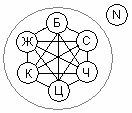

# Конфессиональное взаимодействие

Так или иначе, любой человек имеет свои собственные полученные с детских лет жизни представления о мироустройстве, на основании которых складывается его отношение к непознанному и неизведанному, а также к прошлым событиям, происходившим не только с Предками его Рода-Племени, но и к событиям, происходившим на Земле и во Вселенной. Вся эта информация, которую человек получал, она у него складывалась, как сейчас принято говорить, в его **религиозные представления** или в его вероисповедание. Т.е. чем больше был объём информации о прошлом, настоящем и будущем, тем громаднее было Наследие его Предков, тем выше был уровень восприятия данного человека. Если объём информации о прошлых событиях был ограничен, то такая информация становилась догматической, т.е. ограниченной. При этом независимо от уровня данной догматической информации, каждый человек считает, что только эта информация самая полная и самая истинная. \*Сразу оговорюсь, что слова «каждый человек» - здесь это относится только к человеку, который владеет догматической информацией.

1. Разделение информации  
2. Инакомыслие и низменные инстинкты  
3. Уровни полноты знаний  
4. «Общечеловеческие ценности» - гибрид  
5. Разделяй и властвуй (пример: РПЦ)

## Разделение информации

, духовные течения (ДТ), культы (К).")Допустим, есть какая-то **целостная информационная система**, например, о прошлом, но кому-то желательно, чтобы только он или группа людей контролировали данную информационную систему. И со временем, новым людям, которые родились и живут в определённой среде, где существуют данные знания, им уже передавалось не целое, а часть. Т.е. сначала скрывалась половина, потом, разделяя людей, срезали ещё на половину, т.е. давали половинку от половинки. При этом сами знали всё. И со временем вводилась специальная система, чтобы человек, который получил одну часть информации (допустим: 1/8), должен был пройти определённые испытания, чтобы получить доступ к следующей части (1/4), получив ещё одну порцию информации, он опять проходил испытание на лояльность к тем, кто хранит целое знание, и тогда он получал другую половинку.

Иногда человеку хватало 1/4 или 1/8, и он начинал считать, что эта информация, которую он получил – она полная. Поэтому **эти кусочки информации постепенно трансформировались в самостоятельный круг**, как бы в целостную систему. Т.е. те, кто владел, допустим: 1/8 частью информации, или четвертью информации, она у них трансформировалась в определённый круг. У кого была половина информации, тоже трансформировалась в свой круг. То есть из целого начали появляться всевозможные **культы, духовные течения, духовные учения, религии**. При этом каждый, стоящий во главе какой-то системы, считался для своих последователей непогрешимой личностью, наместником Бога на Земле и т.п. Т.е. какой-то жрец, священник, гуру, монах...

И только лишь те, кто имел целостную систему, и передавали её как целостную, это у нас была **ВЕРА** или Вероисповедание, т.е. Вера, которую испокон веков ведают.

Кроме того, допустим, из кусочка 1/8 ещё берут половинку, т.е. 1/16 и этот маленький кусочек тоже выделяют в самостоятельную структуру, которую принято называть **сектой**.

Поэтому, когда мы слышим: «Вот там духовный учитель приехал», или «Там какой-то культ совершают», или «Там собираются представители какой-то религии (секты)» - уже по этим понятиям можно определить, насколько люди далеки от целостной формы. Но при этом каждая система, вышедшая из целого, объявляла себя Истиной в последней инстанции, самой правильной и самодостаточной (т.е. есть вот это, и больше ничего не надо).

## Инакомыслие и низменные инстинкты

Приняв какой-то кусочек информации как целое, все остальные люди, которые имели совершенно другую информацию, непохожую на данную, или коренным образом отличающуюся, автоматически **заносились в разряд чужих**, их называли: неверные, язычники; погане, а также еретики, крамольники, вероотступники, сектанты и т.д. Впоследствии отношение к людям с иным мировосприятием становилось более холодным и потом враждебным, доходящим до фанатического неприятия существования иной информационной среды и живущих в данной информационной среде.

Всяческое вольное толкование определённой информации не допускалось, оно вводилось в **жёсткие рамки понимания**, и за отход от установленных канонов, впоследствии установилось наказание, вплоть до смерти. При этом данная жестокость объяснялась как забота о вечной Душе или о вечном Духе, которые необходимо постоянно от чего-то спасать, чтобы получить жизнь вечную.

Представления о вечной жизни преподносились последователям данных ограниченных информационных форм, как воплощения их низких помыслов, как удовлетворение всех желаний и полное безделье, которое руководители данных систем преподносят как отдых после тяжёлой земной жизни. Единственная обязанность, которая пропагандируется в вечной жизни - это **восхваление и прославление какого-либо Бога или Учителя**.

И заметьте, что говорят эти учителя своим последователям о вечной жизни? «Там молочные реки и кисельные берега», т е. на **низменные инстинкты**, что всегда будет набит желудок. А люди даже не задумываются, как можно набить желудок, если тело в ящик положили и в землю закопали или кремировали. Или допустим, в исламе - там тоже о низменных чувствах, т.е. в этой жизни Коран допускает иметь 4 жены, а там тебе дадут сразу 72 штуки, пожалуйста, наслаждайся сколько тебе влезет (при этом именно девственниц, т.е. которые для тебя). Так что давай, полагайся на волю Аллаха и всё получишь! Также культы, секты и пр. опять низменные желания, низменные потребности. И всё это для того, чтобы не дать человеку гармонично развиваться.

## Уровни полноты знаний

Иерархия систем относительно полноты знаний:

\* **Вера** - сначала идут представители вероисповеданий, над нами никого, кроме Богов и Предков.  
\* **Религия** - ниже представители религий, потому что у них уже как бы сформированная система.  
\* **Духовные течения** и Духовные движения  
\* **Культы**  
\* **Секты**  
\* **Атеизм** - ниже сект, его можно отнести и к богоборцам.  
\* **Материализм** - ещё ниже, здесь признаётся всё только материальное. Допустим, Предков, которые жили тысячи, миллионы лет назад, их нельзя пощупать, уже даже нельзя археологически раскопать; а для материалистов всё, что не имеет подтверждения – это отвергается. И главный материалистический принцип: «Этого не может быть, потому что не может быть никогда». Т.е. заметьте, атеизм – это как бы против Бога, т.е. антибожие, но при этом отвергая Бога, они верят в чёрта, домового, в порчу, сглаз, наговор, т.е. всё равно вера какая-то есть в информационный источник, который выходит за пределы человеческого понимания. А материализм воспринимает только то, что может понять.

Некоторые пытаются сюда ещё и **примитивизм** вставить, т.е. первобытность и прочее. Но очень часто получается, что первобытно-общинные племена, с их воззрениями на Природу и прочее, они стоят выше по уровню и находятся либо где культы, либо имеют свою религию, или даже свою собственную веру, допустим: догоны или австралийские аборигены, у них своя целостная система.

**Матрица, которую мы сейчас расписали, имеет отношение ко всем народам**, живущим на Земле. Т.е. у белых сейчас это всё присутствует, у жёлтых это всё присутствует, у красных, у серых, у чёрных это всё присутствует, и даже цветное население Земли, т.е. смешанные – создают свою смешанную систему, но опять же на этих принципах.

## «Общечеловеческие ценности» - гибрид

Т.е. у белых – своя система, и все уровни присутствуют; у жёлтых своя система; и у всех других народов свои системы, и тоже всё это есть. И если раньше шло противоборство в одной системе, то теперь противоборство такое - цветные пытаются белым привнести свою систему, а также несут своё понимание жёлтым и пытаются повлиять на серых, красных и чёрных. Белые пытались и красным и чёрным привнести свою систему. Серые влияют и на белых, и на жёлтых, и на красных, и на чёрных. Т.е. во многих местах стало происходить **замещение родных форм на чужеродные**. Сейчас вся эта система переплелась до такой степени, что появилась какая-то внешняя надструктура (N), которая стала называть это всё единым целым, как бы «общечеловеческие ценности».

Но при этом, выбирается со всех систем что-то угодное для этих «N», и облекается в новую форму. «N» - это как раз искусственное создание на базе этих шести видов людей, это и есть «неизведанные», неведомые для простых людей, это те, кто **пытаются извне собрать это всё в кучу и создать некий гибрид**. Т.е. тех, кто под буквой «N», разные народы называли по-разному: чужеземцами, евреями, alien national (т.е. чужой народ), чужие, инопланетяне, пришельцы, демоны и т.д. Т.е. «N» - это нечто другое, которое не имеет ни исторического прошлого на Мидгард-Земле, не имеет, как принято говорить, мифического прошлого на Земле, не имеет наследия на Земле, т.е. следов их пребывания на нашей Земле не было. Но используя информацию из разных кругов, они для себя как бы создают информационную матрицу, чтобы жить на Земле, т.е. проникать в жизнь, и зная информацию о прошлом вот этих всех народов, они создают как бы себе застолблённое информационное поле, т.е. как бы прописку: «А вот здесь мы жили испокон веков».

## Разделяй и властвуй

Вот мы разобрали систему. Т.е. придя в новую жизненную среду, сначала изучается Наследие, входят в доверие к старшим Родов (старейшинам), и со временем это всё переписывается под себя, т.е. идёт внутреннее вторжение в определённую систему. Потом «разделяй и властвуй» - стравили людей, народы сами себя уничтожили, а они остались. **Вот принцип: разделил – стравил - остался на данной территории хозяином**, хотя данная территория никогда ему не принадлежала.

Заметьте, чуждая система, проникая в другую, сначала её принцип - не высовываться, закрепиться, набирать побольше информации. А через несколько поколений, когда уже потомки тех, кто помнил что они пришлые, умрут, тогда уже можно говорить: «Вот стоит наш храм, и мы здесь живём давно». Т.е. вновь рождённые воспринимают так, что стоит храм чужого бога, и при дедах был и при прадедах, а раз стоял всегда, это конечно нечто другое, но вроде на нашей территории. А ещё через несколько поколений, это другое объявляет себя здесь хозяином.

**Пример: РПЦ** - 1000 лет назад пришли к нам византийцы, греки; сначала для народа они были греки, потом священников поменяли на русских, потом объявили это всё Российской церковью, т.е. при Петре 1 уже не Греческая церковь греческого обряда, а Российская, да ещё и «православная». А при большевиках Российская церковь автоматически трансформировалась в Русскую церковь. Т.е. произошла плавная подмена понятий.

Если бы тысячу лет назад кто-то сказал что это «**Русская православная церковь**», его бы тут же за клевету, за ложь лишили бы языка. А сейчас это уже вроде бы в порядке вещей. И при этом все понятия подменены, вот что главное: чёрное выдаётся за белое, белое за чёрное, а среднее – серое, как первооснова между чёрным и белым. И получается винегрет не только в Душах, но и в памяти, языке, а значит и в мыслях, и в образе жизни. А когда везде «винегрет» - это называется «мутная вода», а раз мутная, значит и сознание замутнено, а значит человек не может ориентироваться, и его как барана ведут в определённом направлении. Но при этом ему говорят, что его ведут к светлому будущему, даже вопреки его желанию. А светлое будущее для него – это скотобойня.
