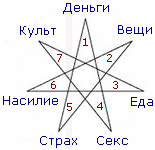

# Семиконечная звезда (звезда магов лунного культа)

Семиконечная звезда называется «звезда магов лунного культа» или просто: звезда магов.  

**Связующая система:**  
\* Деньги (1) она ведёт к сексу (4), т.е. секс и деньги связаны.  
\* Секс связан с культами тёмных (7).  
\* Культы связаны с едой (3).  
\* Еда связана с насилием (6), т.е. чтобы съесть надо у кого-то отнять.  
\* Насилие связано с вещами (2).  
\* Вещи связаны со страхом (5), т.е. вдруг украдут.  
\* Страх связан с деньгами (1), их тоже могут украсть.

То есть, вот они взаимосвязи, одно с другим. Получается замкнутый круг, хоть в одну сторону, хоть в другую.

## Звезда магов в США

Сегодня работу этой системы хорошо видно в США, т.е. собрали граждан со всех стран и в этом «плавильном котле» обрабатывают их в 4-х плоскостях:

**1. Деньги** - для американца деньги превыше всего.  
**2. Вещи** – надо или не надо, лишь бы купить. Т.е. сначала рекламой приучили к бутикам, появилась даже болезнь «магазиномания», а теперь уже изобрели таблетки от этой болезни и предлагают их покупать.  
**3. Еда**.  
**4. Секс**.  
Затем появляются дополнительные факторы:  
**5. Страх** – вдруг деньги отнимут, или вещи какой-то лишусь и т.д. Плюс подаётся эта система как «Побойтесь Бога», т.е. если украл – дай богу десятину.  
**6. Насилие** – чтобы бороться со страхом, им предлагают насилие. Допустим, они боятся своему боссу сказать в глаза, потому что их тут же уволят, поэтому придумали специальную комнату, где кукла похожая на босса, иди и набей этой кукле морду, т.е. как бы отдушина… но ведь это тоже проявление насилия.  
**7. Культ** – культ тела, культ лживой красоты, культ питания, религиозный культ, культ насилия и т.д.

Всё это (как тёмные внушают людям) ведёт к достижению благополучия в этих системах. И все эти системы соединяются в семиконечную звезду. Поэтому иерархия тёмных сил создаёт различные системы воздействия, допустим: христианство, ислам, иудаизм, бахаизм и др. они могут внешне быть не похожи, и внутри этих религий создаваться различные направления, но чтобы они не говорили, в их основе – строгое посещение собраний, пожертвования, страх. И заметьте, **за 2000 лет не появилось ни одной христианской Державы в общинной форме**, о которой говорил Иисус. Потому что, если всё будет на Совести и Любви, тогда кем они будет управлять? Как сказал Иисус: «По деяниям их узнаете их. Приходят к вам волки в овечьей шкуре». Вот и думайте, решайте сами.
