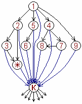

# Тёмная иерархия

На схеме показана лишь верхушка иерархии тёмных сил. Все они оказывают влияние на Кащеев, а от них уже идёт влияние на разные структуры, Миры. Эта система, хотя она отражает лишь небольшую часть всех тёмных, которые в ней есть, легла в основу науки: **демонология**.

Т.е. из «Тайной Книги Иоанна» нам уже известно, что падшие ангелы во главе с Сатанаилом явились как бы противниками Невидимого Отца, они создавали свои Земли (планеты), допустим, нашли Землю с морями, почвой и создавали там свои лаборатории, жилые районы, т.е. обживали.

**Кащеи** – это правители серых. Их ещё называют «бессмертные», т.е. бесы, несущие смерть (именно беСсмертные, а не беЗсмертные, потому что они смертные). Кащеи управляют серыми народами, которые идут по бездуховному технократическому пути.  
**Главная задача кащеев** – накопление природных элементов, несущих и накапливающих психическую энергию, т.е. золото и кристаллы. И чтобы это накопление не прекращалось, они пытаются свою власть распространить на большее количество Миров и народов, населяющих различные Земли. Т.е. одних серых им мало.

## Тёмная иерархия

**1. Сатанаил** (*Сатана*, лат. *Люцифер*) – это владыка тёмных Земель Мира Нави (т.е. планет мира тьмы). «Тьма» по-славянски это числительная форма = 10 тысяч, т.е. Сатанаил – владыка 10000 планет, которые под его руководством пошли по технократическому пути развития. Родитель Сатанаила был одним из Элохимов, которого называли «Бог семи небес» или как потом его назвали «Бог седьмого неба». В Тайной Книге Иоанна сказано, что Сатанаил с 7-го неба доходил до самой преисподней, до Огня, но дальше его не пускали.

**2. Самаэль** (евр. *Шмаэль*) – помощник Сатанаила, князь воздуха и ангел Суда (как бы верховный судья) на Землях в тёмных Мирах Нави.

**3. Лилит** – создание Сатанаила, первая жена Адама и первая жена Самаэля, родила двух детей Белиала и Саваофа. В связи с тем, что эти дети были кошмарны и уродливы даже по меркам тёмных, их стали называть «**демоны**», а Лилит увидев своих родившихся детей, восприняла это как месть божию, дала слово убивать каждый день по 100 младенцев в тех народах, которые отказываются от наречения своих детей её именем (т.е. Лилит или Лолита). Но в тех мирах, где простирается её влияние и мощь, она старалась, как правило, убивать девочек.

**4. Гагтунгр** – тёмный князь, обеспечивающий захват Земель в различных звёздных системах. Делал захват через своих помощников, которые не имели жалости, сострадания, любви, совести и т.д., поэтому их называли «**бесы**». Кроме того, ему помогали помощники, которые переходили черту дозволенности, нарушали всякие правила и законы, поэтому их называли «**черти**», от слова «черта» (но раньше писали через «О» - чорт, чорта). Захваченные Земли, Гагтунгр присоединял к территории Мира Тьмы, и при этом охранял свои Земли в тёмных мирах от проникновения чужих, поэтому его называли охранителем тёмных миров Шаданакара (об этих мирах более-менее доступно описывал Даниил Андреев в своей книге «Роза Мира», а также о них можно прочитать у Василия Головачёва «Посланник (Вирус Тьмы)»).

**5. Вельзевул** – тёмный князь демонов, которого ещё называют «повелитель мух», т.е. может насылать всяких мух и прочую заразу (но «мухи» не в современном понимании, а раньше так называли различных членистоногих, т.е. это демоны из цивилизаций членистоногих).

**6. Белиал** – помощник Вельзевула, сын Лилит. Тёмный князь, который был высшим проявлением Вероломства и Обмана.

**7. Даниэль** – в переводе «судья бога», т.е. назначенный богом. Данный судья отправлял осужденных либо на вечные страдания, либо на уничтожение.

\* **Саваоф** – сын Лилит и Самаэля, князь тьмы. На схеме отмечен звёздочкой (\*) – он главнокомандующий и управляющий всеми звёздными силами Сатанаила.

**8. Асмадей** – тёмный лег (т.е. ангел), истребитель жизни, уничтожитель всего живого.

**9. Левиафан** – ангел вод, хранитель тёмных знаний, т.е. знаний Мира Тьмы, а также управляющий хищными существами, живущими в воде (акулы, крокодилы и пр.).

Дальше: Отличие Света от Тьмы
