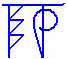

# Вера и религия - отличие

Вера состоит из двух Рун:  
Веда – Мудрость, Знание.  
Ра – изначальный Свет.

**Вера** – это **изначальное Знание**, которое имеет каждый народ, то есть язык, культура, традиции, обряды, праздники, информация о Предках (откуда собственно появился данный народ, где его корни) и прочее. Эта система знаний называется одним словом - ВЕРА, то есть Мудрость, и эти знания передаются из поколения в поколение. Поэтому Вера у каждого народа своя (свой язык, традиции, Предки), но одни хранят это Знание, а другие относятся к нему равнодушно: есть – хорошо, нет – и не надо.

**Религия** – это **повторная связь** высшего с низшим (РЕ – повтор, ЛИГА – объединение). Допустим, по каким-то причинам люди утратили Веру (цельное знание), и пытаются восстановить связь с родными Богами, познать древнюю Мудрость своих Предков, и какой-либо посланник начинает высказываться от имени Бога, на основе этих высказываний создают учение (заповеди, информация о прошлом, и так далее). При этом хорошо, если посланник правильно передал информацию и его правильно поняли, а могут и исказить. Или какой-то «мудрец» начинает по-своему объяснять Веру, как он её понимает в зависимости от своего образования, культуры, такую религию и создаёт. Поэтому религий много, это искусственно созданные учения, какая-то часть от целого Знания (Веры).

## Искажение религии

**У славян Вера и Жизнь – это одно и тоже**, то что существует, миропонимание, Вселенские Законы, поэтому исказить Веру невозможно, также как нельзя исказить восход Солнца или Звёздное небо. Человек может экспериментировать только в вопросах религии – вводить какие-то догматы, постулаты, правила, потом их отменять и вводить другие.

Религиозные люди иногда решают такие вопросы, о которых вообще никакого понятия не имеют. Пример: на втором Вселенском Соборе множество христиан мужчин несколько месяцев решали: **есть ли у женщины Душа?** Лишь с перевесом в два голоса выиграли те, кто сказали, что у женщины Душа есть. (У славян не может стоять такого вопроса, потому что Вера гласит – Душа есть не только у людей, но и у животных, птиц, камня, древа, Земли, Небес… то есть у всего есть своя Душа). На шестом Вселенском Соборе христиане **отменили понятие реинкарнации**, то есть понятие о повторном рождении на Земле, потому что решили, что так будут легче подчинить себе людей, сказать, что живёшь один раз, а потом или вечное блаженство или вечные муки, третьего не дано.

## Вера и религия 1000 лет назад

Мы уже разобрали, что религия – это какая-то часть от целого Знания, причём может быть взята из чужой Веры. Допустим, в основе христианской религии - **Пятикнижие Моисеево**, т.е. история еврейского народа, их версия Сотворения Мира и сотворения человека (Бытие), еврейские правила храмовой службы, поклонение еврейскому богу и прочее. Заметьте, христиане **уничтожали библиотеки белых людей** и на Западе и у нас, то есть древние знания наших Предков, и вместо них давали часть знаний еврейского народа (исТОРЫю), Древлесловенскую Буквицу заменили церковно-славянской Азбукой, славянские обряды и праздники заменили иудо-христианскими, хотя у многих из них остались языческие корни. Нам следует осознать, что произошло и удалить все чужеродные вкрапления. ВЕРА – это Сияющая Мудрость.

\* Вера как миропонимание, пишется с большой буквы и с буквицей Ять [Вѣра], а обычная «вера во что-то» с маленькой буквы и с буквицей Е.  
\*\* **Вѣра** – это просветление знанием, понимание Законов Природы, а **религия** – это слепое следование каким-либо традициям.

Храмы славян
