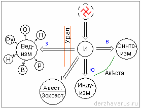

# Ветви Инглиизма

**Инглиизм – это Изначальная Вера**, т.е. единая изначальная система, которая была у наших Предков, когда они прибыли в Даарию. И заметьте, Изначальная ВЕРА она была изначальной и на Ингарде и на других Землях, где живут белые люди.

Но проходит некоторое время, и проживать компактно вместе уже тесновато. Роды Асов начинают расселяться, при этом каждый Род переносит данную систему на новое место жительства, и происходит расширение Вероисповедания, т.е. за счёт расширения территории. Проходит ещё определённый период времени (неважно 1000, 10 000 или 100 000 лет) происходит опять разделение. Но, когда уже большие массы народа расселяются в разные места, получилась следующая система (см. **рис. 1**) - пунктиром отмечена Изначальная Вера (Инглiизм), которая была у нас на Севере в Даарии, потом наши Предки переселились в Беловодье, и вся эта система в изначальном виде перешла с Северного материка на территорию Беловодья (нынешняя Западная и Восточная Сибирь).

1. Ведизм  
2. Индуизм  
3. Синтоизм  
4. Авеста (война белых с жёлтыми)  
5. Авестизм и Зороастризм  
6. Культы  
7. Христианизация

## Ведизм

Когда начались переходы за Урал (за Каменный пояс), а это длительные переходы, то **часть информации терялась**, т.к. допустим, в дороге кто-то из Хранителей Мудрости умер и не успел передать всю информацию, которой владел. Тот, кому он передавал информацию, получил её уже не полностью, и дальше также начинал передавать в неполном объёме своему сыну, и т.д. Но у них были Саньтии и Харатьи, которые хранили Мудрость (Мудрость – это Веды). Поэтому, переходя на Запад, люди начали полагаться только на те Веды, которые хранили их Рода. Поэтому в скором времени на Западе появился похожий, но уже не полный Круг Знаний (см. предыдущий урок), основанный на данном учении, т.е. даже не на учении, а основанный на тех изначальных Ведах, которые хранились там.

Таким образом, если у нас изначально был Инглиизм как основа, то на Западе появился уже **Ведизм - т.е. Вера, основанная на Ведах**. При этом, заметьте, Ведизм - это не религия, потому что Ведизм не утверждал: «Я – самодостаточная система, и только то, что моё - правильно, а остальное неправильно». Потому что Заповедь Сварога она для всех звучала: «Не отвергайте Богов вам не ведомых и познавайте Мудрость всех Родов человеческих». Потом уже на основе Ведизма начали появляться другие системы (см. ниже: Культы).

## Индуизм

Потом наши Предки пошли на юг, а там жили представители другого вида человечества – чернокожие народы: Дравиды и Наги. Наши Предки, расселяясь и живя там, не могли спокойно воспринимать человеческие жертвоприношения Богине Кали, убийства, уничтожение каких-то форм жизни. И белые на основе Инглиизма, или как сейчас говорят, на основе Мудрости Вед, создали там **систему, основанную на Ведах и понятную чёрным людям**. Эта система получила название - Индуизм. Т.е им сначала одна книга Вед была дана, потом ещё две, но не в полной, а в урезанной форме. И для них даже был составлен язык, которому их научили (Самскрыт). Таким образом, появился Индуизм.

## Синтоизм

Также наши Предки пошли и на восток. И вот эта система Родового саморазвития для жёлтых людей, она тоже дала толчок к развитию новой формы, которая превратилась в Родовую религию жёлтых – Синтоизм. Т.е. основа вся та же: Родовые взаимоотношения, культ Предков, культ Природы, но **основная взаимосвязь была уже с традициями и обычаями жёлтых народов**, обитающих на Востоке. Т.е. сначала японцы жили на материке, а уже когда начался конфликт религиозных систем, очень много народу переселилось на остров, чтобы сохранить вот эту привнесённую систему. Но помимо синтоизма, у древних японцев существовали ещё и свои верования, поэтому если изначально в синтоизме была веротерпимость в отношении к другим верующим, то после переселения на острова, синтоизм стал самодостаточной системой, т.е. системой, которая воспринимает только себя.

## Авеста (война белых с жёлтыми)

Территориальные конфликты, которые были между белыми и жёлтыми на юго-востоке, привели к **войне между Великой Расой и Великим Драконом**. Одновременно здесь шла борьба не только воинская, но и в системе мировосприятия и мировоззрения. Получилось так, что те, кто появлялся извне, так называемые: «посланцы неба», «сыны неба», они пытались стравливать жёлтые народы (Аримов) с белыми (РАСА). Это привело к конфликту, белые в этой войне выиграли, и был подписан договор о мире, который у нас назвали: «Сотворение Мира в Звёздном Храме».

После этого вся предыстория возникновения конфликтов, т.е. как это видели обе стороны, сами битвы и победа белых над тёмными, т.е. над аримами была записана в книге, которая называлась: «Первая Весть», т.е. **Азъ + Веста = Авеста** (над буквицей «А» можно поставить титло, т.е. пометить как числовое, потому что цифрами не пользовались) - это **Весть о победе светлых над тёмными**, поэтому появился образ - белый витязь на коне поражает копьём крылатого дракона.

## Авестизм и Зороастризм

Те, кто участвовал в событиях «Авесты», потом вернулись домой и эти Роды с берегов Ирия переселились на Ближний Восток, эта территория стала называться Ириания (т.е. пришедшие с Ирия), а потом уже Сирия (С-Ирия), а когда пришли Жрецы Асы – стала Ассирия. Но там всё равно проживали, как они сами себя называли: «Перуна Сыны» (Персы). Там же местами и жёлтые проживали, т.е. как бы компактное проживание было, и в результате влияния «Авесты» на жёлтых, появился **Авестизм**.

Но прошло несколько тысяч лет, и мальчик, родившийся в Скифии (совр. Ставропольский край), прочитав Авесту, дал свою трактовку: «А почему все думают, что это было на Земле? Ведь Боги же живут на Небесах», поэтому битву он как бы с Земли перенёс на Небеса, и дал своё толкование Авесты. И вот Авеста в толковании Заратустры превратилась в **Зороастризм** (Авеста у него стала называться «Зенд-Авеста»). Таким образом, у тех, кто переселился на Ближний Восток, появилось две формы: Авестизм и Зороастризм.

## Культы

Дальше больше: Роды, которые переселились на Запад, и у которых были свои Боги-Покровители, т.е. это уже будем говорить, из Ведизма стали появляться не просто культы, а **Родовые культы** - культ Рода (Р), культ Велеса (В), культ Ния (Н) - он же Нептун, он же Посейдон, культ Перуна (П), культ Руевита (Ру), культ Одина (О). Но, если сначала это были обожествлённые Предки, то в последствии система этих Родовых культов переросла в то, что Предки, которые Боги – живут на Небесах и как бы регламентируют. Т.е. появились уже не Родовые культы, а как бы мы сейчас сказали - **религиозные культы**.

Но отсюда ещё вышли и другие системы, которые были построены не на Богах-Покровителях данных Родов, а системы, в которых покровительствуют Боги, управляющие Стихиями или самой Природой. Так, допустим, появился **культ друидов**, т.е. жрецов леса, или Друидизм. И другие всевозможные формы.

## Христианизация

Многие задают вопрос: «Почему представили Старой Веры, старых культов, старых религий проиграли в борьбе за народ перед христианами, почему позволили христианам себя уничтожить?» Но вопрос как бы в корне не верный, они не позволили пришлым себя уничтожить. Т.е. здесь совершенно другое: **старые культы в основе имели хоть и частичный, но образ Изначальной Мудрости**, т.е. все эти системы были основаны на веротерпимости в первую очередь (веротерпимость не в современном понимании). Т.е. когда приходили представители другого культа, их воспринимали как равных себе: «Ну, веришь ты в другого Бога, верь на здоровье» (у каждого свои Предки). А христиане, они тихой сапой начинали готовить своих последователей из среды данного народа, особенно начиная с маленьких детей и женщин. Т.е. они не сами, а уже своих последователей противопоставляли представителям Старого Культа. Т.е. использовался принцип «разделяй и властвуй».

Допустим, когда в 999 году проходила насильственная **христианизация Исландии** - собрался альтинг (т.е. Совет глав Родов), и старший сказал: «Пусть каждый для видимости пройдёт обряд крещения, т.к. для нас это не что иное, как просто купание, но пусть Закон Одина живёт в сердце каждого». Т.е. они пошли на хитрость, официально прозвучало, что Исландия теперь христианская и крещена, хотя никто там поклоняться Христу и не собирался, т.к. в сердцах у всех живёт Закон Одина. Так же было и в других странах. Но заметьте, как только официально территория объявлялась христианской, тут же все эти проповедники почему-то уезжали, посчитав, что дело своё сделали; а люди как жили своими старыми Родовыми законами и устоями, так и продолжали жить. Поэтому до 1970 года Исландия так и считалась официально языческим государством, где люди жили Старой Верой, или как её ещё называют «**Асатру**», что дословно означает: «Вера в Асов», т.е. в Богов, в Предков. И они сохраняли своё Изначальное.

И заметьте, как бы христианизация славянских земель не шла, как только они не уничтожали Ведизм, Родовые культы, жрецов, волхвов и пр., но даже после 75 лет безбожия – атеизма, и уже не помня своей изначальной Веры – Инглиизма, сейчас как грибы после дождя, люди начали возрождать свои Родовые традиции. Называют их по-разному: Родноверием, Любомудрием, Славянским язычеством и т.д. Люди вновь стали прославлять Родных Богов, петь им гимны, славу, проводить обряды, празднества, как проводили их Предки и 300, и 500, и 2000 лет назад. О чём это говорит? Что, несмотря на официальную систему, где официальная религия была одна, народ придерживался совершенно другой точки зрения. И в основе Инглиизма – Веды, а Веды указывая на линию грядущего, говорят о грядущих переменах. Поэтому те, кто жил потаённо, сохраняя для потомков, они согласно Ведам чувствуют приближение перемен, и поэтому выходят и начинают эту всю систему возрождать.
