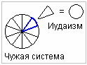

# Ветви иудаизма

Стоит пояснить, что сам иудаизм является малой частью изначальной системы серых (см. ветви Сефир). Т.е. когда серые появились на Мидгард-Земле, у них была своя определённая система, которую наши Предки называли: «**Чужая система**» или «Иная», т.е. иная форма суждений, иная форма жизни. Появилось это всё у нас на Востоке, в Шри-Ланке, южная оконечность Индии. Потом, когда их оттуда попросили, они перебрались прямиком в «страну гор рукотворных», т.е. в Африку, в Такемию, и вся эта Чужая система перешла туда в той же форме. И заметьте, когда Моше (Моисей) повёл евреев в Синайский турпоход, с ним же не все пошли, часть народа осталась. Те, кто не пошёл, они не захотели разделения и потери целостности системы.

1. Иудаизм - монотеизм  
2. Ступени иудаизма  
3. Ветви иудаизма

## Иудаизм - монотеизм

Изначальная система серых - это десятеричная система, **система десятибожия**, или как её ещё называли «шимот» - 10 шимотов божьих, т.е. 10 имён божьих. Но заметьте, из этой системы, Мойша выбрал только одну небольшую часть (см. рис.), и вот этот осколочек превратился из политеистической системы, т.е. многобожия, в систему монотеизма (единобожие). И эта система монотеизма в последствии трансформировалась из этого осколочка в самостоятельную систему, которая получила название - иудаизм. Заметьте не «Мошеизм» (по учителю Моше), а именно иудаизм, потому что не только относилось к колену иудеев, но на эту систему одновременно повлиял ещё Иуда Маккавей и братья его, которые, **взяв за основу монотеистическую систему**, сумели сплотить все племена Израиля для того, чтобы освободиться от греческих захватчиков, оккупантов.

**Разница между изначальной системой десятибожия и иудаизмом:**  
**1**. Иудаизм стал системой единобожия, т.е. когда во главе единый бог. Ведь не зря же Яхве (Иегова) сказал Мойше: «Да не будет у вас других богов кроме меня», т.е. он как бы выделил себя над остальными девятью богами, и сказал: «Я у вас главный, я вас создал, остальных даже упоминать не надо».  
**2**. Если в изначальной политеистической системе серых были знания и о Природных явлениях, и о Вселенной, и о Космосе, и о жизни после смерти, то после трансформации в иудаизм, все эти понятия либо отошли на второй план, либо исчезли вообще. Основа этого: «Зачем ждать когда-то чего-то? Живи, где живёшь, как в раю».

## Ступени иудаизма

Т.е. из старой веры пришельцев получилось самостоятельное учение. Но со временем иудаизм тоже начал делиться, хотя он оставался вроде как целым, но начал делиться как бы на 5 систем. Целостная система - это пять книг Моисея, т.е. Тора, пять основ мудрости или принципов Соломона, отсюда и пятиконечная звезда в последствии получила название «Маген Шломо» - звезда Соломона, и так же 5 ступеней к познанию, эти ступени можно расписать так:

**1. Тора** – т.е. познание пяти книг Моисея.  
**2. Танах** - т.е. познание Законов и Пророков.  
**3. Талмуд** – чтобы понять, что зашифровано в первых двух ступенях. Талмуд состоит из двух частей: Мишна и Гемара. И есть два Талмуда - Вавилонский (толкование Торы и Танаха составляли иудеи, жившие в Вавилоне) и Иерусалимский (составляли иудеи, жившие в Иерусалиме).  
**4. Каббала** – эта ступень даётся тем, кто стали талмудистами, т.е. разобрались в Талмуде. Каббала состоит из двух частей: Зогар и Сефер Йецира - там как раз Древо Сеферот, эта книга говорит о том, что когда-то было 10 шимотов божьих, 10 сеферотов божьих, 10 царств. И те, кто проходит четвёртый уровень, достигают 5-го уровня.  
**5. Хохн** (или как по-русски говорят «хохма») - хохна по-древнееврейски – мудрость. Этого состояния достигают очень, очень и очень редко. В основном идёт постоянный отбор, передача из поколения в поколение, и люди, которые вошли в состояние хохны, они себя причисляют к так называемому «Золотому миллиарду», т.е. как бы к мудрецам, которые (по их мнению) управляют миром.

## Ветви иудаизма

Со временем из иудаизма начали появляться всевозможные движения и течения. Запишем основные пять, это:

**1**. Христианство.  
**2**. Ислам.  
**3**. Хасидизм.  
**4**. Коммунизм.  
**5**. Социализм.

В свою очередь эти пять систем тоже делятся.

**Христианство:**  
\* Католики - самые многочисленные.  
\* Ортодоксы - старообрядцы, наша РПЦ, зарубежная РПЦ, греческая РПЦ.  
\* Протестанты - лютеранство, кальвинизм, баптизм и пр.  
\* Англиканство - т.е. английская королева объединила католицизм и протестантство в единую синтетическую религию.  
\* Новые течения - Аум Синрикё, Церковь последнего завета (Виссариона), Церковь Христа, и другие.

**Ислам:**  
\* Сунниты.  
\* Шииты.  
\* Ваххабиты.  
\* Суфизм.  
\* Новые течения и движения.

**Хасидизм:**  
Хасидизм - это ультраортодоксальный иудаизм, т.е. хасиды признают только Тору, никаких Мишн, Гемар, Каббалы и пр. И у них также разные течения, т.е. по различным учителям, и они даже одеваются по-разному: одни не бреются, другие бреют всю голову и носят только пейсы, кто-то ходит в чёрной шляпе с широкими полями, кто-то в коротких сюртуках с подвязками и т.д..

**Коммунизм:**  
Коммунистов каких только нет, тут даже в 5 не уложимся - есть национал-коммунисты, есть большевики, национал-большевики, есть левые коммунисты, есть правые коммунисты, центристы, правоцентристы, левоцентристы, троцкисты, марксисты, коммунисты-ленинцы, коммунисты-сталинисты.

**Социализм:**  
Социал-демократический социализм, национал-социализм, христианский социализм, исламский социализм, демократический социализм, «социализм с человеческим лицом», который строили при М.С. Горбачёве (видать до этого лицо было звериное :)

\* Прим.: в Чужой системе – политеизм, в иудаизме – монотеизм, а у нас – Родотеизм, т.е. единая система из множеств. У нас каждый может сказать: «Единый Род меня породил» - мама, папа, дедушки, бабушки, прадедушки, прабабушки и т.д., их много - это единство во множестве, и множество в единстве.
