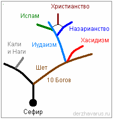

# Ветви Сефир – иудаизм, христианство, ислам...

Когда серые прибыли на Мидгард, у них было своё стройное учение – **Сефир** (это одно из названий, были и другие). И заметьте, их изначальное учение было политеистическим, т.е. многобожие. Затем начались деления на ветви:

**1. Кали и Наги** – эта ветвь отделилась от изначального древа. Т.е. одна из ветвей, сохраняя учение Сефир в чистоте, зациклилась, но от неё отошла ветвь, где шло подчинение Кали и Нагам – змеям (серпентам). Кали – чёрная мать (см. культы Индии).

**2. Шет (Сет)** – т.е. в Египте эта ветвь тоже отделилась от изначального древа, но здесь уже не было абсолютного множества Богов. В религии Шета осталось всего 10 Богов, и каждому Богу был отведён свой собственный Сефир (Цефир), и у них появилось учение о десяти Сефиротах – учение «Сефер Йецира», т.е. 10 Богов. Но у каждого Бога было своё имя, поэтому они почитали 10 шимотов Божиих, т.е. 10 имён Божьих.

**3. Иудаизм** – затем один из 10 Богов сказал: «Не хочу быть одним из…, хочу быть одним вообще». Он нашёл Мойшу и сказал: «Да не будет у тебя других богов, кроме меня. Иди сюда, я дам тебе своё учение». И так появился иудаизм. Но заметьте, иудаизм пошёл с религии Шета, и чтобы народ принял, им сказали: «главный Бог, тот который нас создал, с нами заключил завет, нам всё пообещал, он дал 10 заповедей» (ведь 10 – для шетников, шимотников было священное число), поэтому многие восприняли. Но многие не восприняли – таких Мойша вместе с братом своим Ароном, просто в пустыне вырезали. А многие шимотники вообще не пошли вместе с Моисеем в «Синайский турпоход», т.е. каждый из них имел своё дело (мастерскую, гончарную, ткацкую и пр.), и они сказали: «Ради чего куда-то идти, Бог уже дал нам достаток», и они про себя решили – у кого ничего нет, те пускай идут, а мы здесь останемся, нам и тут неплохо. И сейчас, заметьте, шимотники (т.е. чистокровные евреи, те у кого многобожие) – это самая как бы притесняемая народность в Израиле. Ведь там сейчас официально иудаизм, за это их и притесняют.

**4. Хасидизм** – эта ветвь выделилась от Шета и иудаизма, т.е. дальше пошёл чистый Шет, а от смеси Шета с иудаизмом появились различные направления, одно из которых – это современный хасидизм. Считается, что хасидизм появился недавно, хасиды – как ортодоксы иудаизма, которые строго признают только Тору, а Талмуд и другие книги не признают. Кроме того, есть и другие направления: **жиды, караимы** и прочие (см. символы иудеев).

**5. Назарианство** – это ветвь иудаизма. Т.е. пришёл Иешуа (Иисус) и сказал: «Не думайте, что Я пришёл нарушить законы (Тору) и пророков: не нарушить пришёл Я, но исполнить». И он создал свою ветвь иудаизма – назарианство, т.е. учение Иисуса из Назарета. Символом назариан была рыба – ИХТИС (Иисус Христос Божий Сын Спаситель).

**6. Христианство** – эту систему создал иудей Савл (апостол Павел), взяв за основу две ветви: иудаизм и назарианство. Т.е. уничтожая ветвь назарианства, он скрестил эти два учения между собой и создал христианство, которое в последствии также поделилось: **католичество, ортодоксия, арианство, копты** и прочие (см. ветви христианства). Т.е. западная церковь разделилась на лютеранство, протестантизм и прочие течения. Восточная церковь разделилась сначала в XIII веке (боролись с ересью жидовствующих), потом в XVII веке раскол на старообрядцев и никониан. Затем старообрядцы начали дробиться. И в ХХ веке никониане тоже поделились на РПЦ (в России) и РПЦЗ (которые за границей). А в 90-х годах появилась ещё и Истинно-Православная церковь.

**7. Ислам** – эту ветвь создал пророк Мухаммед, он скрестил иудаизм, назарианство, Шет, хасидизм, и объединил это всё в ислам. Т.е. Коран – это Тора, Танах, Евангелие Иисуса, добавленные комментариями Мухаммеда. И сделал он это для того, чтобы степные племена держать в кулаке, в жёстком порядке. Потом ислам начал делиться, появились: **сунниты и шииты**, в XIX веке появились **ваххабиты**.

## Подтверждение в Коране и Библии

Многие говорят: *«Как это может быть одна вера, если мусульмане воюют с евреями, мусульмане воюют с христианами, христиане-палестинцы воюют с евреями, т.е. все воюют – значит у них веры разные»*. Ничего подобного, вера у них одна. И это подтверждает Коран (см. ниже: сура 5 (Трапеза), аят 50, 51). При этом, заметьте - хоть ислам и отделился, но он связан и с религией Шета, где многобожие, поэтому Аллах у мусульман как бы един во множестве (как «народ» - говорим в единственном числе, но это же множество людей), поэтому и перевод Аллаха идёт во множественной форме – Мы.

> 50. И отправили Мы по следам их Ису [Иисуса], сына Марьам [Марии], с подтверждением истинности того, что было ниспослано до него в Торе. И даровали Мы ему Евангелие, в котором руководство и свет, и с подтверждением истинности того, что ниспослано до него в Торе. Он был руководством и увещеванием для богобоязненных.

\* Т.е. в Коране сказано, что Боги послали Иисуса подтвердить истинность того, что ниспослано до него в Торе; и даровали ему Евангелие (т.е. Новый Завет), в котором руководство как жить дальше. И Евангелие подтверждает то, что было до него в Торе.

> 51. И пусть судят обладатели Евангелия по тому, что низвёл в нём Аллах. А кто не судит по тому, что низвёл Аллах, те – распутники.

\* Т.е. есть путник - это кто знает свой путь, а есть распутники - кто не может выбрать по какому пути идти, и он мечется.

Таким образом, 50 и 51 аят 5-й суры говорят, что Коран, Библия, Тора – это одно и тоже учение. И допустим, та же **Библия объясняет, когда у них это всё разделилось** – согласно Библии, в XIX веке до н.э. жили прародители еврейского народа: Авраам и Сарра; Сарра не могла родить и дала свою служанку-египтянку Агарь своему мужу в наложницы, и та родила **Исмаила**. А потом уже Сарра родила своего сына **Исаака**. И Авраам благословил обоих сыновей. А согласно иудаистическим законам, преимущественным главенством всё равно обладал первородный сын. Т.е. благословляли только одного сына – старшего, а здесь он благословил обоих. И получается:  
- **исмаилиты** (представители ислама, арабы) ведут свою родословную от Исмаила, т.е. старшего сына Авраамической ветви, и они считают, что по всем законам, которые описывает Тора, Коран – младшие братья должны подчиняться старшим (закон уважения).  
- а **евреи**, как младшие потомки тоже Авраама, но от Исаака, говорят: нет, мы-то чистокровные, а вы от рабыни, поэтому мы вам подчиняться не будем, это вы нам должны подчиняться. При этом одна и та же система.  
\* Кстати, из-за этого выяснения кто главней, у них и идут постоянные конфликты, допустим, между сектором Газа и Израилем.

Но вернёмся к христианству, сейчас много пишут о том, что Иисус был арийцем, обошёл чуть ли не всю Россию, Индию, Китай, везде побывал. Но зачем гадать, кто он был по национальности – для этого есть Библия, где с 1 стиха Евангелие сказано: «Родословие Иисуса, Сына Давидова, Сына Авраамова…», т.е. не Бог, а сын Давида, сын Авраама, т.е. еврей, арийцы никогда не были сыновьями Авраама. Поэтому Иисус и говорил, чтобы к язычникам (т.е. к инородцам) не ходили, он послан только к погибшим овцам дома Израилева. Это уже потом Павел, создавая свою систему для подчинения людей, создал ещё одну структуру – христианство, и сказал, чтобы эту религию несли во все народы.
