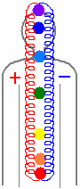

# 7 чакр в восточной системе (нота, цвет, этимология)

Восточная система насчитывает 7 энергетических центров (7 чакр), они расположены вдоль позвоночника и объединены между собой энергетическими потоками. Позвоночник - как связующий элемент, как проводник, и как у любого проводника, по которому течёт энергия, с одной стороны полярность «+», с другой «-». Правая сторона была указана положительными потоками ЯН, а левая – потоками ИН (сейчас смягчают, говорят Янь, Инь). Но это у восточников **Инь-Янь**, а у славян были свои названия: **Ха-Тха** (ХА - положительный поток, ТХА - противоположный). Сегодня всему приписывают восточные названия: китайские, индусские, хотя это старые названия наших Предков, которые они объясняли восточным людям, когда пришли в Дравидию (Древнюю Индию).

## 7 чакр в восточной системе

**1. Муладхара** (район копчика) – через неё проходят потоки энергии для грубой физической работы, а также собираются потоки энергии, которые впоследствии трансформируются в различные другие виды энергии.  
МУ – начало жизни. Заметьте, ребёнка кормит мать, а потом давали коровье молоко. Как объяснить ребёнку, что даёт жизнь корова? Корова - значит «Му».  
ЛАД – гармония, гармоничное состояние (когда «+» и «-» в равновесии).  
ХА – положительная энергия.  
РА – сияние.  
МУЛАДХАРА – это чакра, где начинает жить гармоничное положительное сияние. Т.е. как бы жизнь зарождается.

**Нота** - ДО  
**Цвет** – красный

**2. Свадхистана** (район лобка) – данная чакра перерабатывает энергии других жизненных сущностей, производит энергообмен между мужчиной и женщиной, а также воспринимает специально направленные энергетические потоки (сглаз, наговор, порча, проклятие и т.д.).  
СВА – небеса.  
Д – деяние.  
СИ – Луны.  
СТАН – место сбора.  
А – мера (в древности здесь стояла руна Арш, т.е. аршин – определённая мера).  
СВАДХИСТАНА – небесные деяния, где Лунные потоки собираются в одном месте.

**Нота** - РЕ  
**Цвет** – оранжевый

**3. Манипура** (район пупка) – через эту чакру человек получает (поглощает) энергию жизни космоса.  
МАНИ – энергия окружающего космоса.  
ПУРА – поглощённое сияние (ПУР –поглощение, РА – сияние). Пример: ПурГа – поглощённый путь.  
МАНИПУРА - энергия окружающего космоса, поглощённое сияние.

Пока человек находится в утробе матери, он через пуповину поглощает энергию окружающего космоса (космос для него на тот момент – утроба матери). До этого космосом для него служило межзвёздное пространство. После рождения пуповину перерезают, и ребёнок начинает поглощать энергию из окружающего космоса, т.е. из мира природы.

**Нота** - МИ  
**Цвет** – жёлтый (раньше говорили: златый или солнечный)

**4. Анахата** (солнечное сплетение) – через эту чакру проходила творческая сила, утверждённая Богами (или как сейчас говорят – творческая энергия созидания).  
АНА – творчество.  
ХА – положительная сила.  
ТА – утверждённая Богами.  
АНАХАТА – творческая положительная сила, утверждённая Богами.

**Нота** – ФА  
**Цвет** – зелёный

**5. Вишудка** (район гортани, до кончика носа) – чакра через которую протекает энергия чувственных образов.  
ВИШ – высшая система (отсюда - Вишну, или по-славянски Вышень).  
УД – чувственная.  
ХА – положительная сила.

В древности не пользовались матерщиной, построенной на идише, и называли мужские половые органы УДЫ – чувственная система. А женские - КРАСА. Многие спрашивают, а как же «удилище»? Но ведь удочка тоже чувственная система, через удочку, через леску чувствуешь, когда клюнет.

**Нота** – СОЛЬ  
**Цвет** – небесный (у славян нет голубого цвета; это ориентация, а не цвет)

**6. АДЖНА** (район чела, гипофиз) – взор в другое измерение, состояние. Человек через данную чакру получает энергию безчувственной окраски, и данный поток света человек использовал при энерговидении.

**Нота** – ЛЯ  
**Цвет** – синий

**7. Сахасрара** (район родничка и немного выше) – точка перехода в иной Мир, в иное состояние. Чакра переключает потоки мышления на работу, через него человек получает от Рода, от Богов энергию жизни. А также человек через эту чакру соединяется с хранилищем Мудрости - облака.  
СА – движущая, излучающая.  
ХА – положительная сила.  
С – соединяющая.  
РА – сияние.  
САХАСРАРА – движущая, излучающая положительная сила, которая соединяет два сияния.

**Нота** - СИ  
**Цвет** – фиолетовый

\* 9 чакр в славянской системе
