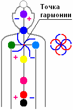

# 9 чакр в славянской системе

В славянской системе **37 основных энергетических центров**: 9 главенствующих и 28 определяющих, причём главенствующие центры разделены на три структуры:  
3 нижние чакры отвечают за физическое развитие человека;  
3 средние - отвечают за душевное развитие;  
3 верхние - отвечают за духовное развитие.

Все 37 чакр создают **энергетический крест**, именно о таком кресте говорил Иисус Христос своим ученикам: «каждый несёт свой крест» - не деревяшку на плече, а свой энергетический крест. Энергетические потоки пересекаются в одной точке и разворачиваются. Эта точка называется: **точка гармонии** или точка равновесия. Если в точке равновесия выделить потоки энергии, мы получим не просто крест, а вращающийся крест. Если этот крест соединить с противоположным потоком, получим древний славянский символ *Свадебник* (см. Солярные символы) – соединение мужского огня с женскими водами, т.е. мужское и женское соединилось воедино.

## 9 чакр в славянской системе

**1. ИСТОК** (район копчика) – здесь зарождается **энергия жизни**.

Звук - инфразвук (сверхнизкие частоты).  
Цвет – чёрный (неизведанный, т.е. за гранью человеческого восприятия).

**2. ЗАРОД** (район лобка) – чакра отвечает «за Род», т.е. за **рождение жизни**.

Звук – ДО  
Цвет – красный

**3. ЖИВОТ** (пупок) – живот по-славянски – **жизнь**. Жизнь зарождается в животе у матери. Сначала человек получает жизненную силу через пуповину. Затем, когда пуповину перерезают, получает жизнь от природы, тоже через живот.

Звук – РЕ  
Цвет - алый

**4. ПЕРСИ** (грудь, солнечное сплетение) – **творчество**. Нарастает творческая энергия.

Звук – МИ  
Цвет – златый

**5. ЛАДА** (правое плечо) – **любовь**. Чакра принимает и излучает энергию любви, добра. На западный манер называется «Солнечное дыхание».

Звук - ФА  
Цвет – зелёный

**6. ЛЕЛЯ** (левое плечо) – **интуиция**. На западный манер «Лунное дыхание».

Звук - СОЛЬ  
Цвет - небесный

**7. УСТА** (горловая система, до кончика носа) – **звуковая энергия**, материализует мысль.  
Когда эта система ещё сохранялась на Западе, данная чакра называлась «юста», отсюда и юстиция, т.е. устами провозглашённое какое-то правило.  
\* Заметьте, здесь заканчивается позвоночник, у нас есть Исток и есть Устье (Уста), здесь энергия вливается в другую систему.

Звук - ЛЯ  
Цвет – синий

**8. ЧЕЛО** (межбровье, «лоб») – чакра вырабатывает **образы и мысли**. Эта чакра также отвечает за энергетическое зрение. Чувствительная система этой чакры находится за гранями восприятия, взор в другое измерение, состояние.  
\* «Лоб» в кавычках, потому что по-славянски эта часть головы называется Чело (челом бьют, а не лобом). Лоб – это самая верхняя часть головы, отсюда и «лобное место», т.е. возвышенность.

Звук - СИ  
Цвет – марный (фиолетовый)

**9. РОДНИК** (темечко) – через эту чакру происходит **связь с Родом**. Человек получает поддержку своих Богов и Предков через этот энергетический центр, принимает энергии высших Душевных и Духовных образов.

Звук – ультразвук (сверхвысокие частоты).  
Цвет – белый

\* 7 чакр в восточной системе
