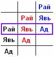
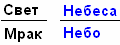

# Ад, Явь, Рай – троичность или свастичность?

Многие исследователи, академики, допустим: Рыбаков или Асов, он же Барашков, сравнивают славянского Триглава с христианской Троицей, потому что там 3 и здесь 3. Но они путают, **у славян не было троичности, а была свастичность**. Также сравнивают Велеса с Власием, потому что созвучно, но на самом деле ничего подобного, это не идентичность, а схожесть.

## Ад, Явь, Рай

Для примера рассмотрим общую для Востока и Запада философию: «Ад, Явь, Рай» - Ад находится внизу, над ним Явь (т.е. наш мир), а выше Рай [выделены чёрным цветом]. Но для кого-то Явь является Адом, а Рай для них - Явный мир, они там живут. Бог живёт где-то ещё выше (Рай2) [выделено красным цветом]. Для кого-то Явь2 является Адом, т.е. нижним миром. Рай2 – для них Явь, а более высший мир - Рай3 [синий цвет].  
Таким образом, **Рай в одной параллели является и Явью и Адом**.

То, что для христиан является Раем, для славян является Адом (ст.-слав. Пеклом). Это одна и та же структура, которая существует явно. Есть славянская поговорка:  
- «Будешь жить праведной жизнью – обретёшь Сваргу Пречистую, а будешь жить неправедной жизнью – попадёшь в христианский рай».  
Поэтому есть такое понятие – **две противоположности**.

**Свет и Мрак** (не говорю Тьма, потому что по-славянски Тьма – это число, десять тысяч). В мире Света - Сварга/Небеса (нет беса), а в мире Мрака - Небо (нет Бога). Заметьте, в христианстве: ангел первого Неба, ангел второго Неба… ангел седьмого Неба. Про Иисуса говорят, что он попал на **7-е небо**. А у славян: 16 Обителей Сварги иди **16 Небес** гармоничных, не считая промежуточных. Т.е. наша система уходит от рубежа вверх, а система Неба уходит вниз. Поэтому эти две системы не стыкуются. Между Светом и Мраком различия, между Небесами и Небом различия, значит системы неодинаковые, хотя по структуре могут быть схожи. Но для каждого из нас всё происходит по-разному.

Поэтому руский язык и обедняют, чтобы человек не знал различия между Небом и Небесами. Луначарский убрал приставку «БЕЗ», ввёл вместо неё «БЕС», и человек сам того не подозревая начал бесопрославление (БЕСславный, БЕСпорядочный и т.п.). Т.е. человек призывает беса, а у нас всегда было «БЕЗ». Потому что самое главное - разбудить в человеке Бога, потомка Богов.

## Кому служат христиане?

Спросите у священнослужителя любой религии, культа, что он знает о жизни после смерти. О каком мире он больше всего знает, в подробностях рассказывает, тому миру он и служит. Допустим, у христианских батюшек всё от Сатаны, от Дьявола, про Ад рассказывают, описывают его во всех подробностях. Ясно кому служат. Не может вероисповедание строиться на страхе.
