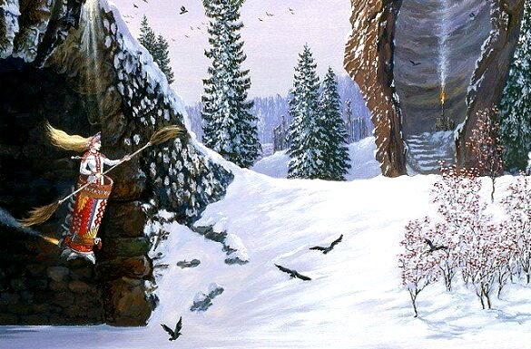

# Баба Яга и её Скит (черепа, избушка)

**Баба Яга** – это искажённый образ славянской Богини, которую называли Баба Йога (*Йогиня-Матушка*), добросердечная Богиня-Покровительница детей. Образ Бабы Йоги очерняют 1000 лет, но до конца превратить её в злодея так и не смогли. В трудную минуту все Иваны-Царевичи и Иваны-дураки приходят именно к Бабе Яге, та их кормит, баньку им топит, на печь спать уложит, а поутру путь укажет, клубок волшебный подарит, проблемы поможет решить и т.д.

Баба Яга / Картина «Полет», худ. Всеволод Иванов

Подмена образа молодой светлой Богини на горбатую старуху-каннибала, которая крадёт и жарит в печи маленьких детей, стала возможной потому, что вследствие христианизации забыли Родное славянское миропонимание, и уже Огненный обряд очищения детей стали воспринимать как сожжение детей.

## Предгорный Скит Бабы Яги

Предгорный Скит Бабы Яги находился в дремучем лесу (т.е. густой, непроходимый лес) и огорожен был высоким тыном с черепами.

\* **Скит** – это поселение с Капищем или Святилищем.  
\* **Тын с черепами** - это обережный круг. На кол одевали черепа медвежьи, волчьи, лошадиные и других животных. Т.е. животное умирало, а череп на кол, потому что считалось, что череп сохраняет в себе силу и мудрость данного зверя. Тын с черепами создавал обережный круг из животных, т.е. использовалась их сила и мудрость, чтобы недруги не могли проникнуть на данную территорию.

Для христиан такой забор с черепами - зло, нечистая сила. А в славянской традиции - обережный круг. Т.е. совсем другое восприятие.

А что было у Бабы Яги за тыном (забором) с черепами, что скрывал и охранял этот обережный круг? Избушку на курьих ножках из которой, как в сказках говорится, вылетала Баба Яга на летательном аппарате с двигателем в одну нечистую силу 🙂

## Избушка на курьих ножках

Мало кто обращает внимание, что избушка не на куриных, а на курьих ножках. Что это за «курьи ножки»? Это дымовые ножки.

**Избушка на курьих ножках** – это возможно летательный аппарат или какой-то механизм, позволяющий избушке вращаться: *«Воротись, избушка, к лесу глазами, а ко мне, молодцу, воротами»*.

Кроме того, в сказках избушка или **дымовая область** под ней являлась единственным проходом в иной Мир, т.е. зашёл и оказался в другом месте (в каком пожелаешь, в том и очутился). И на подворье Бабы Яги часто было много всевозможной жити и нежити – так наши Предки называли другие формы жизни. Значит, был проход не только на нашей Земле, но и на Землях в других системах, и через эти врата прибывали разные существа для обмена какой-то информацией и прочее.

К тому же избушка на курьих ножках **светилась днём и ночью**, переливалась огоньками, так её находили герои сказок: шли по тёмному лесу, увидели свет, а за тыном избушка. Эти огоньки наверно можно сравнить с фотографиями НЛО.

То есть было очень много всего, что современным восприятием не понять. Поэтому, чтобы не было путаницы между дымными ногами и куриными окорочками, чтобы вникнуть в смысл древних славянских сказок, понять что там в действительности происходило, надо менять мировосприятие.
