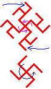

# Чакра (Чак-Ра) – это энергетический центр

**Чакра – это энергетический центр**, это система, работающая в двух направлениях: на приём и передачу энергии. Структурно чакра изображается как колесо двойного вращения (**колесо энергии**). Чтобы показать движение энергии в одну сторону, изображали символ «Коловорот». Если надо показать движение в другую строну, то рисуют зеркально - «Инглия». А чтобы показать, что чакра вращается в две стороны, лучи увеличивают и показывают направление в другую сторону, таким образом, получаем Цветок Папоротника (см. Солярные символы), либо Одолень Трава.

Чакра - это древнее славянское название, состоит из двух рун: **ЧАК** – круговая двунаправленная вращающаяся система, т.е. на приём и излучение; **РА** – сияние.

## Восточный символ чакры

В восточной системе не рисуют такие символы как «Одолень Трава» - объединение двух сил, т.е. двух противолежащих потоков. Они взяли за основу **символ Гаутамы**, т.е. путь. Путь всегда бывает в две стороны: та сторона, куда ты идёшь, и та, откуда ты прибыл. Изображали в круге два потока – **знак Дао**. Принцип тот же, у нас в символике один поток изображён розовой стрелочкой, и он показан в знаке Дао, второй поток синей стрелочкой, и в восточной символике он изображён. Они как бы вращаются, соединяясь между собой.

**Восточники переняли у нас и упростили систему**, поэтому восточная система насчитывает всего 7 чакр (энергетических центров). И эти названия многие считают индусскими, китайскими..., хотя это старые названия, которые объяснили им наши Предки, ещё когда пришли в Индию, и эти образы восточники сохранили до наших дней.

## Современные ошибки

**Направление**. Современные трактовки о том, что солярник в одну сторону имеет положительное значение, а в другую – отрицательно, это полный бред. Потому что, допустим солярник на куполе шатра, когда мы смотрим с юга, он вращается в одну сторону, смотрим с северной стороны - вращается в другую сторону, но при этом он всё равно показывает где восток, где запад, откуда Солнце восходит и куда уходит.

**Излучение энергии**. Многие не знают двунаправленности, и придумали, что правая рука отдаёт, а левая принимает. На самом деле, правая рука действительно излучает положительный поток, но при этом поглощает противоположный. Левая рука принимает положительный поток, но излучает противоположный. Т.е. каналы даже на самых маленьких рецептарах пальцев излучают энергию. И левая рука и правая излучают, это доказала современная наука в конце ХХ века (фотография Кирлиана, там видно, что палец любой руки излучает). Если бы правая рука только поглощала, то ничего бы не излучала.

\* 9 чакр в славянской системе
