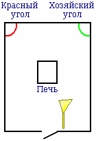
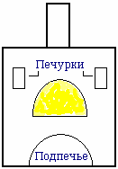

# Домовой

**Домовой** – это добрый Дух, хранитель домашнего очага, т.е. смотрит за хозяйством, за порядком. В старые времена домовой воспринимался как **один из Предков** данного Рода, который в следующем Мире все свои дела сделал и решил помочь своим потомкам по дому, по хозяйству присмотреть. Поэтому изображали домового в виде старца, умудрённого опытом. Современные учёные называют домового – **биоэнергетическое поле квартиры**, то есть домовой есть в каждом доме, везде где живут люди. Но в современном обществе не знают как себя вести с этой энергией, создают неблагоприятную обстановку, доводят домового до белого каления, и он превращается в барабашку, полтергейст, шумный Дух, а ведь только от человека зависит, какой образ примет эта энергия (домовой).

|  |  |
| --- | --- |
| Фото: Домовой с чашей. | 1. Куммир домового  2. Названия домового  3. Отношение к домовому  4. Хозяйский угол  5. Руская печь (домовой под печкой)  6. Питание домового (как подружиться с домовым)  7. Как забрать домового при переезде  8. Как создать домового в новом доме  9. Обращение к домовому     9.1. Поиграть с ребёнком     9.2. Безсонница     9.3. Помощь в делах     9.4. Найти пропажу     9.5. Присмотреть за домом |

## Куммир домового

Делали в основном скульптурные изображения домовых. Как правило, из глины (или как сейчас говорят из керамики), а также вырезали из дерева. Образы могли быть самые разные: очень часто в руках у домового изображали чашу для треб, или домовой сидит на сундуке с добром, как бы бережёт добро, либо другие образы, даже дед с бабкой (Хозяин с Хозяюшкой). Куммир домового делал глава Рода, обычно размером от двух вершков до аршина, то есть от 9 до 71 см.

Если вы купили фигурку домового, то её надо активизировать, как бы вдохнуть в неё Душу, иначе это будет просто скульптура, изображение. Когда человек сам делает домового из камня или дерева, то вкладывает Душу.

## Названия домового

Называли домовых по-разному:  
\* **Дедушко**;  
\* **Хозяин (Хозяюшко)** - потому что хранитель домашнего очага;  
\* **Соседушко** - потому что жил по соседству с людьми в одном доме;  
\* **Шишок** – означает, что домовой небольшого роста;  
\* **Лизун** – считалось, что домовой молоко не пьёт, а лижет сливки с поверхности. Или когда ребёнок плачет, домовой чтобы его успокоить подойдёт и слёзы слижет;  
\* **Кузьмич (Егор Кузьмич)** - до наших дней сохранилось выражение «подкузьмил», т.е. подшутил, потому что домовой любит баловаться, пошалить, про таких говорят: «что старый, что малый любит поиграть»;  
\* **Нафаня** – от слова Навь, т.е. Мир, который граничит с Явью. Эти образы легли как прототипы к мультфильму «Домовёнок Кузя». То есть Кузя, Кузенька - ещё маленький, он ещё не Кузьмич, а его наставник более старый домовой – Нафаня.  
\* **Егорыч, Доброхот** и другие названия.

\* Домовой очень не любит когда его называют чёртом (чёрт - это кто за чертой восприятия). Считалось, что за чертой всё плохое и негативное.

## Отношение к домовому

**Христианские попы очень не любят домовых**, у них даже мания – ходить крестить квартиры, очищать их от нечести, от домовых. И попы людей запугивают, говорят что домовые – это бесы, от них надо избавляться, не пользоваться их помощью и прочее.

**Славяне всегда жили с домовыми дружно**, заботились друг о друге, то есть был так называемый симбиоз - взаимопомощь, взаимоподдержка.

**Домовой любит порядок**, поэтому человек в доме должен всегда наводить порядок, всё должно быть на своём месте. Особенно недопустимым считалось оставлять на столе ножи.

**Домовой не любит ругань, мат, скандалы** и особенно терпеть не может пьянки. Потому что весь этот негатив - всё это противоестественно, а домовой, это существо естественное. То есть зачем ругаться – это неестественно, ведь можно найти точки соприкосновения, решить любую проблему.

## Хозяйский угол

**Хозяйский угол** – это угол домового, он всегда с правой стороны от входа. Здесь устанавливали небольшой приступочек, около 25 см высотой, чтобы домовому было удобнее трапезничать. На приступочке стоял **Куммир домового и требница** (чаша), в которую ему приносили требы. То есть в домах у славян был слева Красный угол (красивый) – в нём стояли Куммиры Рода, а справа Хозяйский угол – здесь стоял Куммир Домового. Любой гость делал два поклона: один в Красный угол, второй в Хозяйский угол, выражая уважение. Если человек просился на постой, т.е. переночевать, и ещё потрапезничал, то кроме поклона приносил домовому требы, чтобы уважить Хозяина (не мужчину главу Рода, а именно домового).

У христиан в Красном углу висели иконы, а правый угол они называли «чёрный угол», ставили там веник, как бы против домового, причём веник ставили рукояткой вверх, хотя славяне всегда ставили **веник у порога и рукояткой вниз**. Во-первых, чтобы домовому (он маленького роста) удобнее было брать веник и нечисть вымести, а во-вторых, чтобы достаток в доме был.

## Руская печь (домовой под печкой)

Считается, что домовой живёт под печкой, но если речь идёт о современной печи, то это неверное выражение. Руская печь отличалась от современной топки с чугунной плитой.

В руской печи большая камера для огня, дрова в ней зажигались вкруг, а посередине на пустое место помещали чугунок, т.е. как бы в круг огня. Поэтому вода нагревалась не снизу (так только выкипает), а со всех сторон сразу, и продукты не варились, а томились. Сверху печи расположена труба и лежанка. По бокам печурки - ниши, куда ставили посуду высыхать. Внизу подпечье - довольно большая полость, куда укладывали дрова для следующей топки, или какие-то предметы, и кошки там могли спать.  
\* В руской печи мылись, а не только готовили пищу. То есть протапливали, угли убирали, залезали в печь, ставили ушат и парились, мылись.

**Любимое место домового было под печкой**, то есть в подпечьи, которое закрывали шторками, чтобы не беспокоить домового пока люди хозяйничают. К печи домового привлекал аромат томящейся пищи. Но также домовой мог поселиться **под кроватью** своего любимчика, поэтому покрывало было до самого пола, чтобы домовой чувствовал себя спокойно и никто туда не заглянул ненароком. В современных квартирах домовой любит быть на кухне за холодильником, за плитой, или в платяном шкафу.

## Питание домового (как подружиться с домовым)

**Домовой питается энергией**. Для чашки домового часто делали и свою резную ложку, но это лишь символика, домовой – это Дух, а не человек, он забирает из продуктов только энергию. Выполняя работу по дому, он тратит энергию, а потом из пищи восстанавливает её. Самой высокоэнергетической пищей считалось **молоко, сметана, сливки**, поэтому их всегда ставили домовому. Если добавляли блины, оладьи или другую пищу, то ставили ещё одну чашку, чтобы не бросать еду в одну кучу. Прикармливать домового можно любой пищей, которую вы едите сами: каша, салат, молоко, колбаса, печенье, конфеты и прочее. Нельзя ставить спиртное (!) ни в Красный угол, ни в Хозяйский, наши Предки не пили.  
\* Раньше у каждого была своя чашка, ложка, кружка – это норма гигиены, ведь зубная щётка у каждого своя, также и ложка у каждого была своя. И даже если еда сделана в общем чугунке, ел каждый своей ложкой.

**Чтобы подружиться с домовым - надо с ним потрапезничать**. Когда садитесь потрапезничать (поужинать), возьмите из Хозяйского угла чашу домового, поставьте рядом со своей, и из своей чаши своей ложкой отложите домовому кашу или салатик, то есть поделитесь пищей с домовым. Затем представьте образ домового (поставьте перед собой Куммир домового и сосредоточьтесь на нём, или просто закройте глаза и представьте доброе лицо домового) и скажите фразу: «**Домовой, домовой, сядь поужинай со мной**» (или «Домовой, домовой, вечерять садись со мной», «Домовой, домовой, потрапезничай со мной»). Потом надо прочитать обращение Пращур-Род, которое читается перед трапезой. То есть вы пригласили домового, прочли Пращур-Род и вместе потрапезничали. Потом берёте блюдечко домового и с поклоном ставите в Хозяйский угол перед Куммиром домового. Он и с вами поел, и там захочет потом ещё покушает. Прикормка должна находиться в блюдечке **не менее 12 часов** или сутки. Допустим, вечером поужинали, и следующим вечером можно дать домовому что-то свеженькое.

Если в современных квартирах площадь или планировка не позволяют сделать Хозяйский угол, блюдечко ставят за холодильник, газовую плиту, шкаф или под кровать, т.е. подальше, чтобы не залезть туда ногой (вам же неприятно будет, если кто-то в вашу чашку ногой залезет). Также надо учитывать, что домовые обычно маленького роста, поэтому не ставить чашу высоко на полочки или холодильник и т.п. Кошка никогда ничего не возьмёт из требницы домового.

## Как забрать домового при переезде

Когда вы переезжаете на новое место жительства, домового надо взять с собой. Раньше для этого брали одиночный лапоток или из дерева вырезали маленькие сани (можно взять одиночный тапочек), ставили этот лапоток в подпечье (либо за холодильник, шкаф, диван – где домовой обитает), закрывали глаза, представляли доброе приятное лицо домового и говорили фразу: «**Домовой, домовой, садись в сани и поезжай с нами**». Делается это в последнюю очередь, когда уже всё хозяйство собрали, все вещи из квартиры вынесли.

В новом доме ставят лапоток в новое для домового место: под печь, диван, шкаф… и говорят: «**Домовой, домовой, мы приехали домой**». Рядом с лапотком ставят блюдечко со сливками или сметаной, если молоко, то в него ещё добавляли маслице, чтобы пожирнее было, посытнее. Но прежде чем внести домового в новое жильё, пускали чёрную кошку, она очень хорошо чувствует положительная или отрицательная обстановка. И когда кошка прошлась по всем комнатам, освоилась, тогда уже заносили сани с домовым.

**Как подружить домовых**.  
Незнающие люди, при переезде забывают домового, поэтому бывают случаи, когда в доме два домовых (старый остался и с вами новый домовой приехал), и между ними бывают даже ссоры, которые могут отразиться и на людях. Тогда проводят специальный обряд, чтобы подружить домовых. Когда вы садитесь потрапезничать, на стол ставятся ещё две чашки (своего домового и для домового старых хозяев), вы из своей чашки накладываете еду в тарелки домовых и произносите: «**Домовой, домовой, потрапезничай со мной, и новый Хозяин, и старый Хозяин**». То есть вы их как бы побратали. Есть такое выражение: «Они из одного котелка кашу ели», а одной ложкой могли есть только родные братья, то есть у каждого была своя ложка, но могли поесть и одной по кругу из одного котелка. После этого и старый домовой будет к вам благосклонен, расскажет вашему домовому о порядках в доме, о соседях, и они потом вдвоём такой порядок наведут, не нарадуетесь.

## Создание домового

В старые времена, когда готовились к свадьбе – Любомир, т.е. породнение двух Родов, молодым строили свои хоромы (дом), заранее размечали, где будет дом, постройки, и где будет Хозяйский угол, т.е. ещё до начала строительства. Становились в будущий Хозяйский угол и говорили: «**Домовой, домовой, помози в деяниях наша, будут тебе щи, да каша**», то есть обращались к будущему домовому, как бы создавали домового. Знаете как рыбаки, чтобы клёв был, они прикармливают в одном месте рыбу. Потом рядом рыбаки могут сидеть и ничего не поймают, а кто прикормил, он в этой лунке одну рыбу за другой будет таскать. Так и здесь, домового прикармливают к данному дому, хотя дома ещё нет, но домовой видит строительство и уже начинает обживать пространство своего будущего хозяйства. А люди не обманывают домового, до вечера строят, потом в будущий Хозяйский угол ставят щи, да кашу. Так каждый день - люди на ужин, и домового не забыть покормить, ведь он уже при строительстве помогает, чтобы дело спорилось, а то строительство может пойдёт криво, бревно не так распилится, ещё что-нибудь случится, да и жить потом в этом доме сам не захочешь.

## Обращение к домовому

Система обращения к домовому – это обряды и ритуалы, то есть нет какого-то одного постоянного, они разные. Сам **ритуал обращения схож с молитвой перед иконой**, то есть человек сосредотачивается на иконе, творит молитвы, просит о чём-то, зажигает свечку, кланяется. Обращение к домовому примерно похоже, потому что христиане перенимали ритуалы у славян. **Основное что надо сделать** – стать ликом своим в Хозяйский угол, воззреть на Куммира домового или представить образ (всегда только один и тот же образ, чтобы не плодить их), сосредоточиться на нём, сотворить обращение, поставить прикормку и совершить поклон.

**При каждом обращении к домовому, его обязательно надо прикормить**, иначе домовой компенсирует затраченную энергию, взяв её с человека, который к нему обращается, жизненную энергию. Поэтому на Руси и говорили: «Попросил домового - то сам и сотвори ему нормальную обстановку».  
  
**Поиграть с ребёнком.**  
Дети стараются перенять всё, что делают взрослые: папа колет дрова и дети тянуться колоть дрова; мама стряпает или стирает и детям надо стряпать и стирать, то есть ребёнок перенимает трудовой опыт. Но когда надо что-то сделать, а отвлекаться на ребёнка времени нет, родители просили домового поиграть с ребёнком. Для этого надо встать лицом в Хозяйский угол, закрыть глаза, представить образ домового и произнести: «**Домовой, домовой, поиграй с моим дитём**». После этого можно заниматься своим делом, а домовой займётся ребёнком. Ребёнок начнёт играть с фантиком, бантиком, газетой, с чем угодно и будет так сидеть, пока вы его по имени не окликните. Имя ребёнка – это ключ к ребёнку. Если вы ребёнка по имени окликнули, домовой видит, что вы освободились и в его помощи больше не нуждаетесь. Но вы тут же должны прикормить домового.  
  
**Безсонница.**  
Когда ребёнок не может уснуть, плачет, встаньте лицом в Хозяйский угол, закройте глаза, представьте образ домового и скажите: «**Домовой, домовой, успокой моё дитя**» (не усыпи, а успокой – домовой ведь не Морфей). Сразу же положите прикормку. Как правило, это помогает детям до 5-7 лет; потом включается советская система образования, которая забивает, разрывает все чувственные каналы у детей по отношению к домовому.

Если безсонница у вас, не можете уснуть, ворочаетесь, положите в блюдечко домового прикормку, ложитесь в постель, закрываете глаза, представляете образ домового и произносите фразу: «**Тук-тук, чок-чок, домовой, домовой, повернись на другой бочок**», и через пару минут уснёте. В данном случае в Хозяйский угол становиться не надо, потому что впечатлительные люди могут там же упасть на пол и уснуть. Если наоборот, вас клонит в сон, а спать не нужно по какой-то причине, то надо встать лицом в Хозяйский угол, представить образ домового и произнести туже фразу: «*Тук-ту, чок-чок, домовой, домовой, повернись на другой бочок*», сон улетучится на 12 часов. Данная фраза меняет биологическое состояние человека со сна на бодрствование и, наоборот, с бодрствования на сон.  
  
**Помощь в делах.**  
Когда человек находится за пределами дома, он обращается к Богам – к Ладе, к Пращуру Рода, либо к Даждьбогу («Даждьбог в помощь»). А когда делает что-то по дому, то обращается к домовому. Бывает, не спорится дело, всё из рук валится, тогда чтобы дело пошло, встаньте лицом в Хозяйский угол, представьте образ домового и скажите: «**Домовой, домовой, помоги в делах моих**» (иди «помози в делах моих»). Потом не забудьте прикормку положить, и поклон обязателен при каждом обращении.  
  
**Найти пропажу.**  
Всем знакомая христианская фраза: «Чёрт, чёрт, поиграл и отдай» - никогда её не произносите, домовой не любит когда его называют чёртом. Чтобы потерянная вещь нашлась надо встать спиной в Хозяйский угол, зарыть глаза, представить добрый образ домового и сказать: «**Домовой, домовой, поиграл и отдай**». Ищите 3 минуты, если не находите – положите прикормку в блюдечко, и уже меняете интонацию: «Домовой, домовой, ну поиграл и отдай!». Если через 3 минуты не нашли – ещё прикормку положите, и уже жёстко: «Домовой, домовой, ну поиграл и отдай!». Должны найти. Если не нашли через 3 минуты, значит этой вещи в доме нет. То есть обращаемся три раза: первый раз спокойно, второй – требовательно, третий – властно, грозно. Домовой бывает как ребёнок, любит поиграть, пошалить.  
  
**Присмотреть за домом.**  
Раньше когда ненадолго отлучались из дома, чтобы всё было в порядке, обращались к домовому: «**Эй, Дедушко, ты не засни, в ночь порядок наведи, присмотри чтоб дети спали, чтобы мыши не пищали, будь хозяином во всём, сохрани (содержи) в порядке дом**». И тут же не забыть прикормить домового.

Когда уезжали надолго (в другую деревню на свадьбу, именины и т.д.), просили домового присмотреть не только за домом, но и за двором: «**Эй, Дедушко, ты не засни, по-своему распорядися с вором, ходи вокруг двора дозором, и всё как следует храни**».
