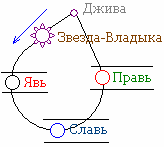
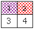
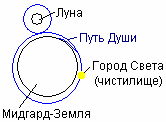
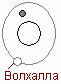

# Душа и Круг Абсолюта

 **Круг Абсолюта** – это движение Души из Мира Прави через пространства-мерности, её развитие и возвращение в Мир Прави. Круг Абсолюта необходим, потому что нельзя познать что такое Свет, не ведая что такое Тьма.

Создаёт Души Богородица Джива (она выделена отдельно, но это тоже Правь). Т.е. Душа отходит от Дживы, идёт в какую-либо систему Звёзд (у славян и у многих других народов это называлось: Душа приходит со своей Звезды-Владыки), потом в потоке света Душа попадает на какую-либо Землю (т.е. в четырёхмерный Мир) – здесь она развивается, и идёт в более высший Мир по многомерности (Мир Слави), там развивается и идёт в Мир Прави, но уже в ином качестве, в иной структуре.

1. Матрица Души  
2. Рождение человека  
3. Реинкарнация и инкарнация  
4. Три Суда после смерти  
5. Волхалла

## Матрица Души

 **Душа – это энергоинформационная матрица**, которую создаёт Джива и направляет в материальный Мир для развития и совершенства. Данная матрица - это образная структура человеческой Души, в каждом квадратике определённая информация. Джива записывает лишь начальную информацию (знания). Второй квадратик (совместимости) заполняет Бог-Покровитель Рода, в котором родиться Душа, а остальную информацию нарабатывает сама Душа.

**В 1-ом квадрате** даются знания:  
- о жизни на обитаемых Землях;  
- о мерностях пространства;  
- определённый набор чувств;  
- указание пути, по которому должна пройти Душа, чтобы совершенствоваться.

**2-ой квадрат** - матрица совместимости:  
- совместимость Души с физическим телом, в котором она будет находиться;  
- совместимость образов Духа и Крови по отцу;  
- совместимость образов и понятий окружающего Мира (т.е. социальная система, которая ближе всего подходит под духовное восприятие Души), поэтому даже негр Пушкин писал: «Только на руской земле, руская Душа и родиться может».  
- совместимость знаний, заложенных в Душе при отправке, со знаниями Мира прибытия.

**3-й квадрат** - матрица того, что Душа должна передать своим потомкам.

**4-й квадрат** – чистое поле, т.е. здесь будет то, что Душа должна наработать, пройдя Круг Абсолюта.

## Рождение человека

Вся эта матрица (информация о Душе) передаётся в течение **22 минут** с момента рождения человека.  
\* Если ребёнок родился чуть раньше или чуть позже (допустим, медики вмешались, вызвали преждевременные роды), т.е. ребёнок получил не полные 22 минуты сопутствующей информации, то такой человек проживёт не более 47 лет.  
\* Если ребёнок вообще не получил сопутствующей информации, то он живёт 4-7 дней.  
\* Двойняшки, родившиеся в пределах 22 минут, будут психологически похожи как две капли воды. Если второй ребёнок родился на 23 минуте и больше, то психологически они похожи уже не будут, и ни какие однояйцовые и разнояйцовые зародыши здесь не причём.

**Ребёнок сам выбирает родителей**, т.е. Душа подбирает, чтобы её матрица совпала с образами матери и отца. И вселяется Душа в ребёнка уже при рождении, а пока ребёнок находится в утробе матери, у него частица Души матери. (\*) В одно мгновение (это тысячная доля секунды) для воплощения в Яви отображается 53 млрд. 896 млн. 11200 Душ.

**Если ребёнок крикнул при рождении** и родился в положенный срок, значит он получил Душу и Мудрость от своей Звезды-Владыки (за 22 минуты). Или как раньше бабушки говорили: «Родился ребёнок, крикнул, ангел наложил ему печать на уста и ребёнок свою долю знаний получил».

**Если ребёнок не кричал**, значит путь был перекрыт другой Душой, которая свою жизнь прекратила в результате насильственной смерти (пример: человек выполнял свою программу, но началась война, он пошёл защищать Родину и погиб). Чтобы довыполнить программу он перерождается, т.е. его Душа переселяется в новорожденного. Ребёнок развивается до 12 лет, а потом подселившаяся Душа довыполнят свою программу. Но чтобы повторно не делать уже выполненное, всё ранее наработанное закрывается в матрице на время, как в сейфе. После выполнения всей программы Душа идёт дальше по Кругу Абсолюта.

## Реинкарнация и инкарнация

**Реинкарнация – это полное вселение** Души в новое тело, чтобы Душа закончила свою программу, т.е. этим вселением управляет Богиня Карна.

**Инкарнация – это подселение** Души (или временное вселение), т.е. в человека с ослабленным защитным телом подселяется Душа другого человека, и тогда наблюдается раздвоение личности, когда в одном теле живут две Души. Как правило, подселённая Душа более мощная, она подавляет изначальную систему, довыполнят свою программу и уходит. Поэтому бывают случаи, когда у человека было раздвоение личности, а после клинической смерти он становится нормальным. Медики называют такие случаи излечения от шизофрении необъяснимыми.

## Три Суда после смерти

На 9-й день после смерти серебряная нить, которая связывает Душу и тело прерывается и Душа поднимается вверх, описывает восьмёрку вокруг Земли и Луны (атмосферные слои воспринимаются ею, как рубежная река), и останавливается Душа в **Городе Света** (или Солнечный город; католики называют **чистилищем**). Здесь Душа находится 40 дней, но это по нашему времени, а там это время может пройти как 1 день или как 1000 лет. Здесь человек находит все ответы на свои вопросы, которые интересовали в жизни, и проходит три суда:

**1. Суд Совести** – это самый страшный суд, потому что страшнее чем сам человек, никто его не осудит. Он сам себе подсудимый, прокурор, адвокат и судья. Человека судит его собственная Совесть, вы не сможете сами себя обмануть, потому что знаете что было именно так, а не иначе.

**2. Суд Предков** - человек держит ответ перед Предками, что он сделал для процветания Рода, чего достиг в своём созидании, на какой уровень душевности и духовности поднялся. То есть, чего ты достиг?

**3. Суд Бога-Покровителя Рода** – если после Суда Предков человека пропускают в Мир Слави, то здесь его ждёт последний третий суд. Выше мы уже разобрали матрицу Души, где второй квадратик заполняет Бог-Покровитель данного Рода. Т.е. он указал цель жизни, а на суде спрашивает – что ты сделал для достижения цели? То есть, годишься ты в созидатели или нет.  
\* Не забывайте, что мы приходим не просто, чтобы выполнить чью-то волю (Дживы или Бога-Покровителя, т.е. наших Небесных Родителей), мы приходим в этот мир, чтобы стать творцами-созидателями.

**Если три суда пройдены**, Душа идёт в следующий Мир по Кругу Абсолюта, т.е. в Мир Слави, на новую Землю. Сначала в Мир Легов (16-тимерный), там развивается и идёт в Мир Арлегов, и т.д. в каждом Мире проходит дальнейшее развитие.

**Если человек не выполнил программу**, допустим: погиб на войне и ничего не успел сделать, тогда вступает в силу Богиня Карна, она позволяет опять вернуться на Землю (реинкарнация) и завершить развитие. А есть ещё один вариант – человек умер, поднялся в чистилище, но Бог Варуна (супруг Карны) даёт ему возможность вернуться и доделать то, что он не успел, т.е. примерно как в фильме «Ворон» (США, 1994 г).

\* Для католиков Солнечный Город является чистилищем, где человек проходит суд и попадает либо в обитель божию (Мир Слави), либо в ад (на галактический восток). Но люди там остаются не вечно, любой, кто осознает свои ошибки, исправится, он может снова подняться до Земли, завершить развитие и пойти дальше в Мир Слави, затем в Мир Прави. А информация, которую накопила Душа, поступает опять к Богине Дживе, и потом с этой матрицей идут в более развитый мир уже подготовленными.

## Волхалла

На пути от Земли до Мира Слави есть ещё одно промежуточное звено - орбита, охраняющая систему Мидгард-Земли, вращается как бы невидимая Земля (потому что находится в другой мерности). На этой Земле царствует Бог Волх (сын Индры и Матери Сырой Земли), и на этой Земле находится обитель воинов – так называемая охранная сторожевая башня – **Волхалла** (т.е. «зал Волха», hall - это зал). Это Небесное воинство охраняет Землю, но не в наших 4-х измерениях, а в других, чтобы по тем измерениям тёмные силы не могли проникнуть на Землю.

\* Раньше считалось, что ребёнка надо показать Солнцу до того, как перережут пуповину, тогда его жизнь будет долгой, а значит и более доступной возможность выполнить то, что предназначено Родом и Богами-Покровителями. Поэтому если ребёнок родился ночью или вечером, то ждали рассвета, и только потом резали пуповину. Если утром было пасмурно, ждали другого дня, иногда ждали неделю, а то и 10 дней. Плацента была подключена к ребенку, и он жил за счёт энергии, ферментов и прочего, что содержится в материнской плаценте. А сейчас, ребёнок не успел родиться, пуповину сразу перерезают.
