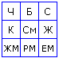

# Единая Система (Дух Расы)

**Единая Система** – это Мудрость, Знания, которые присущи определённому народу, т.е. у нас это Дух Расы. У китайцев это называется Душа Великого Дракона, т.е. все знания, которые касаются именно их жизненной системы. В современном мире это называют «**Информационное поле Земли**», т.е. некое энергетическое поле в котором хранится вся информация. Но если бы эта информационная система была общая, то знания, которыми владеют белые люди, ими владели бы и негры, и индейцы, и индусы и пр., однако этого не происходит. Т.е. общее информационное поле представляет собой матрицу, где знания каждого народа находятся в отдельной ячейке.

1. Матрица Земли  
2. Примеры Единой Системы  
3. Подключение к Духу Расы  
4. Ключевые Лета передачи информации

## Матрица Земли

Схематично общее поле Земли можно разделить на 6 ячеек, и каждый получает какое-то знание именно из той ячейки, системы, которая близка ему на основе генетики, образования, родовых устоев и т.д.

**Матрица Земли:**  
Ч – здесь находится информация только для чернокожих народов;  
С – информация только для серых;  
К – только для краснокожих;  
Ж – только для жёлтых;  
Б – только для белых;  
СМ – информация, которая касается смешанного человечества – метисов, мулатов и пр.

Кроме того, есть и другие информационные структуры: ЖМ – животный мир, РМ – растительный мир, ЕМ – система, которая касается вообще естественного мира (минералы, магма, камни и пр.). Т.е. Матрица Земли состоит из множества систем, мы взяли только основные.

## Примеры Единой Системы

1. Учёные проводят опыты на крысах – запускают в лабиринт, в конце которого кусочек сыра, и с каждым разом крыса быстрее находит еду, т.е. ошибок всё меньше и меньше. Её потомки уже заранее знают все ошибочные коридоры. Но этот эксперимент, допустим, проводили в Америке, а через 10 лет такой же эксперимент решили провести на другом континенте, в Австралии. Взяли такой же лабиринт, но местную лабораторную крысу и она проходит безошибочно, словно уже проходила его в Америке. Т.е. через какую-то энергетическую систему эта крыса получила информацию о том, как пройти данный лабиринт.

2. Допустим, сын живёт в Омске, а мать на Украине. Поздно вечером он вдруг слышит звон ложки о стакан и тут же чувствует, что с матерью что-то случилось. На следующий день приходит телеграмма от родственников: «Приезжай, мать умерла». Он приезжает, и родственники рассказывают, что матери было плохо, и они услышали, как звякнула ложка о стакан, вошли, а мать, потянувшаяся за стаканом уже мёртвая. Т.е. где Сибирь, а где Украина, но через какой-то информационный канал это всё передалось.

3. Старики рассказывали, что 21 июня 1941 года в 4 часа вдруг Душа стала неспокойной, будто что-то произошло. Потом уже днём передали, что началась Великая Отечественная война. Т.е. старики жили в разных деревнях, но жили традиционным русским укладом, и почувствовали как бы боль Державы, им передалась эта информация. Конечно, такое не могли почувствовать смешанные народы, даже негр Пушкин писал: «Здесь русский Дух, здесь Русью пахнет», т.е. данная информационная система только для белых. А те, кто вне этой Системы, кто перемешан, они этого и не почувствовали, у них нет доступа к матрице белых.

Вот эта информационная система, **Дух Расы сообщает каждому белому человеку хранимые знания**. Допустим, один белый человек что-то изобрёл, это сразу же проецируется Духу Расы и там фиксируется. Другой белый, который тоже связан с этой системой, если у него Душа настроена, он тоже это прочувствует. Поэтому в истории много случаев, когда одни и те же изобретения делались одновременно в разных местах. Тот же Маркони и Попов чуть ли ни в один день изобрели радио. А сейчас спорят, кто первый? Да никто из них, они просто взяли за основу то, что было до них, ведь всё новое – это хорошо забытое старое. Эта Система существовала задолго до их появления на Свет Божий, в ней хранится весь накопленный опыт белых людей, вся информация миллионов поколений.

## Подключение к Духу Расы

Если у дерева обрубить корни, дерево начинаёт сохнуть и погибает. Человек – такое же живое существо и без корней погибнет, а Природа не терпит пустоты, она постоянно выравнивает жизненные системы. И Природа знает, чтобы выровнять жизненную систему, надо соки через корни, которые питают человека, поднять, подпитать, и человек начинает тянуться к своим корням. Эти корни и помогают человеку соединиться с Духом Расы, со своей Единой Системой, получить оттуда дополнительную информацию. Но чтобы соединиться, **необходимы определённые ключи**. Вот то, что даётся в Ведах и на Уроках – это и есть ключи, для того чтобы ваша Душа, ваш Дух соединялся с вышними корнями.

Мозг человека, как правило, старается работать так, чтобы не хранить в себе много информации, ему проще переработать информацию, сделать какие-то матричные ключи, а всю информацию через Родничок (9-я чакра) отправить Духу Расы. Образно это можно сравнить с компьютерщиками, они делают то же самое, набрал какой-то текст, записал на диск, и пускай он лежит на полочке, чтобы не занимать свободное пространство. Другой компьютерщик взял ваш диск, прочитал информацию, поставил на место, и может взять следующий. А **можно сравнить с Интернетом**, допустим, кто-то создал страницу в интернете и её может читать один человек, а может читать одновременно миллиард человек, у которых есть компьютеры, доступ и они вышли именно на этот сайт. Т.е. одновременно одну и туже информацию воспринимают многие. Но это мы говорим о белых, здесь написано по-русски, а русский язык передаёт смысл вглубь. Ну, откроет эту страницу китаец или негр - что они поймут? Ничего. Тоже самое, если русский человек зайдёт на китайский сайт, или увидит крючки, которыми пользуются племена чернокожих народов, тоже ничего не поймёт. Но это всё образно. Т.е. даже если человек выйдет в чужое информационное поле, он не поймёт информацию - разная генетика, мировосприятие, культура, язык, мышление и пр. Поэтому белые черпают из своей Единой Системы (Духа Расы), чёрные черпают из своей, серые, жёлтые, красные, цветные из своих Систем.

## Ключевые Лета передачи информации

Информация из Единой Системы передаётся человеку дозировано, т.е. на каждом отрезке его жизненного пути передаётся определённая информация. У белых народов жизненный путь разбит на следующие отрезки (периоды):

**12-16-21-32-39-41-45-48-50-55-64-72-77-80-82-84-88-90-96-108-112-123-133-144**

144 Лета - это один Круг Жизни, кто живёт дольше, идёт наложение второго Круга с тем же интервалом, т.е. 156-160-165 и т.д.

**Рождение** - ребёнок получает знания начала Пути, в каком Роду он родился, в какой местности, чтобы выжил именно в этой местности, какая энергетика ему необходима, т.е. идёт начальная информация, организм получает информацию о взрослении, совершенствовании и т.д.

**12 лет** – ребёнок проходит обряды имянаречения и совершеннолетия, с этого момента он как бы подключается к Духу Расы, начинает получать более расширенную информацию: какой путь ему избрать и как стать на путь полноценного человека. При этом девочки за 4 Лета полностью осваивали домострой, чтобы подготовиться стать мамами и продолжить жизнь Расы. А мужчинам на развитие даётся 9 лет, чтобы овладеть своим жизненным путём, овладеть профессией отца, и пройти путь становления воина, т.е. научиться владеть оружием. Поэтому полноценными личностями, готовыми самостоятельно продолжать жизнь на данной Земле, женщина становится в 16 лет, мужчина в 21. И с этого времени Дух Расы даёт им возможность созидать.

**16 лет** (девушки) и **21** (юноши) – начинают созидать новую жизнь, начинают смотреть на мир новыми глазами. Т.е. раньше они в песочнице строили домики, крепости, из веток шалаши, кораблики и пр. – вся эта информация идёт в Единую Систему (Дух Расы), и там всё формируется, т.е. ребёнок сам того не подозревая, создаёт свой собственный мир, ведь мысли имеют свойство материализоваться. И потом, информация же всё равно идёт сверху, и чем больше совпадений, тем больше этот мир реализуется. Т.е. с этого времени они начинают создавать реальный мир.

**32 лета** (два Круга Лет) – человек получает информацию об окончании Духовных поисков пути, т.е. у него завершаются духовные искания, человек перестаёт метаться между разными учениями, знаниями и как бы расширенный диапазон поисков сужает до более узкого, т.е. множество узеньких тропок превращаются для него в широкую.

**39 лет** – даётся возможность осмысления как бы части жизни, т.е. даётся знание, при котором он смотрит на жизнь уже совершенно другими глазами. Поэтому многие удивляются: Что произошло с человеком? Вдруг стал замкнутым, нелюдимым, сменил знакомых, т.е. он переосмыслил всё.

**41 лето** – Духовное становление, т.е. человек уже идёт Духовным путём. После переосмысления в 39 лет, у кого-то через год, но как правило через два происходит установление своих внутренних принципов, внутренних Родовых Устоев, и человек после этого уже от них не отходит. Происходит такое потому, что по прошествии 40 лет, мир который создал ребёнок, начинает существовать самостоятельно: развивается жизнь, своя социальная структура. Т.е. человек в 41 Лето становится Богом-Творцом своего собственного Мира (воплотив его на нашей Земле, или некоторые его воплощают в параллельных вселенных), и этот мир продолжает существовать, даже если человек забудет о нём, уйдёт, он будет дальше развиваться по космическим законам, потому что всё, что совпадает с теми принципами, которые вложены в созданный Мир, они уже будут получать информацию от Духа Расы, т.е. появляется ещё один Светлый Мир, и все принципы, которые вписываются в рамки сей информации, они все будут идти туда.

**45 лет** – идёт осмысление и Духовного пути и прожитой трети от Круга Жизни. А когда человек осмысляет, он как бы обновляется, поэтому и поговорка была: «45 – баба ягодка опять». Почему она ягодка? Потому что осмыслила, посмотрела не глазами подруг, советчиков, друзей, а своими собственными. Посмотрела и сделала выводы: а вот там-то я сделал не так, а вот здесь время зря потратила на ненужное, на безделие, на дискотеки, косметику, дань моде и т.д., а потом осмысляет это и понимает, что жизнь-то прожгли понапрасну, и это время не вернёшь, а раз не вернёшь, надо нагонять упущенное, навёрстывать. А когда человек начинает трудиться, навёрстывать, то к нему идут дополнительные силы и человек как бы обретает второе дыхание, второе рождение, преображение, расцветает, поэтому и говорят, что «ягодка опять».

**48 лет** (три Круга Лет) – в этот период человек получает с Единой Системы (Духа Расы) знания наставничества. Т.е. человек уже начинает обучать своих внуков не только тому что он наработал, жизненному опыту, но также и опыту в Духовных вопросах.

**50 лет** – человек получает дополнительные знания. Т.е. в 48 лет он получал опыт передачи знаний в своём Роду, а после 50 лет он получает знания для передачи информации ученикам из других Родов.

**55 лет** – время пожинания плодов. Т.е. человек смотрит на плоды, которые он принёс своему Роду, и в зависимости от того, что он создал на благо своего Рода, из Единой Системы идёт проекция необходимая для дальнейшего пути. А каким будет этот путь зависит от человека. Допустим, человеку нужно идти из Омска в Москву, и перед ним выбор - две дороги, идти через Тюмень или через Екатеринбург. Дальше он идёт через Средний, либо Южный Урал, и так доходя до каждого города, перед ним опять выбор. Т.е. можно идти разными путями, чтобы придти в конечную точку. Поэтому каждому даётся своё направление, в зависимости от того, какой жизненный опыт он наработал, какую духовную программу наработал.

**64 лета** (четыре Круга Лет) – свой Род уже пристроен, поднят на ноги, и человек начинает понимать, что цель его жизни – не только его Род, но и окружающий мир, это тоже зона его влияния. Человек начинает усердно восстанавливать Природу для своих будущих потомков, чтобы Род жил в гармонии с Природой. И человек получает необходимые знания: как лучше восстановить окружающий мир, природу, он может даже не задумываться об этом, но у него появляется тяга к земле, начинать садить деревья плодоносные, которые могут начать плодоносить уже когда его самого не будет, т.е. для потомков.

**72 лета** (полКруга Жизни) – даётся информация для подключения человека к следующему миру – Миру Слави. Он начинает воспринимать не 4-хмерные, а 16-тимерные порядки, но для 16-мерного уровня он как ребёнок детсадовского возраста, поэтому приобщение к основам следующей жизни происходит в виде игры, он как бы впадает в детсво. Поэтому и говорят: что малый, что старый – в детство впали. Они воспринимают мир как дети: чисто, объёмно, образно, многоцветно, и люди, которые живут в сжатой системе, зашоренной, они перестают понимать стариков, говорят: старики чудят непонятно что, опять начинают домовых видеть (ребёнок их видит и старики видят). Т.е. они получают информацию, что жизнь существует на более высших уровнях, приобщайся, познавай следующий Мир. Некоторые старики, выполнив долг перед Родом, уходят познавать мир, делают себе шалашик или заимку (избушку на курьих ножках – на пеньках), т.е. становятся отшельниками, живут в гармонии в лесу.

**77 лета** - человек уже осмысливает полученную в 72 лета информацию, и он в ожидании общения с другим Миром, про него говорят: он стал духовидцем или провидцем, т.е. он видит Духов (духовидец) и может видеть события, как прошлого, так и будущего (провидец).

**80 лет** – человек получает Мудрость и обновление своего сознания. Как правило, у людей старше 80 лет раскрывается совершенно иное видение жизни, и про них говорят, что они скорее живут в Слави чем в Яви. Т.е. начинают многое понимать иначе, рассматривают с других позиций, совершенно другими мерками, начинают объяснять какие-то многомерные понятия образами, допустим «Сорока на хвосте принесла», потому что в его многомерном образе мышления не хватает слов двух, трёхмерного языка. Т.е. всё на образах, которые связаны с древней космогонией, древней мудростью, древним знанием, и он этими образными понятиями говорит, и ему абсолютно непонятно, почему для многих простые естественные образы не доходят, почему люди воспринимают их буквально.

**82** (женщины) и **84 лета** (мужчины) – у человека появляются чувства в руках, когда он чувствует растительный мир. Т.е. как правило, самые лучшие отвары, лекарственные настои делают старики после 82 (женщины) и 84 (мужчины). Они чувствуют природную силу, которую несут те или иные растения. Но опять же, это мы говорим об общей форме, хотя есть люди, которые с детства чувствуют растительный мир. И заметьте, старый человек по квартире может ходить с тросточкой, но стоит выйти на землю, на дачу – оживает и тросточка не нужна, грядки начинают полоть, травки собирать, листики заваривать, надо что-то собрать, соединить на пользу, и не столько для себя, как для других. А эти знания: когда собрать, с чем соединить даёт Дух Расы.

**88** (женщины) и **90** (мужчины) – период подведения первых итогов. Бабушки, дедушки в этом возрасте начинают проверять сундуки, считают сколько рубах, ножей, топоров и пр. и всё перекладывают, чтобы одинаковые вещи были в одном месте. Т.е. как бы проводят инвентаризацию, и почти каждый день. И всё должно быть в порядке, всё должно лежать на своих местах, где взял, потом туда и положи, т.е. у каждой вещи своё место. Зачем они так делают? Потому что начинают чувствовать силовые линии Земли, и раскладывают каждую вещь в свою энергетическую ячейку.

**96 лет** - у человека открывается дополнительный канал и он начинает получать с Единой Системы Древнюю Мудрость. Поэтому, как правило, все эти древние певцы, сказители, баяны, они были очень преклонного возраста, и могли произведения на память часами напевать. Мы уже разбирали, что информация идёт волновым уровнем, волной, и они входили в ритм - гусли на колени, и даже если зрение есть, они закрывали глаза, чтобы внешняя информация не мешала и на гуслях себе создают эффект волны, напевно читают, рассказывают древние предания. Многие удивляются, как они в разных землях находятся, но читают наизусть одинаковый текст 50-60 страниц до каждого знака препинания. А они просто воспроизводят из Духа Расы ту древнюю мудрость, которая передаётся – он подключился, и через него, для его потомков, для его Рода изливается Мудрость. И на основе этой мудрости новое поколение выплывает.

**108 лет** - период Божественного преображения. Т.е. к этому возрасту человек уже пронёс через свой жизненный опыт все жизненные основы: Заповеди, которые дали для Мира Яви Вышние Боги, т.е. Триглав: Сварог, Рамхат, Перун дали по 33 Заповеди. Плюс 9 Основ Инглиизма, т.е. основ Старой Веры. Получилось 108. И он их не только осознал, он их опробовал в своей жизни, пронёс через свою жизнь и понял их суть. А на основе этого он уже мыслит совершенно другими категориями. И он может, находясь просто в теле земном, сидеть и описывать другие Миры, другие Земли.

**112 лет** - человек начинает самым младшим потомкам своего Рода мужского пола передавать сокровенные ключи. Т.е. дед самому младшему своему внуку или правнуку, праправнуку передаёт как бы ключ Мироздания, т.е. ключ к пониманию Мироздания. То же самое делает и бабушка, но передаёт самой младшей внучке, правнучке, праправнучке. И для ребёнка это становится путеводной звездой, поэтому и развитие идёт совершенно иное, Род начинает процветать. Т.е. для ребёнка эта мудрость как толчок для поднятия Рода на следующую ступень развития.

**123 лето** - здесь человек либо даёт обет молчания, либо попадет в состояние молчания. Потому что он начинает получать информацию о жизни в других многомерных мирах, и поэтому молчит, чтобы данную информацию не передать людям, которые не подготовлены. Ведь многие начинают просить: «Ну, опиши другой Мир, где всё хорошо, всё здорово», но этот мир человек получит только после смерти. И сразу что? «Где тут 12-й этаж? Откройте окно пошире! Дайте нам рай весь сразу и сейчас!». Ничего подобного. Он всё это осмысляет для своего пути, начинает видеть свой дальнейший путь, куда он после жизни на Мидгарде в Яви пойдёт далее, т.е. следующий пункт его назначения, как проходить и прочее. Как правило, в это время простые жители приходили к волхвам, к жрецам, чтобы им позволили ознакомиться с так называемой «Книгой Пути», иначе её называют «Книга Мёртвых» (Славянская, Тибетская, Китайская, Египетская Книга Мертвых и др.). Т.е. знакомится с Книгой Пути, но если не будет обета молчания, он не будет допущен к этой информации. Молчание – это не значит, что он вообще молчит, он может сказать: я хочу покушать, или говорить о погоде, но о жизненном пути уже молчок.

**133 лето** - человек заканчивает свой обет молчания, т.е. он полностью познал Книгу Пути, и начинает уже полностью готовиться к отправке. Отдаёт свои распоряжения, где, по его мнению, лучше всего разместить Кроду, что ему на Кроду принести, в какие одежды одеть. Т.е. собирается в последний путь.

**144 лето** - заканчивается Круг Жизни, отпущенный человеку на этой Земле, для того, чтобы он нормально перешёл в следующий, более высший Мир. Т.е. как бы вы заканчиваете первый класс, и вам надо перейти во второй. Но если вы что-то в своей жизни не сделали – надо на второй Круг, с учётом прожитого, идёт наслоение как бы новой попытки, жизнь ведь не стоит на месте, она развивается и к новому Кругу Жизни информация добавляется. Так человек наматывает Круги, пока не выполнит то, что ему положено, тогда закончит планетарное развитие и он выйдет на следующий уровень.

Еще раз напоминаю - это общая форма подачи Мудрости, и только от человека зависит, за сколько он пройдёт свой Путь. Чтобы его пройти надо получить определённые знания, определённую Мудрость, навыки, опыт созидания. Если вы успели за более короткий промежуток времени, значит и информация вам раньше придёт. В зависимости от того, как человек будет вкладывать Душу, как творить по Совести или нет, так и Дух Расы даёт следующую систему, плюс ещё и кастовая система учитывается, т.е. профессиональная: кузнецу даётся одно, жрецу другое, орачу третье, каждому своё. Каждый родился в своём урочище, в своё урочное время. Не выполнив своей программы, человек не может уйти, он остаётся на «второй год» - либо инкарнация, либо реинкарнация. То, что дано и положено, надо сделать.
