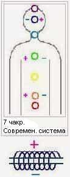
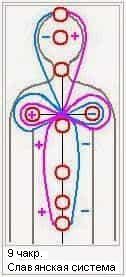

# Энергетические потоки в восточной и славянской системе

Современная восточная система предполагает 7 чакр. И как говорят индусы, а вслед за ними и европейцы – чакры составляют **энергетический столб**, по которому движется энергия жизни Ци (или кундалини). При этом по правой стороне энергия «+», а по левой «-»… Но почему-то в районе головы поток энергии меняется, и уже слева «+», справа «-».

Из школьной программы по физике, все знают, что вокруг проводника, по которому течёт ток, создается опредёленное электрическое поле, с одной стороны это поле имеет знак «+», с другой «-». Но не смотря на законы физики, в восточной системе «+» и «-» начиная с пятой чакры меняются местами. Где произошёл поворот энергии?

Кто-то сделал обрезание восточной системы, убрал 2 чакры.

## Славянская энергетическая система

В славянской системе у человека 9 основных чакр и энергия течёт, согласно всем Вселенским законам, в виде спирали, образуя **энергетический крест**, волновую структуру. Именно о таком кресте говорил Иисус Христос: «каждый несёт свой крест».

Кроме того, волосы – это тоже система проводников, которая собирает природную энергию. И в зависимости от развития человека волосяной покров меняется.  
**В районе каждой чакры растут волосы** – копчик, лобок, пупок, грудь, подмышки, уста, чело, темечко.

\* **Энергия одна:** плюс (+) означает, что энергия входит в чакру, а минус (-), что энергия излучается из чакры.
